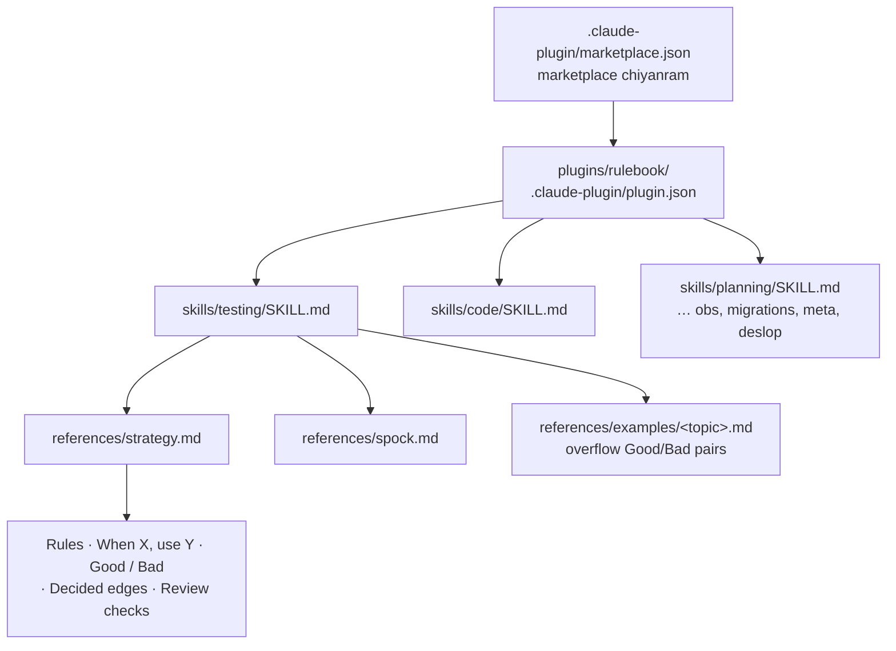
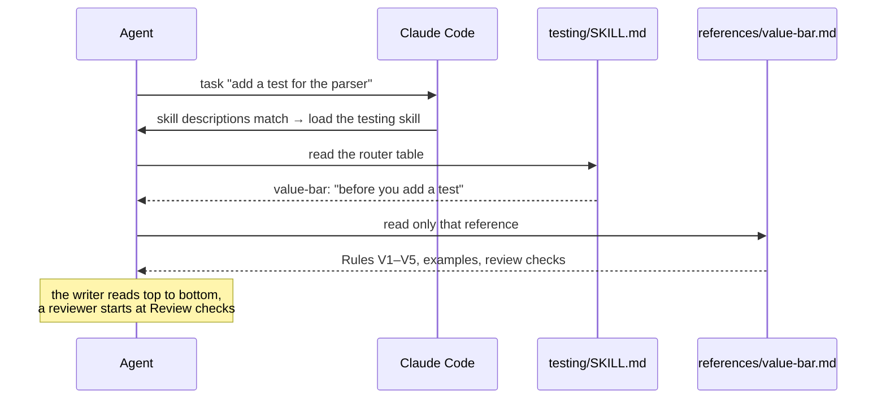
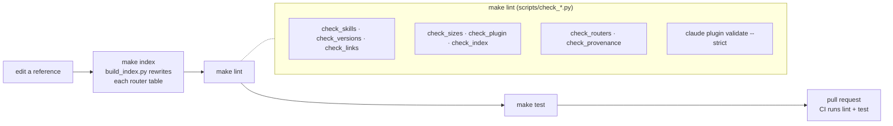
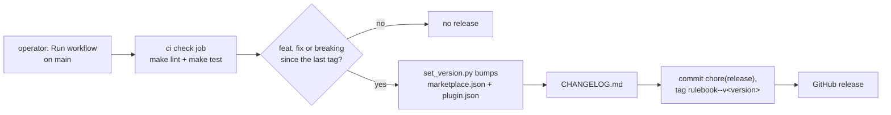

# Architecture

This repo has one product, the `rulebook` plugin in [`plugins/rulebook/`](plugins/rulebook/), and the upkeep around
it: the checks, the index builder and the release. This page shows how the parts fit.

## The plugin

- **Marketplace.** [`.claude-plugin/marketplace.json`](.claude-plugin/marketplace.json) names the marketplace
  `chiyanram` and points at `./plugins/rulebook`. Only that folder is copied into an agent's plugin cache.
- **Domain router.** Each domain is one skill folder with a `SKILL.md`. Its frontmatter `description` tells the agent
  when to load the skill. Its body holds a table: each reference, its rule IDs and a "read it when" line. `make index`
  writes that table between `<!-- index -->` markers.
- **Reference.** One topic, five sections in a fixed order:

  | section | holds |
  |---|---|
  | Rules | one line per rule: an ID, an imperative, *because* + the failure it prevents, at most 35 words |
  | When X, use Y | situation → rule → action |
  | Good / Bad | example pairs in a neutral domain, never a real project's names |
  | Decided edges | cases settled once, so nobody argues them again |
  | Review checks | what a reviewer checks, each naming the rule ID it enforces |

  The full contract is [docs/rulebook/reference-format.md](docs/rulebook/reference-format.md).

## How an agent loads a reference

A project's own `AGENTS.md` points at a reference by skill and name ("use the `testing` skill and read its
`value-bar` reference"), never by path, because the install folder differs per machine and per version.

## Where provenance lives

A shipped file holds only what an agent needs to act. Where each rule came from lives in the ledger,
[docs/rulebook/approved-rules.md](docs/rulebook/approved-rules.md): one row per rule with its ID, target reference,
text, reason, source, evidence and status. A rule enters a reference only after the operator approves it and it has a
row there. [docs/rulebook/rule-sources.md](docs/rulebook/rule-sources.md) holds the sources that were stripped out of
the references and were not yet in a ledger row. Older research is frozen in [docs/archive/](docs/archive/).

`check_provenance.py` enforces the split: it fails a shipped skill file that carries a citation, URL, date, credit or
evidence note outside code.

## The checks pipeline

- Every check is a Python 3 stdlib script in [`scripts/`](scripts/), one file per check. Each reads files through
  [`scripts/repo_files.py`](scripts/repo_files.py), which skips `tests/fixtures/` and `docs/archive/`.
- `check_index.py` and `build_index.py` share [`scripts/index_table.py`](scripts/index_table.py), so the table the
  check expects is the table the builder writes.
- [`tests/`](tests/) runs each check against planted fixtures: a good one that must pass and bad ones that must fail.
  It also tests the index builder, `set_version.py` and the release config.

The full list of checks and what fails each one is in [CONTRIBUTING.md](CONTRIBUTING.md#checks).

## The release flow

semantic-release ([`release.config.mjs`](release.config.mjs)) reads the Conventional Commits on `main`. It runs only
when the operator starts the workflow by hand; a merge does not release (#276). Claude Code pins a plugin to the
`version` in its manifest, so only a version bump tells users there is an update. That is why a change to what ships
must be a `feat` or a `fix`. The tag format `rulebook--v<version>` matches `claude plugin tag`.
[`scripts/release_links.mjs`](scripts/release_links.mjs) links `repo#N` in the notes to the right repo.

## Key decisions

| decision | why |
|---|---|
| One plugin, one folder ships | other repos and containers install one thing; design work never reaches an agent |
| One skill per domain, with a router table | the agent reads only the references a task needs |
| Writer and reviewer read the same reference | the rule that guides the code is the rule the review checks |
| Fixed five-section reference shape | a reader knows where to look without reading the whole file |
| Provenance only in the ledger | reference files stay short; every rule still traces to a source |
| Router tables are generated | a hand-edited index drifts from its references |
| Releases cut from commit messages | a shipped change always bumps the version users are pinned to |

The decisions taken during design are in the archived
[decision register](docs/archive/research/00-decision-register.md).
