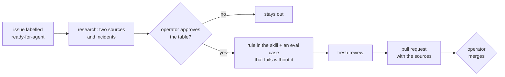

# Contributing

This repo ships two plugins: [`rulebook`](plugins/rulebook/), and [`toolbox`](plugins/toolbox/), typed-only tools.
Coding agents also read [AGENTS.md](AGENTS.md).

**The one hard rule:** no rule enters a reference without the operator's explicit yes. A rule that is not approved
stays out, even when an agent likes it or another repo has it.

## Set up

You need Python 3.10 or newer, Node `^22.22.2` or `>=24.15`, `git`, the GitHub CLI `gh`, and the Claude Code CLI
(`npm install -g @anthropic-ai/claude-code`). The `python3` that macOS ships is 3.9, which fails `make lint` and
`make test`; install a newer one and run `PYTHON=python3.12 make check`, or put it first on `PATH`.

```bash
git clone https://github.com/chiyanram/skills.git
cd skills
npm ci          # release tooling; nothing in node_modules ships
make check      # lint + test, the same as CI
```

To try your working copy in Claude Code: `claude plugin marketplace add ./`, then
`claude plugin install rulebook@chiyanram`.

| target | what it does |
|---|---|
| `make index` | rebuilds the reference table in each skill's `SKILL.md` from its references |
| `make lint` | runs every `scripts/check_*.py`, then `claude plugin validate --strict` |
| `make test` | runs the unit tests in `tests/`; one module: `python3 -m unittest tests.test_fixture_checks` |
| `make check` | `make lint` and `make test`, as CI runs them |
| `make size` | prints the branch's changed lines and files against `origin/main`, split into code, tests, evals and docs, with the pull-request size limits (400 lines, 15 files); generated blocks do not count; a report, not a gate |

One check against one folder: `python3 scripts/check_links.py tests/fixtures/links/broken`. It exits `0` when clean
and `1` with one line per problem.

The guards no test kills in one file: `python3 scripts/mutate.py scripts/index_table.py "python3 -m unittest
tests.test_build_index"`. It exits `0` when every mutant is killed and `1` with one `survivor:` line per survivor.

One pull request title: `python3 scripts/pr_title.py "feat(testing): spock rule file (#123)"`. It exits `0` when the
title follows the rule and `1` with the error CI prints.

A spec's proving commands: `python3 scripts/prove_slices.py <spec.md> [<base>]`. It prints what each
prints today on the base (default `origin/main`), and flags a value that differs from the spec.

## How a change lands

One issue, one branch, one pull request.

1. Open or claim an issue. Use a template: *Bug*, *Feature*, *Task*, *Research* or *Grilling*. Labels:
   [triage labels](docs/agents/triage-labels.md).
2. Branch from the latest `main`, such as `feat/123-spock-cleanup`, in its own worktree, never in the main checkout:

   ```bash
   git fetch origin main
   git worktree add .claude/worktrees/123-spock-cleanup -b feat/123-spock-cleanup origin/main
   ```

3. Make the change. Run `make index`, `make lint` and `make test`.
4. Open a pull request against `main`, from [the template](.github/pull_request_template.md), with every line filled
   in. Its title and description become the commit on `main`; see [Commit messages](#commit-messages). CI must be
   green before merge.
5. To take in a newer `main`, rebase onto it and push with a lease. Never merge `main` into the branch, and never
   force-push without the lease:

   ```bash
   git fetch origin main
   git rebase origin/main
   git push --force-with-lease
   ```

6. Once it is merged, remove the worktree: `git worktree remove .claude/worktrees/123-spock-cleanup`.

A good pull request does one thing and adds a test with every change to a check. Before you open it, check that:

- a change to a released format is a new version file, not an edit, and a new check, role or outside skill starts in
  the toolbox (the format and manual-first MUSTs in [AGENTS.md](AGENTS.md#musts));
- every new or changed rule names its two sources in the pull request body;
- a new or rewritten skill follows the one skill shape ([Add a skill](#add-a-skill));
- no `version` or `CHANGELOG*.md` is edited by hand.

## Commit messages

One format. A branch commit has the commitizen sections, which `cz commit` prompts for:

```
type(scope): lower-case summary (#issue)

Why the change is needed, in 1–3 sentences.

BREAKING CHANGE: what breaks and what to do instead
Refs #12
```

- **Title**: a type from the [Releases](#releases) table, a required lower-case scope, an imperative lower-case summary
  with no full stop, and the issue as `(#N)` or `(owner/repo#N)`. Add `!` after the scope for a breaking change.
- **Body**: why, not what; the diff shows what. Optional footers: `BREAKING CHANGE:`, `Closes #N` to close the issue on
  merge, and `Refs #N` for other issues.
- **No tool or co-author lines**: no `Co-Authored-By`, no "Generated with" line.

Pull requests are squash-merged. The commit on `main` is the **PR title** (GitHub adds `(#pr)`) and the **PR
description** as its body, so on `main` the body is the description in the shape of
[the template](.github/pull_request_template.md): the `Why:` line first, then the breaking-change, rollback and
where-to-look lines, the evidence, the change and the checklist, with the footers last. It is longer than a branch
commit's 1–3 sentences on purpose: the next reader finds the reason, the proof and the way back in the commit itself.
The branch commits are dropped, so they can be anything. CI checks the PR title, and `pr_body.py` checks the
description.

A breaking change carries three marks that agree: `Breaking change: yes` in the description, `!` after the title's
scope, and a `BREAKING CHANGE:` footer. semantic-release reads only the `!` and the footer, so a yes without them ships
as a minor release; `pr_body.py` fails any of the three that disagrees with the others.

To get the prompts, install [commitizen](https://commitizen-tools.github.io/commitizen/) once (`pipx install
commitizen`) and run `cz commit`. `.cz.toml` holds the prompts. commitizen only
writes the message: semantic-release still cuts the releases.

## Add a rule



A rule issue starts when the operator labels it `ready-for-agent`, or says "start #N". The operator decides twice:
at the approval table and at the merge. The merge is the proof of the operator's yes.

1. Read the issue, and list the rules that already cover its topic, so the new rules only fill gaps.
2. Find two independent sources for each part of each rule: a file and line pinned to a commit, or an official doc
   and its section. Pages from one company count as one source; a vendor's own docs are enough for a rule about that
   vendor's API. Read production incidents too, and mark each as a primary write-up or a summary. Check every source
   before the table, not after it. Two parts of a rule from different sources count only for those parts.
3. Show the operator one table, one row per rule: the rule as it would ship, where it goes, the sources for each part
   with how many are independent, the incidents, and a recommendation. Say above it what already covers the topic, and
   below it what was left out and why. A part with one source is decided there, once, as the operator's preference.
   The operator's yes also covers the commits and pushes on the issue's branch until the pull request.
4. Write the rule into its skill, with its *because*. Write an exception inline, next to the rule ("only when …",
   "unless …"). The source never goes in the skill: no citation, credit, label, preference mark, evidence note or
   date (`check_provenance.py` fails it). Keep a tool's name only when it is the action itself, such as a check to
   turn on. Adapt a Good / Bad pair from the rule's source into one neutral domain, or write fresh neutral code; never
   rename a project's code into a neutral domain, because the pair then teaches that project's names.
5. Add an eval case that fails without the rule, and names the skill and the section it tests.
6. Have a fresh reviewer check each rule, grep and example, and every Good / Bad pair against every rule. Bring a fix
   that changes what a rule means (narrower, wider, split, or a part left with one source) back to the operator
   before the pull request. Put every other fix in the review-fix commit and list it in the pull request body.
7. Open the pull request with `Closes #N`. Its body names the two sources of each rule, and a mistake in a project's
   own code that showed the rule was needed. The operator merges.

## Add a skill

Every skill has one shape.

1. `SKILL.md` is a short procedure for one job: numbered steps, each rule with its *because*, and a Good / Bad pair
   only where a model's default is wrong. It is 120 lines or fewer. A notes file beside it holds what only some runs
   need, such as one stack's traps.
2. A rule has no ID. A reviewer's finding names the skill and its section.
3. A rulebook skill holds knowledge and can be loaded by the model. A toolbox skill is a procedure a person starts and
   is typed-only. A skill that another skill calls must be one the model can load.
4. Use a neutral domain in every Good / Bad pair. Never use a real project's names.
5. A new skill is a new folder with one row in [`plugins/rulebook/README.md`](plugins/rulebook/README.md) and one row
   in the root README.

## Add a check

1. Plant a failing fixture under `tests/fixtures/<check>/`, or write it to a temp dir when it is a `SKILL.md`.
2. Add it to the test that expects the check to fail. Watch it fail.
3. Write `scripts/check_<name>.py`. Read files through `scripts/repo_files.py`, which skips `tests/fixtures/`.
4. Add it to `make lint` in the [Makefile](Makefile) and a row to the table below.

When review finds a case a check missed, plant that case first and watch it fail, then fix the check (S7).

| check | fails when |
|---|---|
| `check_skills.py` | a `SKILL.md` has no `name` or `description`, its name is not its folder name, its description is over 1024 characters, it is over 120 lines, or an unquoted frontmatter value holds `: ` or ` #` or starts with a YAML indicator |
| `check_versions.py` | a plugin's marketplace entry and its `plugin.json` disagree on the version |
| `check_links.py` | a relative markdown link points at nothing |
| `check_sizes.py` | root `AGENTS.md` reaches 200 lines, a rule is over 35 words, or an `AGENTS.md` chain is over 32 KiB |
| `check_plugin.py` | a plugin is not under `plugins/`, has no README or icon, or the repo has no LICENSE |
| `check_index.py` | a plugin README does not link every skill router, or a router's table differs from what `make index` builds |
| `check_routers.py` | a skill folder ships references but has no `SKILL.md`, or its `SKILL.md` does not link each one |
| `check_provenance.py` | a shipped skill file carries provenance outside code: a source citation, a URL, a preference line, a credit, an evidence note, a date or a reference to another repository's issue. In the toolbox it reads only each `SKILL.md` |
| `check_glossary.py` | a crq or planning file uses a word the crq glossary lists under `checked`; the error names the term to use |
| `check_routing.py` | a skill router has no `evals/routing/<name>.json`, a file has fewer than 8 `should` or 8 `near_miss` requests, a `should` request does not rank its router first, a near miss does not rank its named owner above that router, or two router descriptions are 75% alike. It skips a typed-only skill, which nothing routes to. Word matching only: a model-graded run (`claude plugin eval`) costs tokens and stays manual |
| `check_settings_keys.py` | a skill file names a settings key for a memory ceiling, machine size, port or timeout in backticks with a number in the same clause, outside fenced code: the rule names the key and the project's settings hold the value |
| `check_toolbox.py` | a toolbox `SKILL.md` lacks `disable-model-invocation: true`, a toolbox skill has no section with `Source:`, `Commit:` and `Licence:` in `THIRD_PARTY_NOTICES.md` and is not listed under its `## Written here`, that list names no toolbox skill, or a toolbox file holds a `git push`, a `gh pr merge`, a `.cursor/` path or a Grok model |
| `check_generic.py` | a rulebook `SKILL.md` or notes file names an engine or its roles: `coordinator`, `onboarder`, `agent-factory`, `role card`, `the engine`, `an engine` |
| `check_history.py` | a line a change adds outside `plugins/` carries history: who decided, an ISO date beside a person or decision word, or an issue number, in markdown prose or a code comment. It reads the diff since `origin/main` (pass another base as the second argument) and spares ADR and `PRINCIPLES.md` status lines, CHANGELOGs, fixtures, `docs/agents/`, `evals/` and one `See #N` / `History: #N` pointer per section or code header |
| `check_comments.py` | a `.py`, `.mjs` or `.js` file outside `tests/fixtures/` holds more comment lines than `scripts/comment-baseline.json` allows, or fewer without `--shrink` run. It keeps the module header, a line with an `http(s)` link and a tool directive. `/delete-comment` (`.claude/commands/delete-comment.md`) sorts and deletes the rest |
| `check_eval_proof.py` | a skill that `evals/skills/settings.json` gives a tier lacks what its tier asks for: cases in both slices, an approved reference answer per case, an approved baseline whose summaries exist, and, for CORE, a passing planted check per llm grader. A summary or planted check made from other case files, or another judge, is stale. CORE fails on any gap; NORMAL prints a warning, except a stale summary behind an approved baseline |

## Add a tool

A toolbox tool is `plugins/toolbox/skills/<name>/SKILL.md` with `disable-model-invocation: true`, and it never pushes
or merges. It comes one of two ways:

- **Copied** from another repo, as written or with the operator's changes: add a `## <name>` section to
  `plugins/toolbox/THIRD_PARTY_NOTICES.md` with its `Source:`, `Commit:`, `Licence:` and changes, and its licence text
  if it is new.
- **Written here**: add `` - `<name>` `` under that file's `## Written here`. It needs no notice.

Either way, add its row to the [toolbox README](plugins/toolbox/README.md) and title the PR `feat(toolbox): …`.
`check_toolbox.py` fails a tool that is in neither place.

## Prove a skill change

A skill change ships with proof that it is no worse. The proof is an eval run that you can trust, and the operator
approves it. Every run is a real model call, so it runs by hand, never in CI. CI checks the committed proof with
`check_eval_proof.py`, which makes no model call.

Each skill has a tier in `evals/skills/settings.json`:

| tier | skills | proof |
|---|---|---|
| CORE | crq, code, testing | everything below, 5 runs per case, the arms in turn, a repeated baseline, planted answers for each llm grader, and the operator's hand check of 20 judge verdicts (18 or more must agree) |
| NORMAL | every other skill | cases, approved reference answers, an approved baseline, 3 runs per case |
| NONE | a change to wording only | `make lint` |

Rules for every run:

1. Start each case prompt with the typed slash (for example `/rulebook:deslop`), so the skill loads.
2. The judge and the agent model are pinned in `settings.json`. Do not run with others.
3. A run counts only when it ended without an error and its session file shows the skill was loaded. Any other run
   is an error, never a FAIL.
4. Each case has a `reference.md` answer. The operator approves it by setting `approved` in its frontmatter.
5. Point a grader at the trace (`focus: trace`) when the work is in files or tool calls, not in the last message.
   Use a free grader (`tool_used`, `regex`, `file_exists`) when the fact is mechanical.
6. A CORE llm grader gates only after its 9 planted answers (3 right, 3 wrong, 3 near misses) give 0 false PASS and
   at most 1 false FAIL. Write a planted answer as a statement about the work, not as first-person reasoning: the
   API can refuse to copy reasoning word for word, and the refused run is an error.
7. Commit the cases, the summaries and `baseline.json`. Keep raw transcripts out of the repo.

The steps, in order, with no step skipped:

1. Write the lesson as a rule in the skill, and add a case that fails without it.
2. Run the baseline and the candidate with `scripts/skill_eval.py`. See [evals/skills/README.md](evals/skills/README.md).
3. Open a pull request with the summaries.
4. The operator approves the cases, the graders and the baseline, and merges.

## Releases

```text
merge to main          ──▶ ci.yml        checks only, no release
Run workflow on main   ──▶ release.yml
                             ├─ checks   ci.yml, called with workflow_call
                             └─ release  semantic-release, only after the checks pass
```

Releases are manual during the dev phase. A merge to `main` runs `make lint` and `make test` only. To release,
open **Actions → release → Run workflow** on `main`, or run `gh workflow run release.yml --ref main`. It runs the checks
from `ci.yml` first; semantic-release then runs after the checks pass. Pull requests are squash-merged, so **the
pull request title becomes the commit** that decides the release. CI fails a title that is not `type(scope): lower-case
summary (#issue)`, such as `feat(testing): spock cleanup rules (#123)`. The issue can be in another repo:
`(chiyanram/other#320)`. Only Dependabot (scope `deps`) and the release commit name no issue. The rule has one home,
[`scripts/pr_title.py`](scripts/pr_title.py), and CI calls it. Before you open a pull request, run
`python3 scripts/pr_title.py "<title>"` to check the title as CI will.

The release notes group changes under ⚠️ Breaking changes, ✨ Features, 🐛 Fixes, ⚡ Performance and ⏪ Reverts, one
bullet per change as `**scope** — summary · #issue (PR #pr)` ([`scripts/release_notes.mjs`](scripts/release_notes.mjs)).
Other types ship nothing and are not listed.

| commit | release | use it when |
|---|---|---|
| `feat(<domain>): …` | minor | a new reference, rule or skill |
| `fix(<domain>): …` | patch | a shipped rule, example or check says something wrong |
| `feat(<domain>)!: …`, or a `BREAKING CHANGE:` footer | major | a rule is removed or its meaning is reversed, or a skill is renamed or removed |
| `docs`, `chore`, `test`, `ci`, `build`, `refactor`, `style` | none | anything that does not change what ships |
| any type with scope `research`, `review` or `repo` | none | design work, even when it is a `feat` |
| `feat(toolbox)`, `fix(toolbox)`, `feat(toolbox)!` | the toolbox only | a tool is added, changed or removed |

Each plugin releases on its own line: scope `toolbox` releases only the toolbox, and every other scope that
ships releases only the rulebook, so a pull request changes one plugin. A release bumps that plugin's version in
`marketplace.json` and its `plugin.json` (`scripts/set_version.py --plugin <name>`), writes its changelog
(`CHANGELOG.md` or `CHANGELOG-toolbox.md`), tags `<plugin>--v<version>` and creates a GitHub release. Users stay on a
version until it changes, so every change to what ships must be a `feat` or a `fix`, and reaches users only at the next
manual release. Preview the next release on `main` with `GITHUB_TOKEN=<token> npm run release:preview`, or
`RELEASE_PLUGIN=toolbox` before it for the toolbox.

## Troubleshooting

| symptom | fix |
|---|---|
| `make lint`: `claude: command not found` | `npm install -g @anthropic-ai/claude-code` |
| `check_index.py`: a table is stale | run `make index` and commit the router it rewrote |
| `make test` fails in `test_release_config`, `test_release_notes` or `test_release_links` | run `npm ci`; the tests load the release config from `node_modules` |
| `check_provenance.py` fails on a skill file | move the citation, URL or date into the pull request body |
| `check_history.py` fails a line you added | say what and why; drop who decided, the date and the issue, which the PR and git log keep. One `See #N` line per section may point at the history |
| `check_history.py`: cannot resolve `origin/main` | run `git fetch origin main` |
| `check_comments.py` fails a file | say it in code or in the module docstring or header; after you delete comments, run `python3 scripts/check_comments.py --shrink` |
| `check_sizes.py`: a rule is over 35 words | shorten it; move detail into a notes file beside the skill |
| `claude plugin marketplace add` or `/plugin install` fails on an SSH clone | set `CLAUDE_CODE_PLUGIN_PREFER_HTTPS=1` |
| a merge to `main` did not release | expected: releases are manual. Open **Actions → release → Run workflow** on `main` |
| the release fails with `RELEASE_TOKEN is not set` | add a repository secret `RELEASE_TOKEN`: the owner's token with Contents read and write, which the admin bypass of ruleset `main` lets through |

## Code of conduct

Be kind and assume good intent. Critique the change, not the person.
