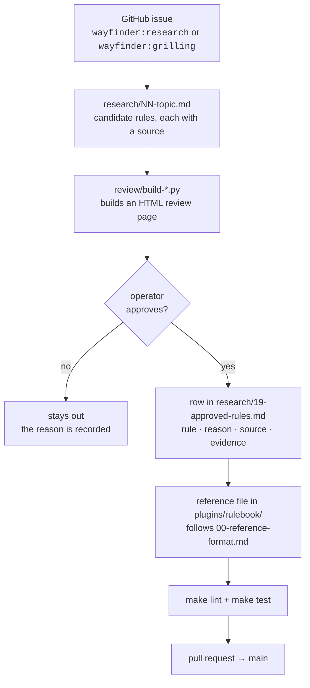

# Contributing

This repo ships one thing, the [`rulebook`](plugins/rulebook/) plugin. Everything else is the evidence and the
decisions behind it. Agents also read [AGENTS.md](AGENTS.md); this file is the long form for people.

## The one hard rule

**No rule enters a reference without the operator's explicit yes.** Not a rule an agent likes, and not a rule copied
from a reference repo. A rule that is not approved stays out.

## How a rule gets in



1. **Open or claim an issue.** Each piece of work is a GitHub issue with a `wayfinder:*` label
   ([labels](docs/agents/triage-labels.md), [tracker conventions](docs/agents/issue-tracker.md)).
2. **Research.** Write `research/NN-<topic>.md`. Each candidate rule cites where it came from: a file and line in a
   pinned reference repo ([refs/README.md](refs/README.md)), an official doc, or a real mistake shown by
   `path:lines @sha`.
3. **Review.** Build the review page with the matching `review/build-*.py`, so the operator marks rules in one place.
4. **Record.** Each approved rule gets a row in the [ledger](research/19-approved-rules.md) with its *because* reason.
   Each decision that is not a rule goes in the [decision register](research/00-decision-register.md).
5. **Write the reference.** Follow [the reference format](research/00-reference-format.md), and see
   [the plugin README](plugins/rulebook/README.md#what-a-reference-holds) for a picture of it.

## Writing a reference

- Five sections, in order: **Rules · When X, use Y · Good / Bad · Decided edges · Review checks**.
- One rule per list item: an ID (`**S1** — …`), at most 35 words, ending in *because* plus the failure the rule
  prevents.
- Good/Bad examples use a neutral domain, never a real project's names. The project-specific values stay in that
  project's `AGENTS.md`.
- Add a new reference to the table in [`plugins/rulebook/README.md`](plugins/rulebook/README.md). `make lint` fails
  until you do.

## Checks

```bash
make lint   # frontmatter, one version, links, size budgets, packaging, README index, claude plugin validate --strict
make test   # each check against its planted fixtures, and each review/ builder
```

You need Python 3.10+ and the Claude Code CLI (`npm install -g @anthropic-ai/claude-code`). CI runs the same two
targets on every pull request and on every push to `main`.

| check | fails when |
|---|---|
| `check_skills.py` | a `SKILL.md` has no `name` or `description`, its name is not its folder name, or its description is over 1024 characters |
| `check_versions.py` | the marketplace entry and `plugin.json` disagree on the version |
| `check_links.py` | a relative markdown link points at nothing |
| `check_sizes.py` | root `AGENTS.md` reaches 200 lines, a rule is over 35 words, or an `AGENTS.md` chain is over 32 KiB |
| `check_plugin.py` | a plugin is not under `plugins/`, has no README or icon, or the repo has no LICENSE |
| `check_index.py` | a plugin README does not link every reference its skills ship |

To add a check, follow the three steps in [AGENTS.md](AGENTS.md#add-a-check): plant the failure first.

## Commits and pull requests

- Work on a branch, and open a pull request against `main`. CI must be green before merge.
- Commit subjects follow [Conventional Commits](https://www.conventionalcommits.org/) with the domain as scope, and
  cite the issue: `feat(testing): spock rule file (agent-factory#31)`, `docs(research): …`, `chore(repo): …`.
- One reference or one research topic per pull request, so each review stays small.
- When a release changes what the plugin ships, bump `version` in both
  [`marketplace.json`](.claude-plugin/marketplace.json) and [`plugin.json`](plugins/rulebook/.claude-plugin/plugin.json),
  and add a line to [CHANGELOG.md](CHANGELOG.md).
