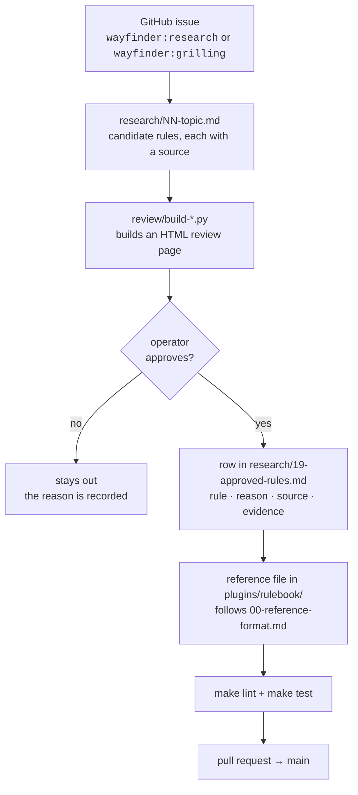
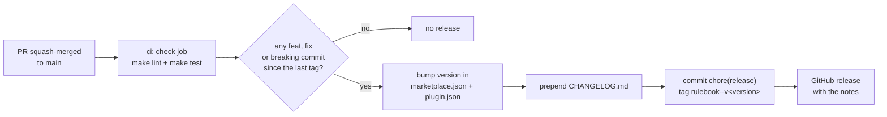

# Contributing

This repo ships one thing, the [`rulebook`](plugins/rulebook/) plugin. Everything else is the evidence and the
decisions behind it. Agents also read [AGENTS.md](AGENTS.md); this file is the long form for people.

## The one hard rule

**No rule enters a reference without the operator's explicit yes.** Not a rule an agent likes, and not a rule copied
from a reference repo. A rule that is not approved stays out.

## How a rule gets in



1. **Open or claim an issue.** Each piece of work is a GitHub issue with a `wayfinder:*` label
   ([labels](docs/agents/triage-labels.md), [tracker conventions](docs/agents/issue-tracker.md)).
2. **Research.** Write `research/NN-<topic>.md`. Each candidate rule cites where it came from: a file and line in a
   pinned reference repo ([refs/README.md](refs/README.md)), an official doc, or a real mistake shown by
   `path:lines @sha`.
3. **Review.** Build the review page with the matching `review/build-*.py`, so the operator marks rules in one place.
4. **Record.** Each approved rule gets a row in the [ledger](research/19-approved-rules.md) with its *because* reason.
   Each decision that is not a rule goes in the [decision register](research/00-decision-register.md).
5. **Write the reference.** Follow [the reference format](research/00-reference-format.md), and see
   [the plugin README](plugins/rulebook/README.md#what-a-reference-holds) for a picture of it.

## Writing a reference

- Five sections, in order: **Rules · When X, use Y · Good / Bad · Decided edges · Review checks**.
- One rule per list item: an ID (`**S1** — …`), at most 35 words, ending in *because* plus the failure the rule
  prevents.
- Good/Bad examples use a neutral domain, never a real project's names. The project-specific values stay in that
  project's `AGENTS.md`.
- Open a new reference with a title, then one paragraph that says what it covers and holds one sentence starting
  "Read it when …" or "Read it before …". Run `make index`: it rebuilds the table in the domain's `SKILL.md` router
  from each reference's rule IDs and that sentence. Never edit the table by hand. `make lint` fails while it is stale.
  When two pull requests in one domain conflict on the table, take either side and run `make index` again.
- An agent reaches a reference only through its router, and a project's `AGENTS.md` points at it as "use the
  `<domain>` skill (rulebook plugin) and read its `<reference>` reference". A new domain also gets one row in
  [`plugins/rulebook/README.md`](plugins/rulebook/README.md).

## Checks

```bash
make index  # rebuild each skill router's reference table
make lint   # frontmatter, one version, links, size budgets, packaging, router index, skill routers, claude plugin validate --strict
make test   # each check against its planted fixtures, and each review/ builder
```

You need Python 3.10+, Node `^22.22.2` or `>=24.15`, the Claude Code CLI (`npm install -g @anthropic-ai/claude-code`),
and `npm ci` once for the release tooling the tests load. CI runs the same two targets on every pull request and on
every push to `main`.

| check | fails when |
|---|---|
| `check_skills.py` | a `SKILL.md` has no `name` or `description`, its name is not its folder name, or its description is over 1024 characters |
| `check_versions.py` | the marketplace entry and `plugin.json` disagree on the version |
| `check_links.py` | a relative markdown link points at nothing |
| `check_sizes.py` | root `AGENTS.md` reaches 200 lines, a rule is over 35 words, or an `AGENTS.md` chain is over 32 KiB |
| `check_plugin.py` | a plugin is not under `plugins/`, has no README or icon, or the repo has no LICENSE |
| `check_index.py` | a plugin README does not link every skill router, or a router's table differs from what `make index` builds |
| `check_routers.py` | a skill folder ships references but has no `SKILL.md`, or its `SKILL.md` does not link each one |
| `check_provenance.py` | a shipped skill file carries provenance: a source citation, an operator-preference line, a credit on an example, an evidence note, a date or an agent-factory reference |

`make test` also checks `scripts/set_version.py`, which the release runs, and that `release.config.mjs` still matches
the manifests and links each issue reference to its own repo.

To add a check, follow the three steps in [AGENTS.md](AGENTS.md#add-a-check): plant the failure first.

## Commits and pull requests

- Work on a branch, and open a pull request against `main`. CI must be green before merge.
- One reference or one research topic per pull request, so each review stays small.
- Pull requests are squash-merged, so **the pull request title becomes the commit** that decides the release. CI
  fails a title that is not a [Conventional Commit](https://www.conventionalcommits.org/): `type(scope): summary`,
  with the domain as scope and the issue cited, such as `feat(testing): spock rule file (agent-factory#31)`.

## Releases

Releases are automatic. [semantic-release](https://semantic-release.gitbook.io/) runs on every push to `main`,
after `make lint` and `make test` pass, and reads the commits since the last release tag. Never edit a version or
`CHANGELOG.md` by hand.



| commit | release | use it when |
|---|---|---|
| `feat(<domain>): …` | minor, `0.2.0` → `0.3.0` | a new reference, a new rule, or a new skill |
| `fix(<domain>): …` | patch, `0.2.0` → `0.2.1` | a rule, example or check in a shipped file says something wrong |
| `feat(<domain>)!: …`, or a `BREAKING CHANGE:` footer | major | a rule ID is renamed or removed, or a reference moves, so links into the plugin break |
| `docs`, `chore`, `test`, `ci`, `build`, `refactor`, `style` | none | everything that does not change what ships |
| any type with scope `research`, `review` or `repo` | none | design work, even when it is a `feat` |

Users stay on a version until it changes: Claude Code pins a plugin to the `version` in its manifest. That is why
every shipped change has to be a `feat` or a `fix`. The tag `rulebook--v<version>` is the format
`claude plugin tag` uses, so another plugin can depend on a range such as `rulebook@^0.2`.

To preview the next release locally, run `npm ci` and then `GITHUB_TOKEN=<token> npm run release:preview` on
`main`. It needs Node `^22.22.2` or `>=24.15`.

**A release that did not run.** GitHub skips every workflow for a push whose commit message contains the skip-ci
marker (`[skip ci]` and its variants) anywhere, in the title or the body. The release's own commit uses it on purpose;
never quote it in a pull request title or description, since the squash commit carries both. If a merge was
skipped, open **Actions → ci → Run workflow** on `main`: the release job runs from a manual run too.

**Branch protection.** The release job pushes a commit to `main` with the workflow's `github.token`. If a ruleset
blocks that push, add a repository secret `RELEASE_TOKEN`: a fine-grained token, or a GitHub App token, with
Contents read and write that is allowed to bypass the rule. The workflow uses it when it is set.
