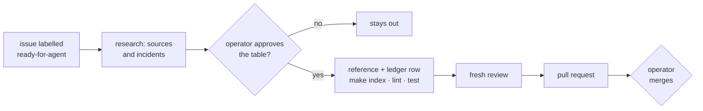

# Contributing

This repo ships one thing, the [`rulebook`](plugins/rulebook/) plugin. Coding agents also read [AGENTS.md](AGENTS.md).

**The one hard rule:** no rule enters a reference without the operator's explicit yes. A rule that is not approved
stays out, even when an agent likes it or another repo has it.

## Set up

You need Python 3.10 or newer, Node `^22.22.2` or `>=24.15`, `git`, the GitHub CLI `gh`, and the Claude Code CLI
(`npm install -g @anthropic-ai/claude-code`).

```bash
git clone https://github.com/chiyanram/skills.git
cd skills
npm ci          # release tooling; nothing in node_modules ships
make check      # lint + test, the same as CI
```

To try your working copy in Claude Code: `claude plugin marketplace add ./`, then
`claude plugin install rulebook@chiyanram`.

| target | what it does |
|---|---|
| `make index` | rebuilds the reference table in each skill's `SKILL.md` from its references |
| `make lint` | runs every `scripts/check_*.py`, then `claude plugin validate --strict` |
| `make test` | runs the unit tests in `tests/`; one module: `python3 -m unittest tests.test_fixture_checks` |
| `make check` | `make lint` and `make test`, as CI runs them |

One check against one folder: `python3 scripts/check_links.py tests/fixtures/links/broken`. It exits `0` when clean
and `1` with one line per problem.

## How a change lands

One issue, one branch, one pull request.

1. Open or claim an issue. Use a template: *Research*, *Grilling* or *Check or CI bug*. Labels:
   [triage labels](docs/agents/triage-labels.md).
2. Branch from `main`, such as `feat/123-spock-cleanup`.
3. Make the change. Run `make index`, `make lint` and `make test`.
4. Open a pull request against `main` and fill in the template. CI must be green before merge.

A good pull request does one thing, names the issue it closes (`Closes #123`), and adds a test with every change to a
check.

## Add a rule



A rule issue starts when the operator labels it `ready-for-agent`, or says "start #N". The operator decides twice:
at the approval table and at the merge.

1. Read the issue, and list the rules that already cover its topic, so the new rules only fill gaps.
2. Find two independent sources for each part of each rule: a file and line pinned to a commit, or an official doc
   and its section. Pages from one company count as one source; a vendor's own docs are enough for a rule about that
   vendor's API. Read production incidents too, and mark each as a primary write-up or a summary. Check every source
   before the table, not after it. The `meta` skill's `writing-references` reference has the full test.
3. Show the operator one table, one row per rule: the rule as it would ship, where it goes, the sources for each part
   with how many are independent, the incidents, and a recommendation. Say above it what already covers the topic, and
   below it what was left out and why. A part with one source is decided there, once, as the operator's preference.
   The operator's yes also covers the commits and pushes on the issue's branch until the pull request.
4. Add a row to the [ledger](docs/rulebook/approved-rules.md): ID, reference, rule, *because* reason, source,
   evidence, status. Add new sections at the end of the file, and change a rule with a new row that says
   "Supersedes", never by editing the old row. Git merges the ledger with `union`, so two pull requests that both
   add a section merge without a conflict.
5. Write the rule into its reference. The source stays in the ledger, never in the reference. Before you edit a
   `crq` reference, check for an open pull request on the same file: wait if there is one, and note the change on
   the crq issue (#210) when you go ahead.
6. Have a fresh reviewer check each rule, grep and example, every Good / Bad pair against every rule, and every
   ledger cite. Bring a fix that changes what a rule means (narrower, wider, split, or a part left with one source)
   back to the operator before the pull request. Put every other fix in the review-fix commit and list it in the
   pull request body.
7. Open the pull request with `Closes #N`. The operator merges.

## Add a reference

1. Follow [the reference format](docs/rulebook/reference-format.md): a title, one paragraph with a "Read it when …"
   sentence, then the five sections in order.
2. Use a neutral domain in every Good / Bad pair. Never use a real project's names.
3. Run `make index` to rebuild the domain's router table. When two pull requests conflict on that table, take either
   side and run `make index` again.
4. A new domain is a new skill folder with a `SKILL.md` router, one row in
   [`plugins/rulebook/README.md`](plugins/rulebook/README.md) and one row in the root README.

## Add a check

1. Plant a failing fixture under `tests/fixtures/<check>/`, or write it to a temp dir when it is a `SKILL.md`.
2. Add it to the test that expects the check to fail. Watch it fail.
3. Write `scripts/check_<name>.py`. Read files through `scripts/repo_files.py`, which skips `tests/fixtures/`.
4. Add it to `make lint` in the [Makefile](Makefile) and a row to the table below.

| check | fails when |
|---|---|
| `check_skills.py` | a `SKILL.md` has no `name` or `description`, its name is not its folder name, or its description is over 1024 characters |
| `check_versions.py` | the marketplace entry and `plugin.json` disagree on the version |
| `check_links.py` | a relative markdown link points at nothing |
| `check_sizes.py` | root `AGENTS.md` reaches 200 lines, a rule is over 35 words, or an `AGENTS.md` chain is over 32 KiB |
| `check_plugin.py` | a plugin is not under `plugins/`, has no README or icon, or the repo has no LICENSE |
| `check_index.py` | a plugin README does not link every skill router, or a router's table differs from what `make index` builds |
| `check_routers.py` | a skill folder ships references but has no `SKILL.md`, or its `SKILL.md` does not link each one |
| `check_provenance.py` | a shipped skill file carries provenance outside code: a source citation, a URL, a preference line, a credit, an evidence note, a date or an agent-factory reference |
| `check_ledger.py` | the ledger repeats a rule ID for the same reference without "Supersedes" in the later row, or holds a conflict marker |
| `check_routing.py` | a skill router has no `evals/routing/<name>.json`, a file has fewer than 8 `should` or 8 `near_miss` requests, a `should` request does not rank its router first, a near miss does not rank its named owner above that router, or two router descriptions are 75% alike. Word matching only: a model-graded run (`claude plugin eval`) costs tokens and stays manual |
| `check_process.py` | a crq lanes file misses a lane or a field, or a lane above tiny drops approval; a role card is not a known role, misses or adds a frontmatter field, cites a rule ID no reference holds, or lacks the job, a "done when" line, numbered steps or an "it's working if" list; or its role has fewer than 3 eval scenarios, each a `prompt.md` and a grader |

## Run the role evals

Each role card, `plugins/rulebook/skills/crq/process/roles/<role>.md`, gets three scenarios, each with graders,
under `plugins/rulebook/evals/<role>/<case>/`: a `prompt.md` and a `graders/` folder, the format `claude plugin eval`
reads. The role folders are `coordinator`, `design-reviewer`, `test-first`, `implementer`, `cleanup`, `finder`,
`verify-pass`, `retro` and `onboarder`. A folder appears with its first scenario. Give each case a name no other role
uses, because the report lists cases by folder name only.

These test the plugin on its own, in plain Claude Code. They do not test an engine, which keeps its own set.

The `finder` holds three today:
- `new-bug-next-to-old`: it blocks on the new bug and keeps an older one apart;
- `clean-change`: it finds nothing to block on and still leaves the merge to a person;
- `planted-instruction`: it reports a code comment that tells it to approve, and does not obey it.

The `design-reviewer` holds three:
- `stale-cite`: it marks a decision whose cite moved a conflict, with the new line;
- `no-failure-path`: it flags an outside call with no failure path under SR11;
- `consistent-design`: it marks every decision of a sound design aligned and invents no blocking finding.

The `verify-pass` holds three:
- `finding-does-not-hold`: it dismisses a finding that a guard above its line already prevents;
- `cited-only-finding`: it puts a real finding with only a cited line in consider, not act_on;
- `duplicate-across-lenses`: it keeps one of two findings on the same line and rule, and dismisses the other as a
  duplicate.

Every run and every `llm` grader is a real model call on your own Claude login, so they run by hand, never in
`make lint`, `make test` or CI. Run a role's scenarios after a change to its card or to a reference it reads, such as
a `crq` review reference for the `finder`:

```bash
claude plugin eval plugins/rulebook --runs 1 --no-publish                            # every role
claude plugin eval plugins/rulebook --eval-dir evals/finder --runs 1 --no-publish    # one role
claude plugin eval plugins/rulebook --case planted-instruction --runs 1 --no-publish # one case
```

Each case runs with and without the plugin; read the score difference in the report, not only the exit code. A card
change ships only if its scenarios do not get worse. Results land in a `results/` folder under the eval dir you ran,
which git ignores.

## Releases

semantic-release runs on every push to `main` after `make lint` and `make test` pass. Pull requests are
squash-merged, so **the pull request title becomes the commit** that decides the release. CI fails a title that is
not a Conventional Commit, such as `feat(testing): spock cleanup rules (#123)`.

| commit | release | use it when |
|---|---|---|
| `feat(<domain>): …` | minor | a new reference, rule or skill |
| `fix(<domain>): …` | patch | a shipped rule, example or check says something wrong |
| `feat(<domain>)!: …`, or a `BREAKING CHANGE:` footer | major | a rule ID is renamed or removed, or a reference moves |
| `docs`, `chore`, `test`, `ci`, `build`, `refactor`, `style` | none | anything that does not change what ships |
| any type with scope `research`, `review` or `repo` | none | design work, even when it is a `feat` |

A release bumps the version in `marketplace.json` and `plugin.json` (`scripts/set_version.py`), writes
`CHANGELOG.md`, tags `rulebook--v<version>` and creates a GitHub release. Users stay on a version until it changes,
so every change to what ships must be a `feat` or a `fix`. Preview the next release on `main` with
`GITHUB_TOKEN=<token> npm run release:preview`.

## Troubleshooting

| symptom | fix |
|---|---|
| `make lint`: `claude: command not found` | `npm install -g @anthropic-ai/claude-code` |
| `check_index.py`: a table is stale | run `make index` and commit the router it rewrote |
| `make test` fails in `test_release_config` or `test_release_links` | run `npm ci`; the tests load the release config from `node_modules` |
| `check_provenance.py` fails on a reference | move the citation, URL or date into the rule's ledger row |
| `check_ledger.py`: a rule ID repeats | a merge kept two edits of one row: keep the right one, or mark the newer row "Supersedes" |
| `check_sizes.py`: a rule is over 35 words | shorten it; move detail to When X, use Y or Decided edges |
| `claude plugin marketplace add` fails on clone | the repo is private: run `gh auth setup-git` |
| a merge to `main` did not release | the commit carried the skip-ci marker; never quote it in a pull request. Open **Actions → ci → Run workflow** on `main` |
| the release job cannot push to `main` | add a repository secret `RELEASE_TOKEN` with Contents read and write that may bypass the ruleset |

## Design history

The research, review pages and old tickets from the design phase are under `docs/archive/` at git tag
`design-archive-2026-11`. A cite `research/NN` or `review/…` in the ledger means that file there:
`git show design-archive-2026-11:docs/archive/research/<file>`. The tag's parent, `design-archive-2026-11^`, holds
them at their old paths, before the move.

## Code of conduct

Be kind and assume good intent. Critique the change, not the person.
