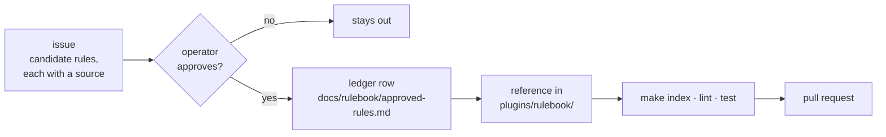

# Contributing

Thanks for helping. This repo ships one thing, the [`rulebook`](plugins/rulebook/) plugin. Setup and the make
targets are in [DEVELOPMENT.md](DEVELOPMENT.md); how the parts fit is in [ARCHITECTURE.md](ARCHITECTURE.md). Coding
agents also read [AGENTS.md](AGENTS.md).

## The one hard rule

**No rule enters a reference without the operator's explicit yes.** Not a rule an agent likes, and not a rule copied
from another repo. A rule that is not approved stays out.

## How a change lands

One issue, one branch, one pull request.

1. **Open or claim an issue.** Use a template: *Research* for a question about what others do, *Grilling* for a
   decision with the operator, *Check or CI bug* for a check or CI run that is wrong. Labels:
   [triage labels](docs/agents/triage-labels.md), [tracker conventions](docs/agents/issue-tracker.md).
2. **Branch** from `main`, such as `feat/123-spock-cleanup`.
3. **Make the change** and run `make index`, `make lint` and `make test`.
4. **Open a pull request** against `main`. Fill in the template. CI must be green before merge.

A good pull request:

- does one thing: one reference, one rule set or one check;
- names the issue it closes, such as `Closes #123`;
- has a [Conventional Commit](https://www.conventionalcommits.org/) title (see [Releases](#releases));
- adds or changes a test with every change to a check.

## Add a rule

1. **Find the source.** Each candidate rule cites where it came from: a file and line in a reference repo pinned to a
   commit, an official doc, or a real mistake shown by `path:lines @sha`.
2. **Get the yes.** The operator approves or drops each rule.
3. **Record it.** Add a row to the [ledger](docs/rulebook/approved-rules.md): ID, reference, rule, *because* reason,
   source, evidence, status.
4. **Write it** into the reference, following [the reference format](docs/rulebook/reference-format.md).

## Write a reference

- Five sections, in order: **Rules · When X, use Y · Good / Bad · Decided edges · Review checks**.
- One rule per list item: an ID (`**S1** — …`), at most 35 words, ending in *because* plus the failure the rule
  prevents.
- Good/Bad examples use a neutral domain, never a real project's names. Project values stay in that project's
  `AGENTS.md`.
- No provenance in the reference: no citations, URLs, dates or credits outside code. They go in the ledger.
- Start a new reference with a title, then one paragraph that says what it covers and holds one sentence starting
  "Read it when …" or "Read it before …".
- Run `make index`. It rebuilds the table in the domain's `SKILL.md` from each reference. Never edit that table by
  hand. When two pull requests conflict on it, take either side and run `make index` again.
- A new domain is a new skill folder with a `SKILL.md` router and one row in
  [`plugins/rulebook/README.md`](plugins/rulebook/README.md).

## Add a check

1. Plant a failing fixture under `tests/fixtures/<check>/`, or write it to a temp dir when it is a `SKILL.md`.
2. Add it to the test that expects the check to fail. Watch it fail.
3. Write `scripts/check_<name>.py` and add it to `make lint` in the [Makefile](Makefile).
4. Add a row to the table below.

## Checks

| check | fails when |
|---|---|
| `check_skills.py` | a `SKILL.md` has no `name` or `description`, its name is not its folder name, or its description is over 1024 characters |
| `check_versions.py` | the marketplace entry and `plugin.json` disagree on the version |
| `check_links.py` | a relative markdown link points at nothing |
| `check_sizes.py` | root `AGENTS.md` reaches 200 lines, a rule is over 35 words, or an `AGENTS.md` chain is over 32 KiB |
| `check_plugin.py` | a plugin is not under `plugins/`, has no README or icon, or the repo has no LICENSE |
| `check_index.py` | a plugin README does not link every skill router, or a router's table differs from what `make index` builds |
| `check_routers.py` | a skill folder ships references but has no `SKILL.md`, or its `SKILL.md` does not link each one |
| `check_provenance.py` | a shipped skill file carries provenance outside code: a source citation (`name :N`, `file.md:N`, `§section`, a URL, `ADR-N`, `research/N`), an operator-preference line, a credit or label on an example, an evidence note, a date or an agent-factory reference |

The checks skip `tests/fixtures/` and the frozen `docs/archive/`.

## Releases
 Releases are manual during the dev phase (#276). A merge to `main` runs `make lint` and `make test` only. To release,
open **Actions → ci → Run workflow** on `main`, or run `gh workflow run ci.yml --ref main`.
[semantic-release](https://semantic-release.gitbook.io/) then runs after the checks pass. Pull requests are
squash-merged, so **the pull request title becomes the commit** that decides the release. CI fails a title that is not a
Conventional Commit: `type(scope): summary`, with the domain as scope, such as `feat(testing): spock cleanup rules (#123)`.

| commit | release | use it when |
|---|---|---|
| `feat(<domain>): …` | minor, `0.2.0` → `0.3.0` | a new reference, rule or skill |
| `fix(<domain>): …` | patch, `0.2.0` → `0.2.1` | a rule, example or check in a shipped file says something wrong |
| `feat(<domain>)!: …`, or a `BREAKING CHANGE:` footer | major | a rule ID is renamed or removed, or a reference moves |
| `docs`, `chore`, `test`, `ci`, `build`, `refactor`, `style` | none | anything that does not change what ships |
| any type with scope `research`, `review` or `repo` | none | design work, even when it is a `feat` |

Never edit a `version` or `CHANGELOG.md` by hand; the release writes both. Users stay on a version until it changes,
so every shipped change has to be a `feat` or a `fix`, and reaches users only at the next manual release.

**The skip-ci marker.** GitHub skips every workflow for a push whose commit message contains the skip-ci marker
(`[skip ci]` and its variants), in the title or the body. The release commit uses it on purpose; never quote it in a
pull request title or description.

**Branch protection.** The release job pushes to `main` with the workflow's `github.token`. If a ruleset blocks that,
add a repository secret `RELEASE_TOKEN`: a token with Contents read and write that may bypass the rule.

## Code of conduct

Be kind and assume good intent. Critique the change, not the person.
