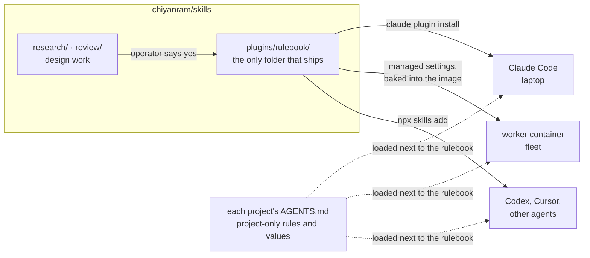

# skills: the generic rulebook

[](https://github.com/chiyanram/skills/actions/workflows/ci.yml)
[](LICENSE)

The engineering rules every project shares, written once and shipped as one plugin,
[`rulebook`](plugins/rulebook/). The agent that writes the code and the agent that reviews it load the same file, so
they cannot drift apart. Rules that belong to one project stay in that project's own `AGENTS.md`.

**Status:** see the [changelog](CHANGELOG.md) for the current version. The `testing` references are in. The skill router, the other
domains (code, obs, migrations, delivery, planning) and the `/crq` workflow are still to come. See the
[open issues](https://github.com/chiyanram/skills/issues).

## How the rules reach an agent



One source and no copies: a rule changes in one file, and every agent sees the change in its next session.

## Install

The repo is private, so git needs credentials first. A bare `GH_TOKEN` is not enough; git has to use it through a
credential helper.

**Claude Code**

```bash
gh auth setup-git
claude plugin marketplace add chiyanram/skills
claude plugin install rulebook@chiyanram
```

Update with `claude plugin marketplace update chiyanram`. Each release bumps the plugin's version, which is what
tells Claude Code there is an update. Auto-update is off for third-party marketplaces unless you
turn it on.

**Other agent tools**

```bash
npx skills add chiyanram/skills
```

**Worker container.** Add the marketplace and the plugin to the managed settings:

```json
"extraKnownMarketplaces": { "chiyanram": { "source": { "source": "github", "repo": "chiyanram/skills" } } },
"enabledPlugins": { "rulebook@chiyanram": true }
```

`bake-plugins.sh` reads the BuildKit secret `skills_token` for the clone. The whole repo is cloned, but only
`plugins/rulebook/` is copied into the plugin cache.

## What is inside

The [plugin README](plugins/rulebook/README.md) lists every reference and when to read it. Each reference follows
one shape: **Rules · When X, use Y · Good / Bad · Decided edges · Review checks**
([format](research/00-reference-format.md)).

## Repo map

| path | status | what it holds |
|---|---|---|
| [`plugins/rulebook/`](plugins/rulebook/) | **ships** | the plugin: skills, references and examples |
| [`.claude-plugin/`](.claude-plugin/) | **ships** | the marketplace manifest that points at the plugin |
| [`scripts/`](scripts/), [`tests/`](tests/), [`Makefile`](Makefile) | live | the checks behind `make lint`, and their tests |
| [`release.config.mjs`](release.config.mjs), [`package.json`](package.json) | live | semantic-release: cuts each release from the commits on `main` |
| [`research/`](research/) | live | the evidence behind each rule, plus the [rule ledger](research/19-approved-rules.md) and the [decision register](research/00-decision-register.md) |
| [`review/`](review/) | live | builders that turn research into the HTML pages the operator approves rules on |
| [`docs/agents/`](docs/agents/) | live | the answers upstream skills need: issue tracker, labels, domain docs |
| [`requirements.md`](requirements.md) | live | what the design must deliver, and the scenarios every decision is checked against |
| [`refs/`](refs/) | live | the reference repos and the commits that research citations are pinned to |
| [`issues/`](issues/), [`map.md`](map.md) | archive | the first local wayfinder map and its tickets; the map moved to [#9](https://github.com/chiyanram/skills/issues/9) |
| [`p1/`](p1/), [`design-overview.md`](design-overview.md) | archive | the scoped-reviewer prototype, and the design picture as of 2026-10-01 |

Archive files stay at their paths because research files and other repos cite them by path and line.

## Contribute

Read [CONTRIBUTING.md](CONTRIBUTING.md). In short: no rule goes in without the operator's yes, and `make lint` and
`make test` must pass before you push. Agents also read [AGENTS.md](AGENTS.md).

## License

[MIT](LICENSE)
