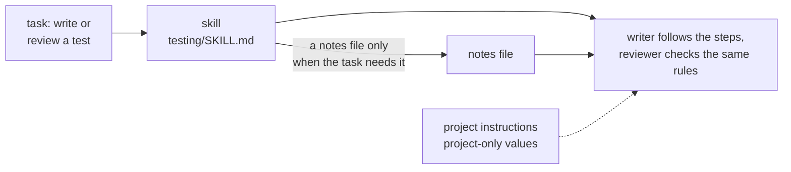

# skills

[](https://github.com/chiyanram/skills/actions/workflows/ci.yml)
[](LICENSE)

One shared rulebook for coding agents: the agent that writes the code and the agent that reviews it read the same rules.

## What it is

`skills` ships the Claude Code plugin [`rulebook`](plugins/rulebook/). It holds engineering rules for Java and Spring
services with an Angular front end, plus stack-neutral ones: tests, code, agents, migrations, observability and
planning. The `code` and `testing` rules lean on Java, Spring, JPA, Spock and Angular; the others apply to any stack. Each rule has a reason and an approved
source. A second plugin, [`toolbox`](plugins/toolbox/), holds tools a person types, copied from other skill repos with
their licence notices.

- **One file, two readers.** The writer follows the rules. The reviewer checks the same rules.
- **One short skill per job.** A skill is a short procedure an agent reads whole. A notes file beside it holds what
  only some tasks need.
- **Project values stay in the project.** Commands, paths and module names go in that project's own `AGENTS.md`.

It is for teams that run coding agents and want one standard across their repos. Claude Code is the main harness and
GitHub Copilot CLI the second; other agents get the skills on a best-effort basis. The
current version is in the [changelog](CHANGELOG.md).

## Quick start

1. Install the plugins. On a machine with no GitHub SSH key, set `CLAUDE_CODE_PLUGIN_PREFER_HTTPS=1` first.

   ```bash
   claude plugin marketplace add chiyanram/skills
   claude plugin install rulebook@chiyanram
   claude plugin install toolbox@chiyanram
   ```

   In GitHub Copilot CLI, run `copilot plugin marketplace add chiyanram/skills`, then `copilot plugin install` for
   each plugin. Other agents can try `npx skills add chiyanram/skills`, on a best-effort basis: it does not keep
   typed-only skills or the hook.
2. Paste this block into the file your agent reads for project instructions, so it loads the skills on a task that
   does not name them. In Claude Code, a project with a `CLAUDE.md` reads that file: paste the block there, or keep it
   in `AGENTS.md` and add the line `@AGENTS.md` to `CLAUDE.md`.

<!-- agents-index: built by `make index` from plugins/rulebook/hooks/index.txt; do not edit by hand -->
```text
Rulebook skills (rulebook plugin). Load the skill before you start, even when the task does not name it.
- `code`: before you write, change or review production code, a small fix or a refactor included.
- `testing`: before you write, change or review a test, and with each code change that needs a test.
- `playwright`: before you write, run or fix a browser end-to-end test, or its CI job.
- `agent`: before you write or review code that calls a language model or runs an agent.
Then read the notes file that the skill names for your task.
```
<!-- /agents-index -->

3. Type `/toolbox:onboard` in the project once. It proposes the lines an agent needs for that project, such as its
   verify command, which the skills read.

If the agent skips the skills, set `RULEBOOK_INDEX=1` in the `env` of `.claude/settings.json`. The plugin then prints
the same block at the start of each session.

To give a repo's sessions the report rules (picture first, each work-item number with context, one decision per
message), set `RULEBOOK_REPORT_RULES=1` in the same `env`. The plugin then prints
[`hooks/report-rules.txt`](plugins/rulebook/hooks/report-rules.txt) at the start of each session. Leave it unset
where no person reads the replies, such as an unattended run.

Update with `claude plugin marketplace update chiyanram`. To put the plugin in a worker container, add it to the
managed settings:

```json
"extraKnownMarketplaces": { "chiyanram": { "source": { "source": "github", "repo": "chiyanram/skills" } } },
"enabledPlugins": { "rulebook@chiyanram": true }
```

## How it works



Each skill is a short procedure for one job: numbered steps, each rule with its *because*, and a Good / Bad pair only
where a model's default is wrong. A rule has no ID: a reviewer names the skill and its section. `planning` and
`agent` still use an older router shape, with references in five sections, until each is rewritten.

A project points at a skill by name, never by path:

```text
Tests here call the model: use the `testing` skill (rulebook plugin) and read its notes on tests that call a model.
```

## Use

| skill | load it when you |
|---|---|
| [testing](plugins/rulebook/skills/testing/SKILL.md) | choose, write or review a test |
| [playwright](plugins/rulebook/skills/playwright/SKILL.md) | write, run or fix a Playwright end-to-end or smoke spec |
| [code](plugins/rulebook/skills/code/SKILL.md) | write or review production code |
| [agent](plugins/rulebook/skills/agent/SKILL.md) | write or review code that calls a model or runs an agent |
| [deslop](plugins/rulebook/skills/deslop/SKILL.md) | clean up a branch's diff before review |
| [skill-feedback](plugins/rulebook/skills/skill-feedback/SKILL.md) | turn a session's skill failures into issues |
| [migrations](plugins/rulebook/skills/migrations/SKILL.md) | write or review a database migration |
| [obs](plugins/rulebook/skills/obs/SKILL.md) | write or review a log call, a metric or a trace |
| [planning](plugins/rulebook/skills/planning/SKILL.md) | write or review a spec, a design or a diagram |
| [crq](plugins/rulebook/skills/crq/SKILL.md) | take a change from request to merge, or run one of its phases |

The [plugin README](plugins/rulebook/README.md) has more on each skill.

## Docs

- [CONTRIBUTING.md](CONTRIBUTING.md): set up, add a rule, a reference or a check, and how releases work.
- [AGENTS.md](AGENTS.md): instructions for coding agents that work in this repo.

## License

[MIT](LICENSE)
