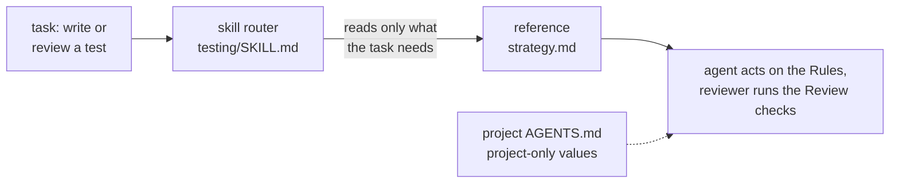

# skills: the generic rulebook

[](https://github.com/chiyanram/skills/actions/workflows/ci.yml)
[](LICENSE)

The engineering rules every project shares, written once and shipped as one Claude Code plugin,
[`rulebook`](plugins/rulebook/). The agent that writes the code and the agent that reviews it load the same rules, so
they cannot drift apart. Rules that belong to one project stay in that project's own `AGENTS.md`.

It is for teams that run coding agents (Claude Code, Codex, Cursor) and want one shared standard for tests, code,
migrations, observability and planning. The current version is in the [changelog](CHANGELOG.md).

## Quick start

The repo is private, so git needs your GitHub credentials through a credential helper first.

```bash
gh auth setup-git
claude plugin marketplace add chiyanram/skills
claude plugin install rulebook@chiyanram
```

Other agent tools:

```bash
npx skills add chiyanram/skills
```

Update with `claude plugin marketplace update chiyanram`. To bake the plugin into a worker container, add it to the
managed settings:

```json
"extraKnownMarketplaces": { "chiyanram": { "source": { "source": "github", "repo": "chiyanram/skills" } } },
"enabledPlugins": { "rulebook@chiyanram": true }
```

## How it works



Each domain (`testing`, `code`, `migrations`, `obs`, `planning`, `meta`, `deslop`) is one skill. Its `SKILL.md` is a
router: a table of references and when to read each. Every reference has the same five sections: **Rules · When X,
use Y · Good / Bad · Decided edges · Review checks**. A rule changes in one file, and every agent sees it in its next
session. [ARCHITECTURE.md](ARCHITECTURE.md) has the full picture.

## Repo map

```text
plugins/rulebook/      the plugin, the only folder that ships
  skills/<domain>/     SKILL.md router + references/ (+ references/examples/)
.claude-plugin/        marketplace manifest that points at the plugin
docs/rulebook/         rule ledger, reference format, moved sources
docs/agents/           issue tracker, labels, domain-doc conventions for agents
docs/archive/          frozen design history (research, review pages, old tickets)
scripts/               the checks behind make lint, and make index
tests/                 unit tests and planted fixtures for each check
release.config.mjs     semantic-release config (package.json holds the tooling)
```

## Docs

- [ARCHITECTURE.md](ARCHITECTURE.md): the plugin, the checks pipeline, the release flow, where provenance lives.
- [CONTRIBUTING.md](CONTRIBUTING.md): how to propose a rule or a fix.
- [DEVELOPMENT.md](DEVELOPMENT.md): setup, make targets, tests, troubleshooting.
- [AGENTS.md](AGENTS.md): instructions for coding agents working in this repo.

## License

[MIT](LICENSE)
