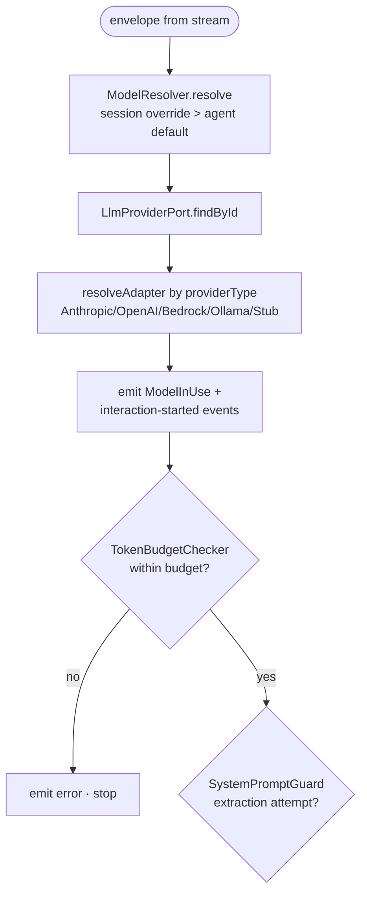
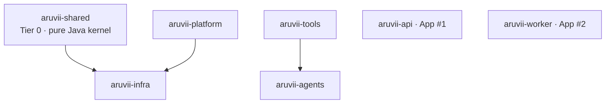
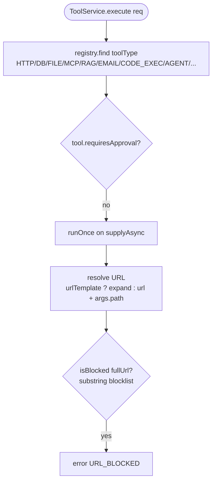

# 42 — Good/Bad examples: planning domain (#35, G9d)

Rules: the 20 the operator asked to exemplify — SR2 SR3 SR4 SR6 SR7 · AC7 AC8 AC9 · PD1–PD5 · DG2 DG3 DG5 ·
WD2 WD3 WD5 WD6 (rule text: `19-approved-rules.md` §Planning; candidates: `41-planning-candidate-rules.md`).
Skipped by operator decision (text unambiguous): SR1 SR8 AC10 PD6 PD7 DG1 DG4 DG6 WD1 WD4 WD7.
Source: agent-platform `origin/master` pinned at **`8f7bf163`** (fetched 2026-10-02), the worktree branch
`chore/643-one-rulebook-skeleton` @ `71b5deb4` where named, and GitLab issue/MR notes (read with `glab`).
Format per `31a-v2.md` / `31-good-bad-v2-BRIEF.md`. "adapted" = built from the named real artifact and changed only
where the Good would otherwise break another approved rule (GB1a). Gherkin Goods obey GA1 (fenced), CV1 (`# AC-n`),
GA3 (concern tags only), GA6 (title starts "should"). A Bad that also breaks unrelated rules says so ("also breaks:").

---

## spec-review

### SR2 — Every claim about today's behaviour cites `file:line` on master

**Good** (real — already complied)
```markdown
### Ground truth

| | value | where |
|---|---|---|
| `login_max_attempts` | **5** | `V32__login_security_settings.sql:16` — NIST SP 800-63B's floor is **no fewer than 10** |
| mechanism | hard account lockout | `LoginThrottleService.isLocked` |
| scope | the account only | `auth:fail:{email}` |
| `Retry-After` | **`900`, hardcoded** | `AuthController.java:48`. Also at `:59`, on a path that **has never executed** — see below. |
```
`docs/spec/REQ-500-login-throttle-progressive-delay.md:46-53` — every "today" fact sits beside the place a reviewer opens to check it.

**Bad** (real)
```markdown
The survey left one point unconfirmed: does `--rerun-tasks` skip the build cache? The repo settles it.
`gradle.properties` doesn't enable the Gradle build cache, and `FRESH=1` passes `--rerun-tasks` (`Makefile:28`).
The body is updated, and no questions remain open.
```
`#585 note, 2026-09-30 13:28 (📌 Decisions)` — the uncited half is false: the next pre-check found
`gradle.properties:9` is `org.gradle.caching=true`. The cited half (`Makefile:28`) was true. The false fact had already
settled a DoD decision (fleet analyst row: "unverified repo facts (#585 build cache)").

### SR3 — A drifted `file:NN` cite is found mechanically, not by reviewer memory

**Good** (adapted from `scripts/check-doc-drift.sh:32-36,94-117`) `NEEDS RUN CHECK`
```bash
mapfile -t DOCS < <(
  { echo CLAUDE.md
    git ls-files '*/CLAUDE.md' 'docs/architecture/*.md' '.claude/rules/*.md' 'docs/spec/REQ-*.md'
  } | grep -v '^\.claude/worktrees/' | sort -u
)
# §2b · a cite written `Foo.java:42` (`symbol`) must still hold `symbol` on line 42
while IFS=$'\t' read -r doc path line symbol; do
  sed -n "${line}p" "$path" | grep -qF -- "$symbol" \
    || finding "$doc  cite drifted — $path:$line no longer holds \`$symbol\`"
done < <(cites_with_symbol "${DOCS[@]}")
```
— the real script checks only "file exists / line ≤ EOF", and only over CLAUDE.md, `docs/architecture`, `.claude/rules`
(`:32-36`). Adapted: REQ files added to the list, and the symbol-on-that-line check the rule needs.
`cites_with_symbol` does not exist yet; issue bodies would be fed in via `glab issue view --output json`.

**Bad** (real)
```markdown
**Notes**
- Line cites off: the `expect`s in `draftEnv` are at `:45`, `:53`, `:57` (story says `:44`, `:52`, `:55`);
  the smoke-90 comment is `:95-97` (story `:94-96`); the sweep block is `:111-136` (story `:111-133`).
```
`#636 note, 2026-10-02 14:29 (Pre-check #636)` — three drifted cites in one story, found only because a reviewer
happened to open each file. Nothing would have caught them on a story the reviewer skimmed.

### SR4 — No open question survives `/approved` unless it names a decider and why it doesn't block

**Good** (real — already complied)
```markdown
## Open questions

**None are open.** Every one is closed, and the record of what each was stays here — a question that
was open while the spec was under review is part of how the spec was built, and deleting it hides
the fact that the answer was chosen rather than obvious.

| | was | closed by |
|---|---|---|
| **OQ-1** | which consumers `utility_model` governs — … | **D14.** History compression only. … |
| **OQ-2** | where the settings UI lives and what it looks like | **D15.** A new `settings/models` route … |
```
`docs/spec/REQ-079-model-role-bindings.md:700-709` (rows trimmed) — the list is empty at approval, and each closed
question names the decision that closed it.

**Bad** (real)
```markdown
## 7. Open questions (review before implementation)

### Q1 — `ToolResultEvent.summary` shape
…
Tradeoff: Option B adds a tool-result storage mechanism we don't otherwise need yet. Recommend starting with A;
revisit when a UI requirement justifies B.

**Decision pending.**
```
`docs/spec/DESIGN-S6-chat-messages.md:550-577` — still "pending" on master, the design long since built; no one is
named to decide and nothing says why building could go ahead without the answer.

### SR6 — A story is checked for actor/action/benefit, scenarios, out-of-scope and an Escalation answer

**Good** (adapted from `#636` issue body, `Story` · `Acceptance criteria` · `Out of scope` · `Escalation`)
````markdown
## Story
As a developer reading a smoke report, I want smoke-90 to fail only when collection scoping is broken,
and smoke specs to never leave tools behind, so that a red smoke run means the product is wrong.
## Acceptance criteria
```gherkin
# AC-1
Scenario: should pass smoke-90 while another spec's platform tool is still live
  Given a live PLATFORM tool that another spec created and did not delete
  When smoke-90 runs
  Then it passes
```
## Out of scope
- Moving smoke-77's API tests to ITs, and deleting smoke-90 `:104`: these are #607's.
## Escalation
REQ treatment required: **no.** Test code and the cleanup script only.
````
— all four parts present (real); the AC is rewritten from the body's prose `Given…when…then` into CV1/GA6 form.

**Bad** (real)
```markdown
## Acceptance criteria

- [ ] REQ-004 §Tool Execution Outcome: **TEO-AC-1 … TEO-AC-15** hold (the REQ on !238 is the contract; …).
- [ ] No smoke spec in the `@core` tier calls a public internet host.
- [ ] smoke-41 has no `test.skip` driven by the endpoint under test; breaking `test-connection` fails tests.
- [ ] smoke-43 `:85` runs on `fake-llm` and passes 10/10 consecutive runs.
```
`#622 issue body, §Acceptance criteria` — no story line, checkbox criteria, and no Escalation section on a change that
touches `aruvii-shared`, `aruvii-infra`, `aruvii-tools` and `aruvii-worker`. The reviewer raised it as G4 ("ACs are
checkboxes … no Escalation line (it is cross-module)", `#622 note, 2026-10-01`).

### SR7 — The review tier is decided by what the diff IS; an unplaceable path is code

**Good** (adapted from `.agents/skills/architecture-review/SKILL.md:49-60` @ `71b5deb4`)
```markdown
4. **Read only the authority this change class can reach.** The trigger is stated as what the diff
   **is**, not what it is not, so a new path class does not default into the cheap tier silently.

   | the diff's class | how it is recognised | what it costs |
   |---|---|---|
   | **code** | any path under a module's `src/`, a build file, or `db/migration/` | the full Authority table |
   | **operability** | `docker-compose*.yml`, `scripts/`, `nginx.conf`, `.claude/hooks/`, `Dockerfile` | the full Authority table |
   | **authority document** | any file the Authority table itself names | the full Authority table |
   | **process and docs** | everything else: `.agents/skills/`, `.claude/agents/`, `docs/` other than the above | the cheap tier |

   A diff spanning classes takes the **most expensive** class it touches. When you cannot place a
   path, it is **code** — the tier is a saving, not a licence.
```
— positive classes plus a default. Changed from source: rows shortened; the duplicated `.agents/skills/` in the last row
(left by the skeleton move's path rewrite) removed.

**Bad** (real)
```markdown
5. **Read the authority a change can actually reach.** When the diff touches **no `src/`, no build file
   and no migration** — a documentation, `.claude/` or scripts change — do **not** read
   `ARCHITECTURE.md`, `IMPLEMENTATION-ROADMAP.md`, `UX-CHARTER.md`, `PRODUCT-DESIGN.md` or
   `CONTEXT.md`'s module map.
```
`.agents/skills/spec-review/SKILL.md:52-56` @ `71b5deb4` — stated as what the diff is not, so a `docker-compose.yml` or
`Dockerfile` change (a customer's start-up path) falls into the cheap tier, and the two rubrics' gates disagree.

---

## acceptance-criteria

### AC7 — A change to stored data or a default has a scenario whose Given predates the change

**Good** (adapted from `docs/spec/REQ-075-certification-execution-gate.md:742-745`, AC-6)
```gherkin
# AC-6
Scenario Outline: should leave an agent created before the migration with no production version
  Given an agent written before V106 with current_version 1 and certification_status <status>
  When V106 runs
  Then the agent has current_version 0

  Examples:
    | status     |
    | DRAFT      |
    | EVALUATING |
    | VERIFIED   |
    | CERTIFIED  |
```
— the Given is a row the old schema wrote (V15's `DEFAULT 1`), so only the migration's `UPDATE` can make it pass. Real
AC-6 already said "a database where agents are at every certification_status"; changed: fenced gherkin, CV1 id,
"should" title, one Then (the snapshot clause becomes its own scenario, GA5).

**Bad** (adapted from `!230 note 3930544110`, QA round 1, F2 — the scenario the test actually proved)
```gherkin
# AC-6
Scenario: should start a new agent with no production version
  Given the migration has run
  When a new agent is inserted
  Then its current_version is 0
```
— only new rows. QA: the IT "inserts a new row with raw SQL, so it exercises the default and not the UPDATE"; and the app
path still wrote `currentVersion = 1` (`AgentEntity.java:77`, F1). Both shipped green until review round 1 (#554).

### AC8 — An Examples column that never varies moves to the Given or Background

**Good** (adapted from `docs/spec/REQ-500-login-throttle-progressive-delay.md:311-327`)
```gherkin
# AC-3
@security
Scenario Outline: should grow the account backoff from zero to the cap
  Given <failures> consecutive failed attempts against one account
  When the next attempt is made
  Then the account backoff is <backoff> seconds

  Examples:
    | failures | backoff |
    | 0        | 0       |
    | 9        | 0       |
    | 10       | 1       |
    | 400      | 30      |
```
— "one account" is constant, so it is words in the Given, not a column. Changed from source: rows trimmed, `@domain`
tier tag dropped (GA3), "should" title (GA6), `# AC-3` assigned here (REQ-500 has no ids — the GA2 gap).

**Bad** (adapted from the same scenario — no real case on master: a scan of every `Examples:` table in
`docs/spec/` at `8f7bf163` found no constant column)
```gherkin
Scenario Outline: should grow the account backoff from zero to the cap
  Given <failures> consecutive failed attempts against <accounts> account
  When the next attempt is made
  Then the account backoff is <backoff> seconds

  Examples:
    | failures | accounts | backoff |
    | 0        | 1        | 0       |
    | 9        | 1        | 0       |
    | 10       | 1        | 1       |
```
— `accounts` is `1` on every row; the reader has to check it really never matters, and GT3 carries the dead column into
the Spock `where:` table. also breaks: CV1/GA2 (no `# AC-n`).

### AC9 — Scenario words come from the glossary; a new noun is declared before a scenario uses it

**Good** (adapted from `docs/spec/REQ-500-login-throttle-progressive-delay.md:104-112,376-386`)
````markdown
| **source backoff** | backoff derived from consecutive failures from one client IP. Capped higher than the account cap. |
```gherkin
# AC-8
@security
Scenario Outline: should apply no source backoff until the source threshold
  Given <failures> consecutive failures from one client IP, spread across different accounts
  When the next attempt is made from that client IP
  Then the source backoff is <backoff>

  Examples:
    | failures | backoff |
    | 99       | 0       |
    | 100      | 1       |
```
````
— "source backoff" is declared in the REQ's Domain terms table (`:104`) before any scenario uses it. Changed: "should"
title, `@domain` dropped, `# AC-8` assigned, "address" → "client IP" to match the glossary's own words.

**Bad** (adapted from the same scenario)
```gherkin
Scenario Outline: should not ban the IP below the lockout limit
  Given <failures> failed logins from one IP
  When the next login is attempted
  Then the IP ban is <ban>
```
— "ban" and "lockout limit" appear in no glossary; REQ-500's own glossary says a backoff is "Never a lockout". By GT1
the title becomes the test name, so the wrong word lands in code. also breaks: CV1 (no `# AC-n`), GA4 (header unseen).

---

## program-design

### PD1 — A new or rerouted call path is shown as a call tree in a fenced `diff`

**Good** (adapted from `docs/architecture/ARCHITECTURE.md:326-338` and `HttpToolHandler.java:300-311`, the #117 change)
```diff
  ToolService.execute(...)
    HttpToolHandler.execute(req, limits)
      runOnce(req, limits)
-       isBlocked(fullUrl)                      substring match on the base URL string
-         → ToolExecutionResult.error("URL_BLOCKED", …)
        query params, API_KEY_QUERY appended to fullUrl
+       SsrfGuard.check(fullUrl)                on the finished URL, after the appends
+         HostResolver.resolve(host)            the address is checked, not the text
+         SsrfDecision.Blocked   → logRefusal(…); ToolExecutionResult.error("URL_BLOCKED", refusalMessage(…))
+         SsrfDecision.Permitted → CheckedUrl; the request is built from it
```
— the reroute (check moves after the URL grows, and changes what it inspects) is one glance. Every unmarked and `+`
name greps on master today; the change shipped as `e3fcb09d` with the reasoning only in a code comment.

**Bad** (real)
```markdown
## Change outline

    upstream answers   before                  after
    2xx                SUCCESS                 SUCCESS
    4xx / 5xx          SUCCESS {"status":n}    ERROR UPSTREAM_HTTP_ERROR
                                               {"error","status":n,"body"}
    MCP non-2xx        ERROR MCP_HTTP_<n>      ERROR MCP_HTTP_ERROR
    DB timeout         ERROR TIMEOUT           LIMIT_EXCEEDED TIMEOUT
```
`!238 description, §Change outline` (#622) — outcomes only. The change reroutes the success path in `HttpToolHandler`
and `McpToolHandler` and adds decoders on the SSE and `chat:buf` paths across tools, infra, api and worker; no tree
shows which calls move or where each new decoder sits.

### PD2 — A file-tree diff marks every new, modified and deleted file, tests included, each with a purpose

**Good** (adapted from `#636` issue body, §Plan and the `Files:` line)
```diff
  aruvii-ui/playwright/
+   support/smoke-name.ts                          NEW  isSmokeName(name) — ^smoke\d*[-_]
+   unit/smoke-name.spec.ts                        NEW  true for smoke77_tool_x, smoke87-agent-x, smoke-x; false for smokehouse
    support/cleanup-test-data.ts                   MOD  every startsWith('smoke-') → isSmokeName
    global-setup.ts                                MOD  pre-run purge → isSmokeName
    e2e/smoke/smoke-77-dry-run.spec.ts             MOD  fixtures delete in finally; teardown DELETE checks status
    e2e/smoke/smoke-90-collection-scoping.spec.ts  MOD  filter to Workspace, assert pagination "of 1"
```
— six files, each with why; the unit test sits beside the code it proves. Unit tests live in `playwright/unit/` on master.

**Bad** (real)
```markdown
Files: `smoke-77-dry-run.spec.ts`, `smoke-90-collection-scoping.spec.ts`, `support/cleanup-test-data.ts`,
`global-setup.ts`, and one new matcher file under `support/`. No product code. **Migration: no.**
```
`#636 issue body, §Plan` — no purposes, the new file unnamed, and AC-4's "Playwright unit test" for `isSmokeName` has no
file at all — the reviewer grading the diff (F-01) has nothing to grade the test against.

### PD3 — New types and signatures are Java with no bodies; the caller's usage comes first

**Good** (adapted from `docs/spec/REQ-075-certification-execution-gate.md:172-186` and
`aruvii-agents/.../domain/RuntimeConfigResolution.java`) `NEEDS COMPILE CHECK`
```java
final var resolution = runtimeConfigPort.resolve(agentId, new RunMode.Prod());
switch (resolution) {
    case RuntimeConfigResolution.Resolved resolved -> runTurn(resolved.config(), resolved.version());
    case RuntimeConfigResolution.NotPromoted _ -> refuse(RefusalReason.AGENT_NOT_VERIFIED);
    case RuntimeConfigResolution.VersionUnusable _ -> refuse(RefusalReason.AGENT_VERSION_UNAVAILABLE);
}
public interface AgentRuntimeConfigPort {
    RuntimeConfigResolution resolve(UUID agentId, RunMode mode);
}
public sealed interface RuntimeConfigResolution {
    record Resolved(AgentRuntimeConfig config, Version version) implements RuntimeConfigResolution { }
    record NotPromoted() implements RuntimeConfigResolution { }
    record VersionUnusable(Reason reason) implements RuntimeConfigResolution { }
}
```
— caller first (`ChatOrchestrator`, a dryRun=false turn): the switch shows the sealed type earns its three cases
before any is declared. Lives in the MR's design section (PD6).
`runTurn` / `refuse` stand for the orchestrator's existing turn and refusal paths.

**Bad** (real)
```text
AgentRuntimeConfigPort.resolve(UUID agentId, RunMode mode) → RuntimeConfigResolution

RuntimeConfigResolution        sealed
 ├─ Resolved(AgentRuntimeConfig config, Version version)   Version.None only for Draft
 ├─ NotPromoted                 mode Prod, and current_version = 0
 └─ VersionUnusable(reason)     the named version is missing or incomplete
```
`docs/spec/REQ-075-certification-execution-gate.md:172-178` — a private notation, no caller; `reason`'s type is left out
and was settled later in code (`Reason { MISSING, INCOMPLETE }`, !230 Decisions). also breaks: PD6 (signatures in a REQ).

### PD4 — Build order is end-to-end slices you can poke, never schema → service → API → UI

**Good** (adapted from REQ-075 and the titles of #556 / #557 / #559)
```markdown
| slice | end to end | poke it |
|---|---|---|
| 1 · chat refuses an unpromoted agent | V106 `current_version` → 0 · `RunMode` · `AgentRuntimeConfigPort` · `ChatOrchestrator` refusal | send a dryRun=false message to a new agent → SSE error `agent-not-verified` (AC-1, row 1) |
| 2 · promote, and chat runs that version | promote endpoint · `first_promoted_at` · resolution `Resolved` | promote v-verified, send → `llm_call_log` carries its model (AC-2) |
| 3 · unattended paths block too | triggers · webhooks · Kafka · async tasks · sub-agent tool | fire a trigger on an unpromoted agent → `BLOCKED_UNCERTIFIED` (AC-1, row 2) |
```
— slice 1 already crosses migration, domain, worker and SSE, so the first merge is a behaviour a person can see.

**Bad** (real)
```markdown
## Story
As the developer building versioned certification, I want the schema, error codes and run-mode types in place
first, so that every later story builds on one migration and one vocabulary, and nothing changes for users yet.
```
`#554 issue body, §Story` (REQ-075 S1, !230) — a horizontal layer with nothing to poke. Its defect (app-created agents
still got `current_version = 1`, `AgentEntity.java:77`) could not show in any running path; it took 3 QA rounds and
2 days (fleet developer row).

### PD5 — Every slice names the `make` target (and `TEST=`) that proves it, plus any manual step

**Good** (adapted from `#636`, §Plan and AC-3/AC-4)
```markdown
**Slice 1 · both sweeps share one matcher**
  proves it: `make test-ui` (runs `playwright/unit/smoke-name.spec.ts` with the Playwright unit tier)
**Slice 2 · smoke-77 cannot hide a leak; smoke-90 counts its own workspace**
  proves it: `make smoke FULL=1` — smoke-77 and smoke-90 pass, none skipped
  manual:    force smoke-77's agent create to fail once, then `make smoke FULL=1`; post the run in an MR note (AC-3)
```
— each slice ends in a command a reviewer can rerun; the one manual step is named with its exact trigger.

**Bad** (real)
```markdown
- [ ] smoke-43 `:85` runs on `fake-llm` and passes 10/10 consecutive runs.
```
`#622 issue body, §Acceptance criteria` — no command proves "10/10"; `!238 description, §Not done, by decision` then
reads "has not been run: the Verifier runs a job once". also breaks: SR6 (checkbox, not a scenario).

---

## diagrams

### DG2 — Call trees and file trees in a design are `diff` text; Mermaid is for component, sequence, state, ER, class

**Good** (adapted from `HttpToolHandler.java:385-407` and `!238` §Implementation — the #622 reroute)
```diff
  ToolService.execute(...)
    HttpToolHandler.execute(req, limits)
      runOnce(req, limits)
        client.send(httpReq, …)                   retried on retryCodes
-       ToolExecutionResult.success(outputJson, latency)    any status, 5xx included
+       2xx       → ToolExecutionResult.success(outputJson, latency)
+       otherwise → ToolExecutionResult.error(ToolErrorCode.UPSTREAM_HTTP_ERROR, …)   status + body as data
```
— a reviewer diffs the plan against the code line by line. Unmarked names grep on master (`HttpToolHandler.java:407` is
today's unconditional `success`); the `+` line names the enum the same design declares (REQ-004 §Tool Execution Outcome).

**Bad** (real — an as-built doc, but the same shape a design reaches for)

`docs/architecture/ARCHITECTURE-DIAGRAMS.md:229-237` (excerpt of a 26-line flowchart) — a call order drawn as boxes and
arrows: nothing to diff against `ChatOrchestrator.process`, and a design in this shape cannot mark what is new.

### DG3 — Every node label is a class, module, table or endpoint name `grep` finds on master

**Good** (real — excerpt)

`docs/architecture/ARCHITECTURE-DIAGRAMS.md:98-128` (nodes and edges excerpted) — every label is a Gradle module name in
`settings.gradle.kts`, so a renamed or deleted module shows up as a grep miss.

**Bad** (real)

`docs/architecture/ARCHITECTURE-DIAGRAMS.md:317-327` (excerpt) — `registry.find` and `isBlocked` occur nowhere under any
`src/main` at `8f7bf163`; `isBlocked` was deleted by `e3fcb09d` (#117) and the node still describes the substring check
that commit replaced. Same file `:50`: `ollama 0.5.4`, a version found in no compose or Dockerfile.

### DG5 — A diagram that needs a paragraph to be understood is redrawn smaller

**Good** (adapted from `#636 note, 2026-10-02 05:49` — caption cut to its first sentence)
```text
smoke-77 retry           creates PLATFORM tool smoke77_tool_… → never deletes it
cleanup-test-data.ts     sweeps names starting "smoke-" (:121); "smoke77_" does not match → persists across runs
smoke-90 :97             asserts exactly "Tools (1)"; a platform tool is visible from every workspace → "Tools (2)" every run
```
Caption: three defects, all in tests; the product is correct throughout.
— three rows, each a real file or spec; the chain explains itself. An issue comment, so plain ASCII (DG1).

**Bad** (real)
````markdown
    API-->>B: SSE frames: text-delta · tool-call-start · tool-call-result ·<br/>usage · cost-step · activity-status · finish · error ·<br/>(ModelInUse falls through to a generic "event" — see note)
    W->>R: XACK on Finish sentinel
```

**Deltas vs. legacy docs** (verified): POST returns **200**, not 202; URLs are
`/api/sessions/{id}/...`, **not** the agent-scoped pattern; failed envelopes are
**dead-lettered on first failure**, not after 3 retries; SSE lives on
`SessionMessageController`, there is no `SseChatController`. SSE auth uses a `?token=` query
param (EventSource can't set headers). Approval pauses re-enter the same stream with
`requestType="RESUME"`.

**Gap found on re-verification (2026-08-16)**: `ChatResponseEvent.ModelInUse` is a real sealed
variant the orchestrator emits, but `SessionMessageController.eventName()` has no case for it — …
````
`docs/architecture/ARCHITECTURE-DIAGRAMS.md:205-217` — the tail of a sequence diagram whose own arrow says "see note", then
two paragraphs to read it. Two smaller diagrams (enqueue · stream) would carry the 200 and the replay without prose.
also breaks: WD3 (doc-vs-doc deltas belong in `ARCHITECTURE.md` §9).

---

## writing-docs

### WD2 — No counts that change as a side effect of unrelated work; stable deliberate facts are fine

**Good** (real — already complied)
```markdown
### 5.1 Flyway migrations

`aruvii-infra/src/main/resources/db/migration/` holds the schema migrations, applied in version
order.
```
`docs/architecture/ARCHITECTURE.md:385-388` — names the thing. The same paragraph read "holds **90 migrations, V1 → V90**"
before #335 (`aefd84f2^:docs/architecture/ARCHITECTURE.md:361`); every new migration made it false.

**Bad** (real)
```markdown
## 2. Module dependency graph

14 Maven modules in the reactor + `aruvii-ui` (Angular, outside the reactor). Every edge is a
real `<dependency>` in the consumer's `pom.xml`, enforced as an allow-list by ArchUnit.
```
`docs/architecture/ARCHITECTURE-DIAGRAMS.md:90-93` — still on master after the build moved to Gradle
(`settings.gradle.kts`): no reactor, no `pom.xml`, and a tally nobody re-counted. Nobody edited this line; the build
moved under it, which is exactly the decay `scripts/check-doc-drift.sh:4-7` records (PUBLIC_PATHS "17 … was 20").

### WD3 — A claim known to disagree with the code goes in `ARCHITECTURE.md` §9 Doc drift

**Good** (real — already complied)
```markdown
## 9. Doc drift — corrections to existing docs

The retired [`ARCHITECTURE-LEGACY.md`](./ARCHITECTURE-LEGACY.md) and `../spec/TECH-OVERVIEW.md`
are stale in the following ways. The list is not exhaustive — only items I directly verified.

| Doc claim                     | Reality                                                                          |
|-------------------------------|----------------------------------------------------------------------------------|
| "Dead-letter after 3 retries" (ARCHITECTURE:234) | Dead-letter on **first failure** [ChatStreamConsumer.java:143-145, explicit comment]. |
```
`docs/architecture/ARCHITECTURE.md:609-621` (one row kept, padding trimmed) — the stale claim stays where it was
written, and the correction lives in one known place with its evidence.

**Bad** (real)
```markdown
- `:413-416` — `isBlocked`: substring match (`lower.contains(p.toLowerCase())`) over the injected pattern list.
- `aruvii-tools/.../infrastructure/ToolsAutoConfiguration.java:97` — the actual SSRF blocklist passed into the handler:
  `["localhost", "127.0.0.1", "0.0.0.0", "169.254.", "10.", "172.16.", "192.168."]`.
```
`docs/architecture/ARCHITECTURE.md:360-362` — `isBlocked` was deleted by `e3fcb09d` (#117, 2026-09-13), whose REQ-107
quotes this very method as the problem; §9 is silent, so the doc still teaches the check that was replaced. The other
wrong form, a bracket fix in place: `docs/spec/REQ-107-ssrf-resolved-address-check.md:102` strikes a row through
("~~…~~ **Corrected by #527 — this row was false when written.**").

### WD5 — A bug corrects its REQ in place; a REQ-less chore carries its spec in the issue; a new REQ is new behaviour

**Good** (real — already complied)
```markdown
Decisions: grilling notes on this issue (two comments). Product behaviour is specified in
**REQ-004 §Tool Execution Outcome** (amended by this change); the test-side scope below has no REQ.
```
`#622 issue body, §Scope` — the bug (a 5xx reported as SUCCESS) amends the REQ that owns tool outcomes; the test-only
half stays in the issue. Same shape for a pure chore: `#576 issue body` opens "This issue has no owning REQ: it is test
tooling. This section **is** the spec."

**Bad** (real)
```markdown
# REQ-028 — A credential that cannot be decrypted stops the call

**Issue:** [#118](…) — `HttpToolHandler` and `McpToolHandler` swallow decrypt failures and call out unauthenticated
**Branch:** `fix/118-credential-decrypt-fail-closed`
**Precedent:** [REQ-071](REQ-071-fail-closed-credential-decrypt.md) — the same policy, shipped for the three mail sites
```
`docs/spec/REQ-028-credential-decrypt-fail-closed.md:1-5` — a bug fix (#118) under "the same policy" REQ-071 already
states, written as a second spec beside it instead of widening REQ-071. Also `REQ-073-tool-rename-name-uniqueness.md:3`:
"**Type:** bug fix" as its own REQ.

### WD6 — A new REQ is `REQ-<issue>-slug`; a new ADR takes the next number free on master and every branch

**Good** (real — already complied)
```markdown
# REQ-500 — Login throttling delays, it does not lock out

**Issue:** [#500](https://gitlab.com/ai-agent-build-platform/agent-platform/-/issues/500) — cluster C of
the Redis usage audit ·
```
`docs/spec/REQ-500-login-throttle-progressive-delay.md:1-4` — the number is the issue's, so no other branch can take it.

**Bad** (real)
```text
docs/spec/REQ-073-jacoco-integration-coverage.md        (#328)
docs/spec/REQ-073-tool-rename-name-uniqueness.md        (#362)

> This spec has now been renumbered **three times** while the MR sat in review — **REQ-063 → 064 →
> 065 → REQ-073**. #334 took `063` for the source-root work, `!108` (#154, Flyway rules) holds `064`
> on its branch, and `REQ-065-agent-snapshot-limit.md` (#314) merged to `master` and took `065`.
```
`git ls-tree origin/master docs/spec/` and `docs/spec/REQ-073-jacoco-integration-coverage.md:29-31` — the next-free-slot
scheme collided four times on one spec, and the fourth number still collided: both REQ-073s are on master. The ADR side
hit the same: `0012` claimed three times (`docs/adr/README.md:52-55`).

---

## Counts

| reference | rules | Good real | Good adapted | Bad real | Bad adapted |
|---|---|---:|---:|---:|---:|
| spec-review | SR2 SR3 SR4 SR6 SR7 | 2 (SR2, SR4) | 3 (SR3, SR6, SR7) | 5 | 0 |
| acceptance-criteria | AC7 AC8 AC9 | 0 | 3 | 0 | 3 |
| program-design | PD1–PD5 | 0 | 5 | 5 | 0 |
| diagrams | DG2 DG3 DG5 | 1 (DG3) | 2 (DG2, DG5) | 3 | 0 |
| writing-docs | WD2 WD3 WD5 WD6 | 4 | 0 | 4 | 0 |
| **total** | 20 | **7** | **13** | **17** | **3** |

**Why Goods were adapted**

| reason | Goods |
|---|---|
| no real artifact of that shape exists (no design on master uses a call-tree / file-tree `diff`, Java-signature sketch or slice table) | PD1 PD2 PD3 PD4 PD5 DG2 |
| real scenario lacks GA1/CV1/GA6 form (prose or private fence, no `# AC-n`, no "should", `@domain` tier tag) | AC7 AC8 AC9 SR6 |
| the mechanical check the rule names does not exist yet | SR3 |
| source carries a path-rewrite artifact / caption longer than one line | SR7 DG5 |

**Open for review**
- AC7/AC8/AC9 Bads are adapted: a scan of every `Examples:` table in `docs/spec/` at `8f7bf163` found no constant
  column (AC8), and no real scenario using an undeclared noun was found (AC9). AC7's Bad is the scenario !230's IT
  actually proved, not text that was ever written as an AC.
- PD3 Good needs a compile check (`AgentRuntimeConfigPort` does not exist on master; it is REQ-075 S3, #556).
- SR3 Good's `cites_with_symbol` is a sketch; the real §2 check stops at "file exists, line ≤ EOF".
- DG3 vs design Goods: a `+` line names a type the same design declares (DG2 Good's `ToolErrorCode`), which `grep` on
  master cannot find yet. The rule may need "unmarked and `-` lines grep on master; `+` lines are declared in the design".
