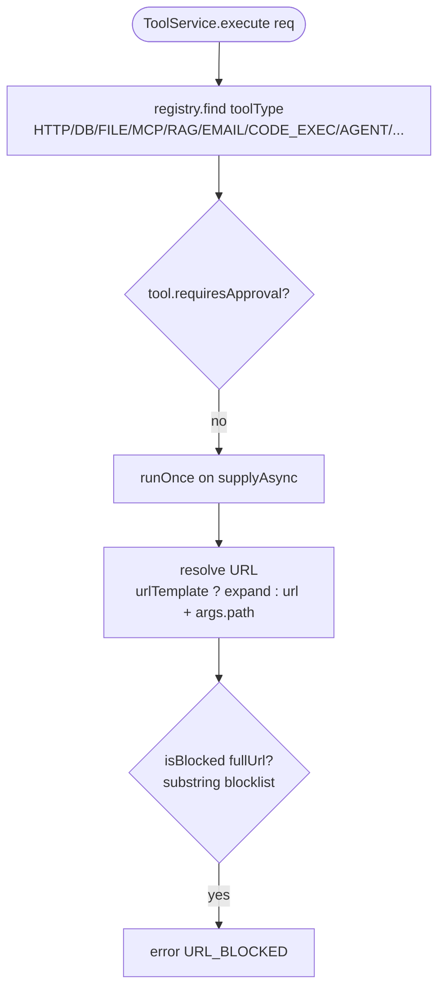
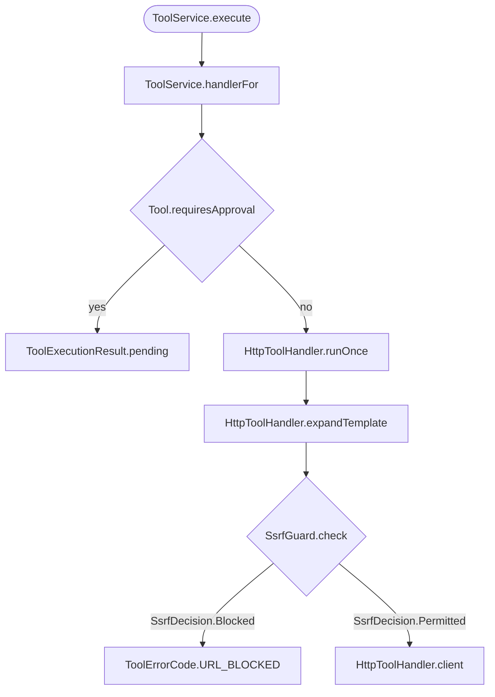

# 47 — Good examples rewritten from a real Bad

Operator rule 2026-10-03 (`00-reference-format.md` "Good / Bad rules" 1–6): the Bad is real code from our repo; the Good is
that Bad rewritten to obey the rule and every other approved rule (`19-approved-rules.md`, `31e-conventions.md`), never our
code as-is. Scope: every entry whose Good was labelled `(real…)` in `31a-v2.md`, `31b-v2.md`, `31c-v2.md`, `31d-v2.md`,
`31e-conventions.md` and `42-planning-good-bad.md`.

Source: agent-platform `origin/master` at **`772736bf`** (fetched 2026-10-03) unless a cite names another commit.
Every Bad was re-read at that SHA; line numbers that moved since the old entry are corrected here.
`NEEDS COMPILE CHECK` marks a Good that names a helper or a class master does not have yet.
"old Good compliant" means the code the old entry quoted already obeyed every approved rule; it is still not reused.

---

## from 31a-v2.md

### S2 — Assert observable behaviour, never a field default or the input passed in

**Bad** (real)
```groovy
    def "the resolution variants carry what the port answers with"() {
        given: "a configuration"
        def config = new AgentRuntimeConfig(UUID.randomUUID(), "m", MemoryMode.NONE, null, [], [])

        expect: "R1 — a version is present for a prod or pinned run, absent for the draft, and the reason is named"
        new RuntimeConfigResolution.Resolved(config, new Version.Of(2)).version() == new Version.Of(2)
        new RuntimeConfigResolution.Resolved(config, new Version.None()).version() == new Version.None()
        new RuntimeConfigResolution.VersionUnusable(reason).reason() == reason

        where:
        reason << RuntimeConfigResolution.VersionUnusable.Reason.values().toList()
    }
```
`aruvii-agents/src/test/groovy/ai/aruvii/agents/domain/RunModeSpec.groovy:49-60` — each line reads back the constructor argument; it passes for any record and fails for no regression. Also breaks: U2a, K6.

**Good** (rewritten from `aruvii-agents/src/test/groovy/ai/aruvii/agents/domain/RunModeSpec.groovy:49-60`)
```groovy
    def "should refuse a resolved version numbered #number, because 0 means never promoted"() {
        given: "the configuration a run would read"
        def config = new AgentRuntimeConfig(UUID.randomUUID(), "m", MemoryMode.NONE, null, [], [])

        when: "a resolution names that version"
        new RuntimeConfigResolution.Resolved(
            config,
            new Version.Of(number))

        then: "the version type refuses it, so no run can claim a version no snapshot has"
        def e = thrown(IllegalArgumentException)
        e.message == "A version starts at 1, but was $number"

        where:
        number << [0, -1]
```
— asserts what `Version.Of` does (`aruvii-shared/.../agents/Version.java:26-30`), not what the test handed in; nothing on master calls the resolution yet, so the refusal is the only behaviour it has. Old Good (`RotationReminderBoundarySpec.groovy:54-63`) was compliant.

### S3 — Before changing code, run the existing tests touching it; note what was green

**Bad** (real)
```text
./mvnw -pl aruvii-api -am -Dtest='ErasureLookupServiceTest+AuditLoggerTest' ... test
→ [INFO] BUILD SUCCESS
→ zero tests executed
```
`.claude/skills/aruvii-standards/references/verification.md:27-31` — a hand-rolled baseline run: the filter matched nothing, nothing ran, and "green" was noted.

**Good** (rewritten from `.claude/skills/aruvii-standards/references/verification.md:27-31`)
```text
make test-module MOD=aruvii-api TEST='*ErasureLookupServiceTest*'
make test-module MOD=aruvii-api TEST='*AuditLoggerTest*'

Baseline before editing ErasureLookupService, at master <sha>:
  ErasureLookupServiceTest   <n> tests, 0 failed
  AuditLoggerTest            <n> tests, 0 failed
```
— goes through `make`, one pattern per run (a pattern that matches nothing fails the build), and the note records the count, so "green" means tests ran. Old Good (`Makefile:197-206`) was compliant.

### C1 — Decide cases with RIGHT-BICEP before writing; skip a dimension only with a reason

**Bad** (real)
```groovy
    def "a new agent entity starts with no production version"() {
        expect: "Hibernate writes the field on every INSERT, so a default of 1 would override V106's column default of 0"
        new AgentEntity().currentVersion == 0
    }
```
`aruvii-agents/src/test/groovy/ai/aruvii/agents/infrastructure/entity/AgentEntityVersionSpec.groovy:8-11` — one R case, and nothing shows which other dimensions were considered or why they were skipped. Also breaks: S2 (asserts a field default), U2a, GT4, line 9 is 121 characters.

**Good** (rewritten from `aruvii-agents/src/test/groovy/ai/aruvii/agents/infrastructure/entity/AgentEntityVersionSpec.groovy:5-11`) `NEEDS COMPILE CHECK`
```groovy
/**
 * REQ-075 AC-6: an agent created through the app has no production version.
 * R: a saved new agent reads back 0. B: 0 is the floor — Version.Of refuses anything below 1.
 * I, C, E, P: skip — no inverse operation, no second source, no error path, one INSERT.
 */
class AgentEntityVersionIT extends AgentsRepositoryIT {

    @Issue(["#554", "AC-6"])
    def "should store a newly created agent with no production version"() {
        given: "an agent built the way the app builds one, its version never set"
        def id = em.persistFlushFind(newAgent()).id
        em.clear()

        expect: "Hibernate writes the field on every INSERT, so the stored row holds the entity's value"
        em.find(AgentEntity, id).currentVersion == 0
```
— every RIGHT-BICEP letter is decided in the header, and the case reads the stored row through the real Postgres slice instead of a field default (S2). `newAgent()` is a helper this spec would add. Old Good (`TokenUsageSpec.groovy:11-24`) was compliant.

### C4 — A knowingly untested case is one gap row in the MR description, never unsaid

**Bad** (real)
```markdown
## Verification

`make verify-full`: 711 tests passed, smoke 774 passed / 0 failed / 0 skipped.
`make test-doctor`: 100 / 39 / 32 / 23 / 21 passed.

Each of the new assertions was mutation-tested rather than assumed: copying the
developer's `.env` into the bundle, blanking `COMPOSE_F`, and dropping one
spelling from `.gitignore` each turn the expected case red.
```
`git log -1 527ae415` body lines 68-75 (#550, the squashed MR description) — lists what ran and nothing about what was not tested, although the same body (:24-27, :38-40) names two paths a reviewer must watch.

**Good** (rewritten from `git log -1 527ae415` body lines 68-75)
```markdown
## Verification

`make verify-full`: 711 tests passed, smoke 774 passed / 0 failed / 0 skipped.
`make test-doctor`: 100 / 39 / 32 / 23 / 21 passed.

## Not tested, by decision

| dimension | missing | risk |
|---|---|---|
| E — error | the `-f` commands `install.sh` prints, pasted into a later shell | an override file in that directory merges again |
| C — conformance | `ARUVII_INSTALL_LIB_ONLY` in the customer bundle | a customer who sets it skips the install |
```
— each gap is one `dimension · missing · risk` row, so a reviewer can tell a decided gap from an oversight. The two rows are built from the body's own reviewer notes; whether #550 tested them is not recorded, so treat the rows as illustrative. Old Good (commit `0aa04944` body) was not compliant: no risk column.

### B2 — Logic taking number/collection/format/enum/time/optional gets ≥1 case per CORRECT letter or a skip line

**Bad** (real)
```java
    void parse_valid_context_returns_headers() {
    void parse_null_returns_empty() {
    void parse_blank_returns_empty() {
    void parse_invalid_base64_throws() {
    void parse_non_json_object_throws() {
    void parse_exceeds_max_headers_throws() {
    void parse_value_exceeding_4kb_throws() {
    void parse_total_exceeds_32kb_throws() {
    void parse_invalid_header_name_chars_throws(String headerName) {
```
`aruvii-platform/src/test/java/ai/aruvii/platform/application/ForwardContextParserTest.java:17,26,31,36,43,51,65,75,92` — the parser takes a count (≤20), sizes (4KB, 32KB) and a format: Range is tried only from outside, Cardinality only at 21, and no line says why Ordering, Reference and Time are skipped. Also breaks: U2a.

**Good** (rewritten from `aruvii-platform/src/test/java/ai/aruvii/platform/application/ForwardContextParserTest.java:14-62`) `NEEDS COMPILE CHECK`
```groovy
/**
 * CORRECT for parse: Conformance (base64, JSON object, header-name characters) · Range (4KB per value,
 * 32KB in total) · Existence (null, blank) · Cardinality (0, 1, 20 accepted; 21 refused).
 * skip: Ordering — no rule reads header order · Reference, Time — no lookup and no clock.
 */
class ForwardContextParserSpec extends Specification {

    def "should forward every header of a context carrying #count of them"() {
        expect: "up to the limit, nothing is dropped"
        ForwardContextParser.parse(encodedHeaders(count)).size() == count

        where:
        count << [0, 1, 20]
    }
```
— the header names every letter, covered or skipped with a reason; Cardinality runs 0, 1 and the edge 20 (21 is a separate refusal feature, K8). `encodedHeaders` is a helper at the end of the spec. Old Good (`CustomPiiResponseSpec.groovy:10-16`) was compliant.

### B3 — Range: test just inside and just outside the edge, not only the edge

**Bad** (real)
```java
    @Test
    void parse_value_exceeding_4kb_throws() {
        String bigVal = "x".repeat(4097);
        String json = "{\"X-Big\":\"" + bigVal + "\"}";
        String b64  = Base64.getEncoder().encodeToString(json.getBytes());
        assertThatThrownBy(() -> ForwardContextParser.parse(b64))
            .isInstanceOf(ForwardContextValidationException.class)
            .hasMessageContaining("4KB");
    }
```
`aruvii-platform/src/test/java/ai/aruvii/platform/application/ForwardContextParserTest.java:64-72` — 4097 only; 4096 is never shown to pass, so an off-by-one `>=` passes too. Also breaks: ST1, U2a.

**Good** (rewritten from `aruvii-platform/src/test/java/ai/aruvii/platform/application/ForwardContextParserTest.java:64-72`)
```groovy
    def "should accept a header value of exactly 4096 bytes"() {
        expect: "the limit itself is inside the range"
        ForwardContextParser.parse(encoded("X-Big", "x".repeat(4096)))["X-Big"].length() == 4096
    }

    def "should refuse a header value of 4097 bytes"() {
        when: "the value is one byte past the per-value limit"
        ForwardContextParser.parse(encoded("X-Big", "x".repeat(4097)))

        then: "the refusal names the limit it broke"
        def e = thrown(ForwardContextValidationException)
        e.message.contains("max 4KB per value")
    }
```
— the edge (4096, accepted) and one past it (4097, refused) each get a case, so `>` versus `>=` is decided by a test. Old Good (`RotationReminderBoundarySpec.groovy:42-52`) was compliant.

### V1 — Before adding a test answer: contract · realistic regression · why not covered · needs a fake seam?

**Bad** (real)
```groovy
    def "a failed production-version eval has its own alert type"() {
        expect: "PROD_VERSION_EVAL_FAILED is named, and the existing four are unchanged"
        AlertTriggerType.valueOf("PROD_VERSION_EVAL_FAILED") != null
        ["TOOL_ERROR_RATE", "RATE_LIMIT_HIT", "TOKEN_BUDGET_NEAR", "AGENT_STATUS_CHANGED"]
                .every { AlertTriggerType.valueOf(it) != null }
    }
```
`aruvii-platform/src/test/groovy/ai/aruvii/platform/domain/AlertTriggerTypeSpec.groovy:8-13` — Q2 has no answer: removing a constant breaks compilation first, and nothing raises the new alert. Also breaks: U2a.

**Good** (rewritten from `aruvii-platform/src/test/groovy/ai/aruvii/platform/domain/AlertTriggerTypeSpec.groovy:5-13`)
```groovy
/**
 * Q1 contract: AlertEvaluatorJob stores AlertTriggerType.name() on each alert row (:149) and the
 *    alerts API returns it as triggerType (PlatformAlertController:85).
 * Q2 regression: a renamed constant strands stored rows and every client that filters on the old name.
 * Q3 not covered: no test names the stored strings; compilation only proves a constant exists.
 * Q4 seam: none; the enum is what the job writes.
 * PROD_VERSION_EVAL_FAILED gets its test when the eval job raises it (REQ-075 R7); today Q2 has no answer.
 */
class AlertTriggerTypeSpec extends Specification {

    def "should still emit every trigger type that stored alert rows carry"() {
        expect: "a rename fails here, not as an empty alert filter after an upgrade"
        AlertTriggerType.values()*.name().containsAll(STORED_TRIGGER_TYPES)
    }
```
— all four answers are written down, and the constant with no answer to Q2 gets no test yet. `STORED_TRIGGER_TYPES` is the V3 Good. Old Good (`RefusalReasonSpec.groovy:9-13`) was compliant.

### V3 — Junk-pattern test fails the gate unless it names the contract it independently guards

**Bad** (real)
```groovy
        AlertTriggerType.valueOf("PROD_VERSION_EVAL_FAILED") != null
        ["TOOL_ERROR_RATE", "RATE_LIMIT_HIT", "TOKEN_BUDGET_NEAR", "AGENT_STATUS_CHANGED"]
                .every { AlertTriggerType.valueOf(it) != null }
```
`aruvii-platform/src/test/groovy/ai/aruvii/platform/domain/AlertTriggerTypeSpec.groovy:10-12` — junk pattern 3 (hand-copied enum members) with no contract named.

**Good** (rewritten from `aruvii-platform/src/test/groovy/ai/aruvii/platform/domain/AlertTriggerTypeSpec.groovy:10-12`)
```groovy
    /**
     * The trigger types alert rows already store and the alerts API returns, verbatim.
     * Hand-copied on purpose (junk pattern 3, contract named): never derive this list from the enum.
     */
    static final List<String> STORED_TRIGGER_TYPES = [
        "TOOL_ERROR_RATE",
        "RATE_LIMIT_HIT",
        "TOKEN_BUDGET_NEAR",
        "AGENT_STATUS_CHANGED",
    ]
```
— still pattern 3, but it names the storage and API contract it guards and says why it must not be derived; the new constant is left out until something emits it. Old Good (`RefusalReasonSpec.groovy:21-26`) was compliant.

---

## from 31b-v2.md

### IT2 — ITs get containers only from the singleton initializer; no @Testcontainers/@Container/@ServiceConnection

**Bad** (real)
```java
@Testcontainers
class FileToolHandlerS3IT {
    ...
    // nosemgrep: aruvii-testcontainers-per-class-container
    @Container
    @SuppressWarnings("resource")
    static final GenericContainer<?> AWS = new GenericContainer<>("ministackorg/ministack:1.5.19")
        .withExposedPorts(S3_PORT)
        .waitingFor(Wait.forListeningPort());
```
`aruvii-tools/src/integrationTest/java/ai/aruvii/tools/infrastructure/handlers/FileToolHandlerS3IT.java:39-40,61-66` — a per-class container, stopped when the class ends. CV5 allows this for `SetupControllerIT` only, so the old Bad (`SetupControllerIT`) no longer breaks IT2; this one does. Also breaks: Spock-first (new tests), the `nosemgrep` comment is inert since semgrep was deleted.

**Good** (rewritten from `aruvii-tools/src/integrationTest/java/ai/aruvii/tools/infrastructure/handlers/FileToolHandlerS3IT.java:39-100`) `NEEDS COMPILE CHECK`
```groovy
/**
 * No Spring context, so no @EnableAruviiSpec: the S3 container comes from the singleton, the way
 * SharedPostgres serves non-Spring ITs, and this spec never starts or stops it.
 */
class FileToolHandlerS3IT extends Specification {

    @Shared
    String endpoint = AruviiTestcontainersInitializer.sharedS3Endpoint()

    FileToolHandler handler = new FileToolHandler()

    def setupSpec() {
        seedBucket(endpoint)
    }
```
— the MiniStack container moves into `AruviiTestcontainersInitializer` beside Postgres and Redis, exposed through a `sharedS3Endpoint()` accessor like `sharedPostgres()` (`AruviiTestcontainersInitializer.java:71-73`); neither the accessor nor `seedBucket` exists on master. Old Good (`ConsumerIdentityIT.groovy:31-40`) was compliant.

### IT4 — Swap a collaborator only at an outbound port with a fake bean; never @MockitoBean

**Bad** (real)
```groovy
    def "shouldDeliverABufferedCallbackWhenTheDrainClosesTheProducer"() {
        given: "a publisher pointed at the broker"
        PlatformSettingsPort settings = Stub() {
            get("kafka_bootstrap_servers") >> broker.brokersAsString
        }
        def publisher = new KafkaCallbackPublisher(settings, new ObjectMapper())
```
`aruvii-worker/src/integrationTest/groovy/ai/aruvii/worker/webhook/KafkaCallbackPublisherDrainIT.groovy:39-44` — an IT replaces our own settings port with a Spock double, not with a real in-memory implementation; the same stub is repeated at `:58-60`. Master has no `@MockitoBean` annotation, so this is the nearest real case. Also breaks: U2a (camelCase name).

**Good** (rewritten from `aruvii-worker/src/integrationTest/groovy/ai/aruvii/worker/webhook/KafkaCallbackPublisherDrainIT.groovy:39-54`) `NEEDS COMPILE CHECK`
```groovy
    @Issue(["#501", "DRAIN-2h"])
    def "should deliver a buffered callback when the drain closes the producer"() {
        given: "a publisher whose platform settings name the embedded broker"
        def publisher = new KafkaCallbackPublisher(
            new InMemoryPlatformSettings(["kafka_bootstrap_servers": broker.brokersAsString]),
            new ObjectMapper())
        def agentId = UUID.randomUUID()
        def jobId = UUID.randomUUID()

        when: "a callback is published and the drain closes the producer straight after"
        publisher.publish(trigger(agentId), job(jobId, agentId))
        publisher.closeWithin(Duration.ofSeconds(5))

        then: "the callback is on the topic, for this job"
        new ObjectMapper().readTree(consumeOne()).get("jobId").asString() == jobId.toString()
```
— the port is a real in-memory implementation (`InMemoryPlatformSettings`, new in `aruvii-test-support`, with its contract spec per IT5), so both features share one fake instead of two stubs. Old Good (`FakeActiveSessionCountPort.java:17-29`) was compliant.

### SP2 — A @TestBean/fake replaces the bean bare; never override a bean whose advice the IT asserts

**Bad** (n/a) — no real Bad on master. Every bean the ITs override (`ActiveSessionCountPort`, `AgentCountByToolPort`, `AgentCountByProviderPort`, `ConnectionTestPort`) and the one they wrap (`AuditLogAdapter`, via `FailableAuditLogConfig`) carries no `@Transactional`, `@Cacheable`, `@Retryable`, `@PreAuthorize` or `@Async` (checked at `772736bf`).

**Good** (rewritten from `aruvii-api/src/integrationTest/java/ai/aruvii/api/support/FakePortsConfig.java:8-24` — no real Bad exists)
```java
/**
 * Shared fakes for owned outbound ports. Each replaced bean carries no @Transactional, @Cacheable,
 * @Retryable or method security, so replacing it bare removes no advice an IT could assert.
 */
@TestConfiguration
public class FakePortsConfig {

    @Bean
    @Primary
    ActiveSessionCountPort fakeActiveSessionCountPort() {
        return new FakeActiveSessionCountPort();
    }
```
— the javadoc records the check SP2 asks for, beside the override. Old Good (`FakePortsConfig.java:17-24`) was compliant; this is a light rewrite of compliant code, flagged because no Bad exists.

### SP3 — Never @Transactional on a RANDOM_PORT IT; isolation comes from DatabaseResetExtension

**Bad** (real)
```java
class DashboardControllerIT extends AbstractIT {
    ...
    @BeforeEach
    void setUp() throws Exception {

        token = adminBearer();

        adminUserId = jdbc.queryForObject("SELECT id FROM users LIMIT 1", UUID.class);
        // Tests share Spring context — clean dashboard inputs per test for determinism.
        jdbc.update("DELETE FROM agent_daily_stats");
        jdbc.update("DELETE FROM interactions");
    }
```
`aruvii-api/src/integrationTest/java/ai/aruvii/api/dashboard/DashboardControllerIT.java:26,34-43` — a RANDOM_PORT IT (`AbstractIT.java:22-23`) isolating itself with its own DELETEs. `DatabaseResetExtension` already truncates both tables before every method (neither is in `AruviiTestReset` `PRESERVE`). Master has no `@Transactional` in any test, so this is the nearest real case. Also breaks: Spock-first.

**Good** (rewritten from `aruvii-api/src/integrationTest/java/ai/aruvii/api/dashboard/DashboardControllerIT.java:20-43`)
```groovy
/**
 * No per-feature DELETE: @EnableAruviiSpec resets the database before every feature, and
 * interactions and agent_daily_stats are not in its PRESERVE list, so both start empty.
 */
@SpringBootTest(webEnvironment = SpringBootTest.WebEnvironment.RANDOM_PORT)
@EnableAruviiSpec
class DashboardControllerIT extends Specification {

    @Autowired
    ApplicationContext applicationContext

    @Autowired
    JdbcTemplate jdbc
```
— isolation has one owner, the reset interceptor, which runs whatever thread the server committed on; no `@Transactional`, no hand cleanup. Old Good (`AruviiSpecResetInterceptor.java:24-36`) was compliant.

### SP5 — Slice tests use @AutoConfigureTestDatabase(replace = NONE) plus the singleton initializer

**Bad** (n/a) — no real Bad on master. The `@DataJpaTest` bases (`AgentsRepositoryIT.groovy:23-25`, `InfraRepositoryIT.groovy:28-30`) both carry `replace = NONE` and the initializer; no `@JdbcTest` exists, and no embedded database is on any classpath (checked at `772736bf`).

**Good** (rewritten from `aruvii-agents/src/integrationTest/groovy/ai/aruvii/agents/repository/AgentsRepositoryIT.groovy:16-29` — no real Bad exists)
```groovy
/** replace = NONE keeps the singleton Postgres; without it Boot swaps in an embedded database. */
@DataJpaTest
@AutoConfigureTestDatabase(replace = NONE)
@ContextConfiguration(initializers = AruviiTestcontainersInitializer)
abstract class AgentsRepositoryIT extends Specification {

    @Autowired
    TestEntityManager em
```
— both halves of the rule sit on the class, with the reason on one line. Old Good (`AgentsRepositoryIT.groovy:23-29`) was compliant; flagged because no Bad exists.

### SP11 — No explicit @ComponentScan on the @SpringBootApplication/configuration slices find

**Bad** (real)
```groovy
@SpringBootConfiguration
@EnableAutoConfiguration
@ComponentScan("ai.aruvii.chat")
@EnableJpaRepositories(["ai.aruvii.chat.infrastructure.repository",
                        "ai.aruvii.agents.infrastructure.repository"])
@EntityScan(["ai.aruvii.chat.infrastructure.entity", "ai.aruvii.agents.infrastructure.entity"])
class ChatTestApplication {
```
`aruvii-chat/src/integrationTest/groovy/ai/aruvii/chat/ChatTestApplication.groovy:38-44` — latent: `ChatIT` uses `@SpringBootTest` today (`ChatIT.groovy:28`), but any `@DataJpaTest` in aruvii-chat would find this class and load every service. Also breaks: ST2 (`:41-42`, first argument on the opening line).

**Good** (rewritten from `aruvii-chat/src/integrationTest/groovy/ai/aruvii/chat/ChatTestApplication.groovy:38-50`) `NEEDS COMPILE CHECK`
```groovy
@SpringBootConfiguration
@EnableAutoConfiguration
@EnableJpaRepositories([
    "ai.aruvii.chat.infrastructure.repository",
    "ai.aruvii.agents.infrastructure.repository"])
class ChatTestApplication {
}

/** The services ChatIT calls. Only ChatIT imports it, so a slice that finds ChatTestApplication loads none. */
@Configuration(proxyBeanMethods = false)
@ComponentScan("ai.aruvii.chat")
class ChatServicesConfig {
}
```
— the scan moves off the class a slice searches for; `ChatIT` becomes `@SpringBootTest(classes = [ChatTestApplication, ChatServicesConfig])`. `@EntityScan` stays on `ChatTestApplication` and the `agentRegistryPort` bean moves to `ChatServicesConfig` (not shown). Old Good (`AgentsJpaTestApplication.groovy:14-20`) was compliant.

### K7 — where: reads only @Shared/static fields; build mocks in given: from a plain discriminator

**Bad** (n/a) — no real Bad can exist on master: Spock refuses an instance field in `where:` when the spec runs, and no `where:` table on master builds a double (every `.groovy` `where:` block scanned at `772736bf`).

**Good** (rewritten from `aruvii-agents/src/test/groovy/ai/aruvii/agents/application/AgentEvalServiceSpec.groovy:35-66`)
```groovy
    @Shared UUID agentId = UUID.randomUUID()
    def "should refuse #entryPoint for an agent that does not exist"() {
        given: "an agent id no row carries"
        agentRepository.existsById(agentId) >> false

        when: "the entry point is called"
        call(service)

        then: "the refusal names the agent"
        def e = thrown(AgentNotFoundException)
        e.message == "Agent not found: $agentId"

        where: "every method that guards on the agent"
        entryPoint << ["listTestCases", "listRuns"]
        call << [{ it.listTestCases(agentId) }, { it.listRuns(agentId) }]
```
— the table reads only the `@Shared` id; the mock is an instance field stubbed in `given:`. The source breaks U2a (no "should"), K6 (no `#var` in the name) and K19 (unbound `thrown`), so the old Good was not compliant; this fixes all three.

### K9 — @Shared only for expensive read-only resources; never mocks or mutable state

**Bad** (real)
```groovy
    @Shared
    CustomPiiEndpointClient client

    def setupSpec() {
        wireMock.start()
        client = new CustomPiiEndpointClient(restClient(),
            SsrfGuard.seededWith(["localhost"], InetAddress::getAllByName).guard())
    }
```
`aruvii-guardrails/src/test/groovy/ai/aruvii/guardrails/infrastructure/CustomPiiEndpointClientSpec.groovy:42-49` — the class under test is shared across features; it is cheap to build, so it belongs in an instance field. Also breaks: ST2.

**Good** (rewritten from `aruvii-guardrails/src/test/groovy/ai/aruvii/guardrails/infrastructure/CustomPiiEndpointClientSpec.groovy:38-53`)
```groovy
    @Shared
    @AutoCleanup("stop")
    WireMockServer wireMock = new WireMockServer(options().dynamicPort())

    CustomPiiEndpointClient client = new CustomPiiEndpointClient(
        restClient(),
        SsrfGuard.seededWith(["localhost"], InetAddress::getAllByName).guard())

    def setupSpec() {
        wireMock.start()
    }

    def setup() {
        wireMock.resetAll()
    }
```
— only the expensive server is shared, and it is reset per feature; the subject is built fresh for each feature. Old Good (`JdkHttpExchangeSpec.groovy:33-46`) was compliant.

### K15 — Spring-context specs prefer fake ports; @SpringBean only at an external boundary

**Bad** (real)
```java
class SecurityIT extends AbstractIT {
    ...
    @TestBean
    ActiveSessionCountPort activeSessionCountPort;

    static ActiveSessionCountPort activeSessionCountPort() {
        return new FakeActiveSessionCountPort();
    }
```
`aruvii-api/src/integrationTest/java/ai/aruvii/api/security/SecurityIT.java:37,57-62` — a per-class override of an owned port that the shared `FakePortsConfig` already provides (`FakePortsConfig.java:20-24`), so this class forks its own uncached context (`FakePortsConfig.java:9-12` names exactly that cost). `:39-50` does the same for `ConnectionTestPort` and `AgentCountByProviderPort`. Master has no `@SpringBean`, so this is the nearest real case. Also breaks: Spock-first.

**Good** (rewritten from `aruvii-api/src/integrationTest/java/ai/aruvii/api/security/SecurityIT.java:37-62`) `NEEDS COMPILE CHECK`
```groovy
@SpringBootTest(webEnvironment = SpringBootTest.WebEnvironment.RANDOM_PORT)
@EnableAruviiSpec
@Import(FakePortsConfig)
class SecurityIT extends Specification {

    @TestBean
    AgentCountByToolPort agentCountByToolPort

    static AgentCountByToolPort agentCountByToolPort() {
        new FakeAgentCountByToolPort()
    }

    @Autowired
    ApplicationContext applicationContext
```
— the shared config supplies the owned-port fakes, so the context is reused; the `ConnectionTestPort` and `AgentCountByProviderPort` fakes move into `FakePortsConfig`. The one `@TestBean` left is the port whose production bean is `@Primary` (`FakePortsConfig.java:14-15`), under the field name every other IT uses (SP1). Old Good (`ApiKeyPrivilegeContainmentIT.groovy:37-40`) was compliant.

### K16 — cleanup: frees per-feature resources defensively (resource?.close())

**Bad** (real)
```groovy
    def cleanup() {
        logger.detachAppender(appender)
    }
```
`aruvii-chat/src/test/groovy/ai/aruvii/chat/application/SessionServiceSpec.groovy:59-61` — an NPE masks the real failure if `setup()` died before `logger` was set, and the DEBUG level set at `:56` is never restored.

**Good** (rewritten from `aruvii-chat/src/test/groovy/ai/aruvii/chat/application/SessionServiceSpec.groovy:36,51-61`)
```groovy
@Isolated
class SessionServiceSpec extends Specification {
    ...
    def setup() {
        logger = LoggerFactory.getLogger(SessionService) as Logger
        previousLevel = logger.level
        appender = new ListAppender<ILoggingEvent>().tap { start() }
        logger.addAppender(appender)
        logger.level = Level.DEBUG
    }

    def cleanup() {
        logger?.detachAppender(appender)
        logger?.setLevel(previousLevel)
    }
```
— null-safe if `setup()` failed early, and the global logger gets its level back; `@Isolated` because the logger is process-wide state (K14). `previousLevel` is a new `Level` field. Old Good (`OllamaThinkingDisabledSpec.groovy:39-40,49-52`) was compliant.

### K17 — Never spy the class under test; extract the collaborator and stub/fake it

**Bad** (real)
```java
    @Test
    @DisplayName("checkInfra never calls the secret-key methods — AC4")
    void checkInfra_neverTouchesSecretKeyPort() {
        // given
        SetupService spy = spy(service);

        // when
        spy.checkInfra();

        // then
        verify(spy, never()).getOrGenerateSecretKey();
        verify(spy, never()).getEffectiveSecretKey();
    }
```
`aruvii-api/src/test/java/ai/aruvii/api/service/SetupServiceTest.java:357-369` — a partial mock of the subject verifying its own methods. Also breaks: ST1, U2a.

**Good** (rewritten from `aruvii-api/src/test/java/ai/aruvii/api/service/SetupServiceTest.java:357-369`) `NEEDS COMPILE CHECK`
```groovy
    PlatformSettingsPort settings = Mock()

    @Issue(["#263", "AC4"])
    def "should report infrastructure status without touching the signing secret"() {
        given: "settings that answer the redis url the status reads"
        settings.get("redis_url") >> "redis://127.0.0.1:1"
        def service = setupService(settings)

        when: "the unauthenticated wizard asks for infrastructure status"
        service.checkInfra()

        then: "the stored secret key is never read and never written"
        0 * settings.get("secret_key")
        0 * settings.set("secret_key", _)
    }
```
— no spy: the secret lives behind `PlatformSettingsPort` (`SetupService.java:166-171`), an outbound port, so the double sits at that boundary. It proves the `getEffectiveSecretKey` half only while `ARUVII_SECRET_KEY` is unset (`:176-179`); moving both key methods into their own `SecretKeyPort` bean removes that gap. Old Good (`TurnRunnerFinalizeSpec.groovy:23-27`) was compliant.

### K18 — Records and value objects are constructed, never Mock()ed

**Bad** (real)
```groovy
    private WorkspaceEntity workspace() {
        def workspace = Spy(WorkspaceEntity)
        workspace.getId() >> UUID.randomUUID()
        workspace
    }
```
`aruvii-auth/src/test/groovy/ai/aruvii/auth/application/WorkspaceCallerRoleSpec.groovy:56-60` — a data holder doubled to fake one getter. Also breaks: K10 (interaction in a helper), K17 (`Spy`).

**Good** (rewritten from `aruvii-auth/src/test/groovy/ai/aruvii/auth/application/WorkspaceCallerRoleSpec.groovy:25-27,56-60`) `NEEDS COMPILE CHECK`
```groovy
    def caller = UUID.randomUUID()
    def owned = workspace()
    def stranger = workspace()
    ...
    private WorkspaceEntity workspace() {
        new WorkspaceEntity(id: UUID.randomUUID())
    }
```
— a real entity carrying the one value the features read. `WorkspaceEntity` has no `setId` (`WorkspaceEntity.java:56`), so this relies on Groovy setting the private field. Old Good (`TurnRunnerFinalizeSpec.groovy:29-32`) was compliant.

---

## from 31c-v2.md

### M1 — Mutation testing is a report, never a gate; threshold stays 0

**Bad** (n/a) — no real Bad on master or in its history. The threshold has been 0 since pitest arrived (`8140a395`, #456): implicit before #505, explicit since `2bf77d1d`; `make mutation` sits outside every gate.

**Good** (rewritten from `build-logic/src/main/kotlin/aruvii.mutation-conventions.gradle.kts:15-17` — no real Bad exists)
```kotlin
    // A report, never a gate (#456): a person reads the score, so the build never fails on it.
    // Raised only after a measured score exists and the operator picks a number.
    mutationThreshold.set(0)
```
— the value and the condition for changing it sit where someone would change it. Old Good was compliant; flagged because no Bad exists.

### M4 — Exclude only code with no decision in it; never to raise the number

**Bad** (n/a) — no real Bad on master or in its history: the only exclusion change (`2bf77d1d`, #505) excluded wiring and deliberately kept `is*` measured.

**Good** (rewritten from `build-logic/src/main/kotlin/aruvii.mutation-conventions.gradle.kts:22-25` — no real Bad exists)
```kotlin
    // Wiring only: no class these globs match contains a decision.
    // Not get*/set*/is*: CustomPiiResponse.isAllow is a decision, and hiding it would raise the score.
    excludedClasses.set(listOf("*Config", "*Properties"))
```
— names what is excluded, why it holds no decision, and the tempting exclusion that is refused. Old Good was compliant; flagged because no Bad exists.

### M6 — Keep PIT DEFAULTS mutators; never ALL

**Bad** (n/a) — no real Bad on master or in its history: no `mutators` setting has ever been committed.

**Good** (rewritten from `build-logic/src/main/kotlin/aruvii.mutation-conventions.gradle.kts:9-13` — no real Bad exists)
```kotlin
extensions.configure<PitestPluginExtension>("pitest") {
    junit5PluginVersion.set(version("pitestJunit5"))
    pitestVersion.set(version("pitest"))

    // No `mutators`: PIT's DEFAULTS group. ALL adds unstable operators and equivalent mutants.
    failWhenNoMutations.set(true)
```
— the absence is the rule, so a one-line comment makes it visible to the next editor. Old Good was compliant; flagged because no Bad exists.

### M9 — Do not rely on withHistory for a verdict you will trust

**Bad** (n/a) — no real Bad on master or in its history: no `withHistory` or `historyInputLocation` has ever been committed.

**Good** (rewritten from `build-logic/src/main/kotlin/aruvii.mutation-conventions.gradle.kts:45-49` — no real Bad exists)
```kotlin
    // No withHistory: every run is a full analysis. PIT calls incremental reuse unproven,
    // and a verdict we act on must not rest on a stale kill.
    timestampedReports.set(false)
    outputFormats.set(listOf("HTML", "XML"))
```
— the deliberate absence is written down beside the report settings. Old Good was compliant; flagged because no Bad exists.

### P4 — Seed random per run, printed on failure, replayable; never fixed, never retried

**Bad** (real)
```ts
export function check<T>(
  gen: Gen<T>,
  predicate: (value: T) => boolean | void,
  opts: PropertyOptions = {},
): Counterexample<T> | null {
  const { runs = 200, seed = 0x5eed } = opts;
  const rng = rngFrom(seed);
```
`aruvii-ui/playwright/support/property.ts:114-120` — default `seed = 0x5eed`: every UI property run explores the same 200 cases. Also breaks: P10 (home-grown, not fast-check).

**Good** (rewritten from `aruvii-ui/playwright/support/property.ts:114-120`) `NEEDS COMPILE CHECK`
```ts
import fc from 'fast-check';

export function check<T>(
  arb: fc.Arbitrary<T>,
  predicate: (value: T) => boolean | void,
  opts: PropertyOptions = {},
): void {
  fc.assert(fc.property(arb, predicate), { seed: opts.seed, numRuns: opts.runs ?? 200 });
}
```
— with no seed given, fast-check draws a new one per run and prints it with the shrink path on failure; passing that seed back replays it. `numRuns` is explicit and nothing retries (P10). `fast-check` is not yet in `aruvii-ui/package.json`. Old Good (`Property.java:134-142`) was compliant.

### P7 — A JVM property is a unit test: runs in make test, counts toward coverage

**Bad** (real)
```java
 * <p>Tagged {@code property}, which the parent pom's Surefire configuration excludes, so this is
 * outside {@code make verify} and the coverage and mutation runs over the unit tier. Its command
 * is {@code make test-property}.
 ...
@Tag("property")
class ToolOutputSanitizerPropertyTest {
```
`aruvii-guardrails/src/test/java/ai/aruvii/guardrails/application/ToolOutputSanitizerPropertyTest.java:29-31,43-44` at `613429ec` (the parent of #440's `37706bd7`) — the security invariants ran outside the main gate and outside coverage until #440 removed the tag.

**Good** (rewritten from `aruvii-guardrails/src/test/java/ai/aruvii/guardrails/application/ToolOutputSanitizerPropertyTest.java:43-65` at `613429ec`)
```groovy
/** No tag: a unit test, so `make test` runs it and coverage counts it (#440). */
class ToolOutputSanitizerPropertySpec extends Specification {

    ToolOutputSanitizer sanitizer = new ToolOutputSanitizer(
        new GuardrailPipeline(new PiiRedactor()),
        new ToolOutputGuard(new InjectionPatternMatcher()))

    def "should hand both destinations the same body whenever the guard matches"() {
        expect: "a blocked verdict for every injected body, whatever the PII governance"
        Property.forAll(injectedBodies(), Gen.booleans()) { rawBody, piiGoverned ->
            def result = sanitizer.sanitize(rawBody, piiGoverned)
            assert result instanceof ToolOutputSanitizer.Result.Blocked
            assert result.llmBody() == result.userVisibleBody()
        }
    }
```
— untagged, Spock, and the checks inside the harness closure are explicit `assert`s (CV4). Old Good (`ToolOutputSanitizerPropertyTest.java:28-30` and `Makefile:280-287`) was compliant.

---

## from 31d-v2.md

### ED5 — make smoke while developing, make smoke FULL=1 as the gate; @core only after a 0-failed full run

**Bad** (real)
```ts
// Full suite: npm run smoke          (all specs, DoD gate)
// Core suite: npm run smoke:core     (this config, the @core tier, daily dev gate)
```
`aruvii-ui/playwright.core.config.ts:14-15` — names `npm run smoke` as the DoD gate; it deploys nothing, so it can test stale containers.

**Good** (rewritten from `aruvii-ui/playwright.core.config.ts:14-15`)
```ts
// Development loop: make smoke          (deploys, then this config: the @core tier)
// Gate (Done means): make smoke FULL=1  (deploys, then every spec; the report must read 0 failed)
// npm run smoke* deploys nothing, so on its own it tests whatever containers are running.
```
— both commands go through `make`, which deploys first, and the comment says why the npm scripts are not the gate. Old Good (`playwright.core.config.ts:17-20`) was compliant.

---

## from 31e-conventions.md

### CV5 — IT2 has one documented exception: SetupControllerIT may start its own container

**Bad** (real)
```java
    // Bootstrap-from-nothing IT: the wizard creates the first admin, so it needs a pristine un-seeded
    // database the shared singleton (which always seeds one) cannot provide. Redis is still shared,
    // via SharedRedis below.
    // nosemgrep: aruvii-testcontainers-per-class-container
    @Container
    static PostgreSQLContainer postgres = new PostgreSQLContainer(TestConstants.POSTGRES_IMAGE)
        .withDatabaseName("ARUVII_test")
        .withUsername("Aruvii")
        .withPassword("testpassword");
```
`aruvii-api/src/integrationTest/java/ai/aruvii/api/controller/SetupControllerIT.java:50-58` — the exception is right, its form is not: the field is not `final`, the credentials are literals that `TestConstants` already holds, the reason repeats the class javadoc (`:31-38`), and the `nosemgrep` marker is inert since semgrep was deleted.

**Good** (rewritten from `aruvii-api/src/integrationTest/java/ai/aruvii/api/controller/SetupControllerIT.java:44-58`)
```java
/** CV5: the one IT2 exception. The setup wizard needs a database no seeder has touched. */
@SpringBootTest(webEnvironment = SpringBootTest.WebEnvironment.RANDOM_PORT)
@Testcontainers
@Import(AruviiTestClientConfig.class)
@ExtendWith({RedisFlushExtension.class, RedisReachabilityCheck.class})
class SetupControllerIT {

    @Container
    static final PostgreSQLContainer POSTGRES = new PostgreSQLContainer(TestConstants.POSTGRES_IMAGE)
        .withDatabaseName(TestConstants.DB_NAME)
        .withUsername(TestConstants.DB_USERNAME)
        .withPassword(TestConstants.DB_PASSWORD);
```
— the exception is named once, the constant is `final`, and the values come from `TestConstants.java:16-23`. Java, because this is the existing class the exception names, not a new test. Old Good (`SetupControllerIT.java:45-60`) was not compliant (the faults above).

---

## from 42-planning-good-bad.md

### SR2 — Every claim about today's behaviour cites `file:line` on master

**Bad** (real)
```markdown
The survey left one point unconfirmed: does `--rerun-tasks` skip the build cache? The repo settles it.
`gradle.properties` doesn't enable the Gradle build cache, and `FRESH=1` passes `--rerun-tasks` (`Makefile:28`).
The body is updated, and no questions remain open.
```
`#585 note, 2026-09-30 13:28 (Decisions)` — the uncited half is false (`gradle.properties:9` is `org.gradle.caching=true`); the cited half was true. The false fact had already settled a DoD decision.

**Good** (rewritten from `#585 note, 2026-09-30 13:28`)
```markdown
The survey left one point unconfirmed: does `--rerun-tasks` skip the build cache? The repo settles it.
`gradle.properties:9` enables the build cache (`org.gradle.caching=true`), and `FRESH=1` passes
`--rerun-tasks` (`Makefile:28`), which re-executes every task instead of reusing a cached result.
The body is updated, and no questions remain open.
```
— both facts carry the line a reviewer opens; writing the cite would have forced reading line 9, which is where the false claim dies. Both cites hold at `772736bf`. Old Good (`REQ-500-login-throttle-progressive-delay.md:46-53`) was compliant.

### SR4 — No open question survives `/approved` unless it names a decider and why it doesn't block

**Bad** (real)
```markdown
## 7. Open questions (review before implementation)
…
Tradeoff: Option B adds a tool-result storage mechanism we don't otherwise need yet. Recommend starting with A;
revisit when a UI requirement justifies B.

**Decision pending.**
```
`docs/spec/DESIGN-S6-chat-messages.md:617-644` (excerpt; the `Q1 — ToolResultEvent.summary shape` heading at `:619` is elided so the quote holds no `###` line) — still "pending" on master, the design long since built; no one is named to decide and nothing says why building could go ahead without the answer.

**Good** (rewritten from `docs/spec/DESIGN-S6-chat-messages.md:617-644`)
```markdown
## 7. Open questions

**Q1 — `ToolResultEvent.summary` shape.** Free-form text (A) or a structured preview with a `fullResultRef` (B).

**Decider:** the operator, when a UI story first asks for a table preview.
**Why it does not block building:** S6 ships A. If B is chosen it arrives as a new `preview` field,
so `summary` stays a string and no client that reads it breaks.
```
— the question stays open honestly: one named decider, the trigger that wakes it, and why building A now forecloses nothing. Old Good (`REQ-079-model-role-bindings.md:700-709`) was compliant.

### DG3 — Every node label is a class, module, table or endpoint name `grep` finds on master

**Bad** (real)

`docs/architecture/ARCHITECTURE-DIAGRAMS.md:317-326` (excerpt) — `registry.find` and `isBlocked` occur nowhere under any `src/main`; `isBlocked` was deleted by `e3fcb09d` (#117) and the node still describes the substring check that commit replaced.

**Good** (rewritten from `docs/architecture/ARCHITECTURE-DIAGRAMS.md:317-327`)

— every label is a type or method `grep` finds at `772736bf` (`ToolService.java:484,602,795`, `HttpToolHandler.java:232,240,307-312,542`), so the next rename shows up as a grep miss instead of a stale picture. Old Good (`ARCHITECTURE-DIAGRAMS.md:98-128`) was compliant.

### WD2 — No counts that change as a side effect of unrelated work; stable deliberate facts are fine

**Bad** (real)
```markdown
## 2. Module dependency graph

14 Maven modules in the reactor + `aruvii-ui` (Angular, outside the reactor). Every edge is a
real `<dependency>` in the consumer's `pom.xml`, enforced as an allow-list by ArchUnit.
```
`docs/architecture/ARCHITECTURE-DIAGRAMS.md:90-93` — still on master after the build moved to Gradle: no reactor, no `pom.xml`, and a tally nobody re-counted.

**Good** (rewritten from `docs/architecture/ARCHITECTURE-DIAGRAMS.md:90-93`)
```markdown
## 2. Module dependency graph

The modules are the `include(...)` list in `settings.gradle.kts`, plus `aruvii-ui` (Angular, outside the
Gradle build). Every edge is a `projects.*` dependency in the consumer's `build.gradle.kts`, checked by
ArchUnit in `aruvii-architecture-tests`.
```
— names where the list lives instead of counting it, so adding a module cannot make the sentence false. Old Good (`ARCHITECTURE.md:385-388`) was compliant.

### WD3 — A claim known to disagree with the code goes in `ARCHITECTURE.md` §9 Doc drift

**Bad** (real)
```markdown
- `:413-416` — `isBlocked`: substring match (`lower.contains(p.toLowerCase())`) over the injected pattern list.
- `aruvii-tools/.../infrastructure/ToolsAutoConfiguration.java:97` — the actual SSRF blocklist passed into the handler:
  `["localhost", "127.0.0.1", "0.0.0.0", "169.254.", "10.", "172.16.", "192.168."]`.
```
`docs/architecture/ARCHITECTURE.md:361-363` — `isBlocked` was deleted by `e3fcb09d` (#117); §9 (`:613`) is silent, so the doc still teaches the check that was replaced.

**Good** (rewritten from `docs/architecture/ARCHITECTURE.md:361-363`)
```markdown
## 9. Doc drift — corrections to existing docs

| Doc claim | Reality |
|---|---|
| "`isBlocked`: substring match over the injected pattern list" (ARCHITECTURE:361) | Deleted by `e3fcb09d` (#117). The URL goes through `SsrfGuard.check` and a `SsrfDecision.Blocked` returns `URL_BLOCKED` (REQ-107) [HttpToolHandler.java:307-312]. |
```
— the stale line is recorded where every reader of the doc is told to look, with the commit and the code that replaced it. Old Good (`ARCHITECTURE.md` §9 table) was compliant.

### WD5 — A bug corrects its REQ in place; a REQ-less chore carries its spec in the issue; a new REQ is new behaviour

**Bad** (real)
```markdown
# REQ-028 — A credential that cannot be decrypted stops the call

**Issue:** [#118](…) — `HttpToolHandler` and `McpToolHandler` swallow decrypt failures and call out unauthenticated
**Branch:** `fix/118-credential-decrypt-fail-closed`
**Precedent:** [REQ-071](REQ-071-fail-closed-credential-decrypt.md) — the same policy, shipped for the three mail sites
```
`docs/spec/REQ-028-credential-decrypt-fail-closed.md:1-5` — a bug fix (#118) under "the same policy" REQ-071 already states, written as a second spec beside it instead of widening REQ-071.

**Good** (rewritten from `docs/spec/REQ-028-credential-decrypt-fail-closed.md:1-5`)
```markdown
# REQ-071 — A credential that cannot be decrypted is never sent to a remote system

**Issue:** [#269](…) — decrypt failure sends the ciphertext to a remote system as a credential ·
**Amended by:** [#118](…) — `HttpToolHandler` and `McpToolHandler` swallow decrypt failures and call out
unauthenticated; their two sites join the three mail sites under the same rule
```
— the bug widens the REQ that owns the policy, so one file states it for all five sites. Old Good (#622 issue body) was compliant.

### WD6 — A new REQ is `REQ-<issue>-slug`; a new ADR takes the next number free on master and every branch

**Bad** (real)
```text
docs/spec/REQ-073-jacoco-integration-coverage.md        (#328)
docs/spec/REQ-073-tool-rename-name-uniqueness.md        (#362)

> This spec has now been renumbered **three times** while the MR sat in review — **REQ-063 → 064 →
> 065 → REQ-073**. #334 took `063` for the source-root work, `!108` (#154, Flyway rules) holds `064`
> on its branch, and `REQ-065-agent-snapshot-limit.md` (#314) merged to `master` and took `065`.
```
`git ls-tree origin/master docs/spec/` and `docs/spec/REQ-073-jacoco-integration-coverage.md:29-31` — the next-free-slot scheme collided four times on one spec, and both REQ-073s are on master.

**Good** (rewritten from `git ls-tree origin/master docs/spec/` and `REQ-073-jacoco-integration-coverage.md:29-31`)
```text
docs/spec/REQ-328-jacoco-integration-coverage.md        (#328)
docs/spec/REQ-362-tool-rename-name-uniqueness.md        (#362)
```
— each number is its issue's, so no other branch can take it and no rename note is needed. REQ-001–REQ-073 keep their numbers; this shows the two specs as the rule would have named them. Old Good (`REQ-500-login-throttle-progressive-delay.md:1-4`) was compliant.
