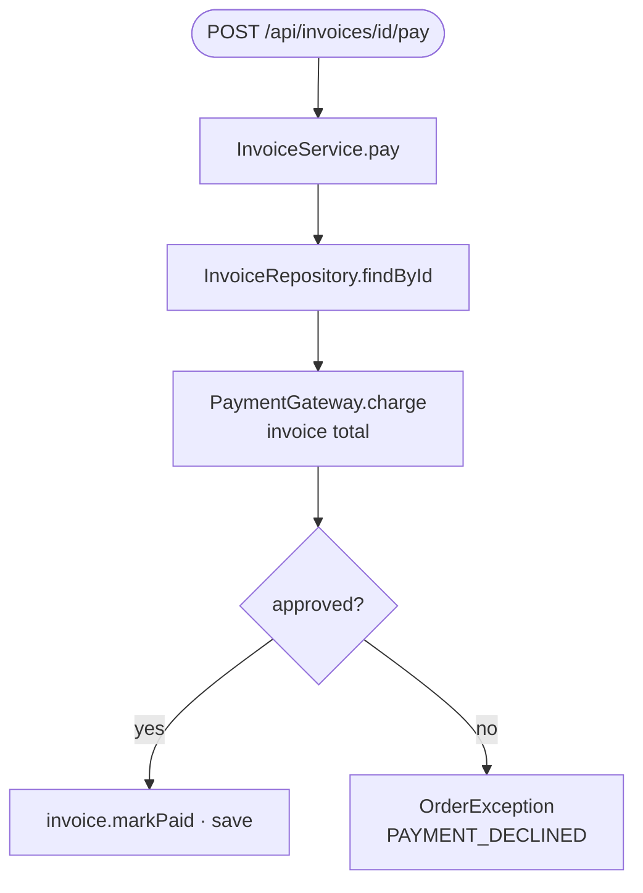
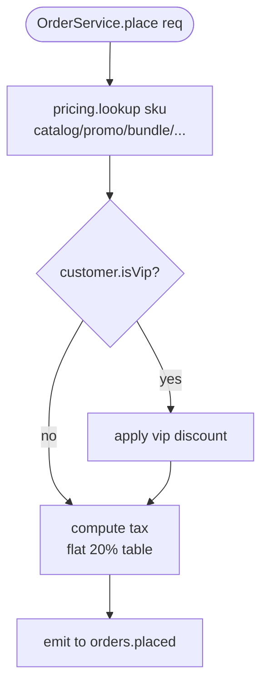
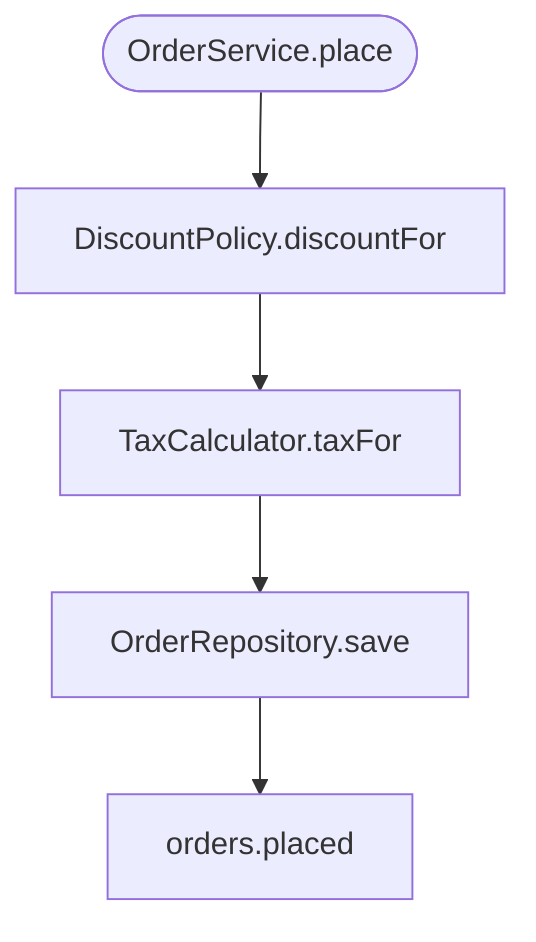
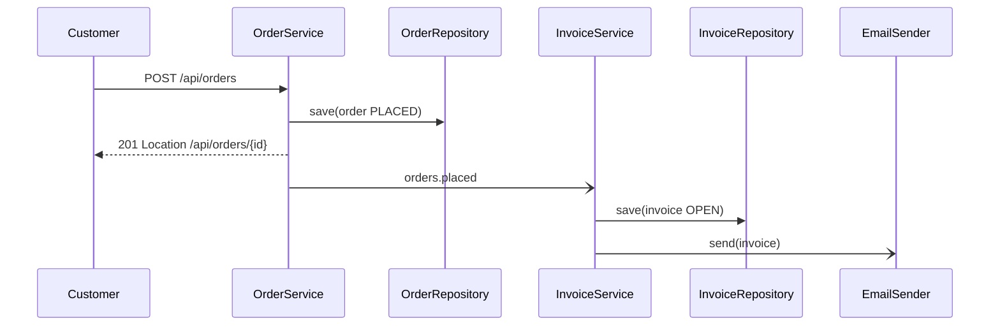

# 68e — Neutral Good/Bad pairs: planning (#99, map #9)

Source: research/42-planning-good-bad.md; research/47-good-rewrites.md (SR2 SR4 DG3 WD2 WD3 WD5 WD6). Domain: ordering + billing (#99 brief). Stand-ins: `make test TEST=<Spec>` for `make test-ui` / `make smoke FULL=1` (PD5) · `scripts/check-doc-drift.sh` kept as a generic name (SR3) · `ARCHITECTURE.md` §9 Doc drift kept as the rule names it (WD3) · "billing product owner" for "the operator" as decider (SR4) · commit `a1b2c3d` placeholder for `e3fcb09d` (WD3). Added terms: ChargeResult (Approved / Declined / Unavailable, Reason TIMEOUT / UPSTREAM_ERROR) (PD1 PD3 DG2) · CancellationPolicy, CancellationPolicySpec (PD2 PD4) · InvoiceController (DG2) · column `cancelled_at`, migration V12 (AC7 PD4) · "reminder threshold" glossary term (AC9) · test classes InvoiceServiceSpec, InvoicePaymentIT, OrderServiceSpec (PD2 PD5) · work items #131, #132 (WD5 WD6) · Bad-only stale names `pricing.lookup`, `isVip`, `isVipCustomer`, "dunning letter", "collections limit" (DG3 WD3 AC9 — the mistake needs a wrong name) · product owner (SR4).
Skipped: none (all 20 ids APPROVED in 19-approved-rules.md; DG3 is "APPROVED (amended; its mechanical check: HOLD)" — pair written, the check is not part of the pair).

### SR2 — Every claim about today's behaviour cites `file:line`

**Bad** (neutral)
```markdown
The survey left one point open: is a CANCELLED order still invoiced? The code settles it.
`InvoiceService` never invoices a CANCELLED order, and `OrderService.cancel` publishes nothing
to `orders.placed` (`OrderService.java:88`). The REQ is updated, and no questions remain open.
```
What goes wrong: the uncited half is false, nobody opened a file to check it, and it already settled a decision.

**Good** (neutral)
```markdown
The survey left one point open: is a CANCELLED order still invoiced? The code settles it.
`InvoiceService.java:54` invoices every order whose status is not DRAFT, so a CANCELLED order is
invoiced; `OrderService.cancel` publishes nothing to `orders.placed` (`OrderService.java:88`).
The REQ is updated, and no questions remain open.
```
Why: each fact carries the line a reviewer opens; writing the cite forces reading line 54, where the false claim dies.

Evidence: `#585 note, 2026-09-30 13:28 (Decisions)` @n/a — GitLab note (Bad, real) · source 42-planning-good-bad.md:16 · fix from research/47:810

### SR3 — A drifted `file:NN` cite is found mechanically, not by reviewer memory

**Bad** (neutral)
```markdown
**Notes**
- Line cites off: the status checks in `OrderService.cancel` are at `:91`, `:97` (story says `:88`, `:94`);
  the PAID guard in `InvoiceService.markPaid` is `:120-126` (story `:118-124`).
```
What goes wrong: drifted cites are caught only because a reviewer happened to open each file; a skimmed story keeps them.

**Good** (neutral)
```bash
mapfile -t DOCS < <(git ls-files 'docs/architecture/*.md' 'docs/spec/REQ-*.md' | sort -u)
# a cite written `OrderService.java:88` (`cancel`) must still hold `cancel` on line 88
while IFS=$'\t' read -r doc path line symbol; do
  sed -n "${line}p" "$path" | grep -qF -- "$symbol" \
    || finding "$doc  cite drifted — $path:$line no longer holds \`$symbol\`"
done < <(cites_with_symbol "${DOCS[@]}")
```
Why: `scripts/check-doc-drift.sh` checks every cite's symbol on its line, so drift fails the check instead of waiting for a reviewer.

Evidence: `#636 note, 2026-10-02 14:29 (Pre-check #636)` @n/a — GitLab note (Bad, real) · `scripts/check-doc-drift.sh:32-36,94-117` @8f7bf163 (Good, adapted) · source 42-planning-good-bad.md:41 · fix from 42-planning-good-bad.md:43

### SR4 — No open question survives approval unless it names a decider and why it does not block

**Bad** (neutral)
```markdown
## 7. Open questions (review before implementation)
…
Tradeoff: option B (a weekly reminder until the invoice is PAID) adds a schedule we do not need yet.
Recommend starting with A; revisit when a customer asks for B.

**Decision pending.**
```
What goes wrong: the question stays "pending" after the build ships; nobody owns it and nothing says building could proceed.

**Good** (neutral)
```markdown
## 7. Open questions

**Q1 — how often `OverdueReminder` sends.** Once when the invoice turns OVERDUE (A) or weekly until PAID (B).

**Decider:** the billing product owner, when a customer first asks for a repeat reminder.
**Why it does not block building:** #123 ships A. B adds a schedule around the same
`EmailSender` call, so nothing built for A changes.
```
Why: the question stays open honestly, with one named decider, the trigger that wakes it, and why building A forecloses nothing.

Evidence: `docs/spec/DESIGN-S6-chat-messages.md:617-644` @772736bf (Bad, real; 42 cited `:550-577` @8f7bf163) · source 42-planning-good-bad.md:69 · fix from research/47:829

### SR6 — A story is checked for actor/action/benefit, scenarios, out-of-scope and an Escalation answer

**Bad** (neutral)
```markdown
## Acceptance criteria

- [ ] REQ-123-order-cancellation §Cancel: **AC-1 … AC-6** hold.
- [ ] Cancelling a PLACED order closes its OPEN invoice.
- [ ] The customer gets a cancellation email; a failed send does not undo the cancel.
- [ ] `POST /api/orders/{id}/cancel` returns 409 for a SHIPPED order.
```
What goes wrong: no story line, checkbox criteria, and no Escalation answer on a change touching orders-api, billing and notifications.

**Good** (neutral)
~~~~markdown
## Story
As a CUSTOMER, I want to cancel a PLACED order, so that I am not billed for goods I no longer want.
## Acceptance criteria
```gherkin
# AC-1
Scenario: should close the open invoice when a placed order is cancelled
  Given a PLACED order with an OPEN invoice
  When the customer cancels the order
  Then no OPEN invoice remains for the order
```
## Out of scope
- Cancelling a SHIPPED order: it stays refused.
## Escalation
REQ treatment required: **yes.** Cross-module (orders-api, billing, notifications) → REQ-123-order-cancellation.
~~~~
Why: all four parts are present, the criterion is a checkable scenario, and the cross-module change is escalated to a REQ.

Evidence: `#622 issue body, §Acceptance criteria` @n/a — GitLab issue (Bad, real) · `#636 issue body` (Good, adapted) · source 42-planning-good-bad.md:101 · fix from 42-planning-good-bad.md:103

### SR7 — The review tier is decided by what the diff IS; an unplaceable path is code

**Bad** (neutral)
```markdown
5. **Read the authority a change can actually reach.** When the diff touches **no `src/`, no build file
   and no migration** — a documentation or scripts change — do **not** read
   `ARCHITECTURE.md`, `CONTEXT.md` or the ADRs in `docs/adr/`.
```
What goes wrong: stated as what the diff is not, so a `Dockerfile` or `docker-compose.yml` change drops into the cheap tier.

**Good** (neutral)
```markdown
4. **Read only the authority this change class can reach.** The trigger is what the diff **is**.

   | the diff's class | how it is recognised | what it costs |
   |---|---|---|
   | **code** | any path under orders-api, billing or notifications `src/`, a build file, `db/migration/` | full Authority table |
   | **operability** | `docker-compose*.yml`, `Dockerfile`, `scripts/` | full Authority table |
   | **authority document** | any file the Authority table names | full Authority table |
   | **process and docs** | everything else under `docs/` | the cheap tier |

   A diff spanning classes takes the **most expensive** class it touches. When you cannot place a
   path, it is **code** — the tier is a saving, not a licence.
```
Why: each class is recognised positively, and an unknown path defaults to the expensive tier, so nothing new slips through cheaply.

Evidence: `.agents/skills/spec-review/SKILL.md:52-56` @71b5deb4 (Bad, real) · `.agents/skills/architecture-review/SKILL.md:49-60` @71b5deb4 (Good, adapted) · source 42-planning-good-bad.md:136 · fix from 42-planning-good-bad.md:138

### AC7 — A change to stored data or a default has a scenario whose Given predates the change

**Bad** (neutral)
```gherkin
# AC-6
Scenario: should mark a new invoice as paid when a payment covers it
  Given V12 has run
  When a new invoice is inserted with a payment covering its total
  Then its status is PAID
```
What goes wrong: only new rows are tested, so the scenario proves the default and never the migration's update of old invoices.

**Good** (neutral)
```gherkin
# AC-6
Scenario Outline: should mark an invoice written before the migration as paid when a payment covers it
  Given an invoice written before V12 with status <status> and a payment covering its total
  When V12 runs
  Then the invoice has status PAID

  Examples:
    | status  |
    | OPEN    |
    | OVERDUE |
```
Why: the Given is a row the old code wrote, so only the migration's update can make this scenario pass.

Evidence: `!230 note 3930544110` (QA round 1, F2) @n/a — GitLab MR note (Bad, adapted) · `docs/spec/REQ-075-certification-execution-gate.md:742-745` @8f7bf163 (Good, adapted) · source 42-planning-good-bad.md:170 · fix from 42-planning-good-bad.md:172

### AC8 — An Examples column that never varies moves to the Given or Background

**Bad** (neutral)
```gherkin
Scenario Outline: should grow the discount with the order total
  Given a <tier> customer with an order totalling <total> EUR
  When the discount is calculated
  Then the discount is <discount> percent

  Examples:
    | total | tier | discount |
    | 0     | GOLD | 0        |
    | 99    | GOLD | 0        |
    | 100   | GOLD | 5        |
```
What goes wrong: `tier` is GOLD on every row; readers must check it never matters, and the dead column reaches the test table.

**Good** (neutral)
```gherkin
# AC-3
@billing
Scenario Outline: should grow the discount with the order total
  Given a GOLD customer with an order totalling <total> EUR
  When the discount is calculated
  Then the discount is <discount> percent

  Examples:
    | total | discount |
    | 0     | 0        |
    | 99    | 0        |
    | 100   | 5        |
    | 1000  | 10       |
```
Why: the constant becomes words in the Given, so every remaining column is a value that changes the outcome.

Evidence: no real Bad (a scan of every `Examples:` table in `docs/spec/` @8f7bf163 found no constant column) — adapted from `docs/spec/REQ-500-login-throttle-progressive-delay.md:311-327` @8f7bf163 (Bad, adapted; Good, adapted) · source 42-planning-good-bad.md:202 · fix from 42-planning-good-bad.md:204

### AC9 — Scenario words come from the glossary; a new noun is declared before a scenario uses it

**Bad** (neutral)
```gherkin
Scenario Outline: should not send a dunning letter below the collections limit
  Given an invoice <days> days late
  When the nightly run happens
  Then the dunning letter count is <letters>
```
What goes wrong: "dunning letter" and "collections limit" are in no glossary; the title becomes the test name, so wrong words reach code.

**Good** (neutral)
~~~~markdown
| **reminder threshold** | days past an invoice's dueDate before `OverdueReminder` sends its first reminder. |
```gherkin
# AC-8
@billing
Scenario Outline: should send no overdue reminder before the reminder threshold
  Given an OVERDUE invoice <days> days past its due date
  When OverdueReminder runs
  Then <sent> overdue reminders are sent

  Examples:
    | days | sent |
    | 6    | 0    |
    | 7    | 1    |
```
~~~~
Why: "reminder threshold" is declared in the REQ's domain terms before the scenario uses it, and every other word is glossary vocabulary.

Evidence: adapted from `docs/spec/REQ-500-login-throttle-progressive-delay.md:376-386` @8f7bf163 (Bad, adapted) · `REQ-500…md:104-112,376-386` (Good, adapted) · source 42-planning-good-bad.md:240 · fix from 42-planning-good-bad.md:242

### PD1 — A new or rerouted call path is shown as a call tree in a fenced `diff`

**Bad** (neutral)
```markdown
## Change outline

    gateway answers   before            after
    approved          invoice PAID      invoice PAID
    declined          invoice PAID      invoice OPEN · PAYMENT_DECLINED
    timeout           invoice OPEN      invoice OPEN · PAYMENT_DECLINED
```
What goes wrong: outcomes only; nothing shows which calls move inside `InvoiceService.pay`, so the reroute is decided in code review.

**Good** (neutral)
```diff
  InvoiceService.pay(invoiceId)
    InvoiceRepository.findById(invoiceId)
-   invoice.markPaid()                          before the gateway answers
    PaymentGateway.charge(invoice.total(), invoiceId)
+     ChargeResult.Approved   → invoice.markPaid(); InvoiceRepository.save(invoice)
+     ChargeResult.Declined   → throw new OrderException(ErrorCode.PAYMENT_DECLINED)
+     ChargeResult.Unavailable → throw new OrderException(ErrorCode.PAYMENT_DECLINED)
```
Why: the moved call and the new branches are one glance; a reviewer diffs the plan against the code line by line.

Evidence: `!238 description, §Change outline` (#622) @n/a — GitLab MR (Bad, real) · `docs/architecture/ARCHITECTURE.md:326-338`, `HttpToolHandler.java:300-311` @8f7bf163 (Good, adapted) · source 42-planning-good-bad.md:276 · fix from 42-planning-good-bad.md:278

### PD2 — A file-tree diff marks every new, modified and deleted file, tests included, each with a purpose

**Bad** (neutral)
```markdown
Files: `OrderService.java`, `OrderController.java`, `InvoiceService.java`, and one new policy class
under `domain/`. No schema change. **Migration: no.**
```
What goes wrong: no purposes, the new file is unnamed, and the unit test AC-4 asks for has no file to grade.

**Good** (neutral)
```diff
  orders-api/src/main/java/com/example/orders/
+   domain/CancellationPolicy.java          NEW  canCancel(order) — true for DRAFT and PLACED only
    OrderService.java                       MOD  cancel(id) asks CancellationPolicy, then closes the invoice
    web/OrderController.java                MOD  POST /api/orders/{id}/cancel → 409 when refused
  orders-api/src/test/groovy/com/example/orders/
+   domain/CancellationPolicySpec.groovy    NEW  true for DRAFT, PLACED; false for PAID, SHIPPED, CANCELLED
    OrderServiceSpec.groovy                 MOD  cancel leaves no OPEN invoice
  billing/src/main/java/com/example/orders/billing/
    InvoiceService.java                     MOD  closeFor(orderId) — the order's OPEN invoice closes
```
Why: every file is marked and has a purpose, and the unit test sits beside the code it proves.

Evidence: `#636 issue body, §Plan` @n/a — GitLab issue (Bad, real) · `#636 issue body, §Plan and Files:` (Good, adapted) · source 42-planning-good-bad.md:309 · fix from 42-planning-good-bad.md:311

### PD3 — New types and signatures are Java with no bodies; the caller's usage comes first

**Bad** (neutral)
```text
PaymentGateway.charge(Money amount, String invoiceId) → ChargeResult

ChargeResult                sealed
 ├─ Approved(String paymentId)
 ├─ Declined                 the card issuer refused
 └─ Unavailable(reason)      the gateway timed out or answered 5xx
```
What goes wrong: a private notation with no caller; `reason`'s type is left out and gets settled ad hoc in code.

**Good** (neutral)
```java
final var result = paymentGateway.charge(invoice.total(), invoice.id());
switch (result) {
    case ChargeResult.Approved approved -> markPaid(invoice, approved.paymentId());
    case ChargeResult.Declined _ -> refuse(ErrorCode.PAYMENT_DECLINED);
    case ChargeResult.Unavailable unavailable -> retryLater(invoice, unavailable.reason());
}
public interface PaymentGateway {
    ChargeResult charge(Money amount, String invoiceId);
}
public sealed interface ChargeResult {
    record Approved(String paymentId) implements ChargeResult { }
    record Declined() implements ChargeResult { }
    record Unavailable(Reason reason) implements ChargeResult { }
    enum Reason { TIMEOUT, UPSTREAM_ERROR }
}
```
Why: the caller's exhaustive switch shows each case earns its place before it is declared, and every type is written down.

Evidence: `docs/spec/REQ-075-certification-execution-gate.md:172-178` @8f7bf163 (Bad, real) · `REQ-075…md:172-186` and `RuntimeConfigResolution.java` (Good, adapted) · source 42-planning-good-bad.md:331 · fix from 42-planning-good-bad.md:333

### PD4 — Build order is end-to-end slices you can poke, never schema → service → API → UI

**Bad** (neutral)
```markdown
## Story
As the developer building order cancellation, I want the schema, error codes and status types in place
first, so that every later story builds on one migration and one vocabulary, and nothing changes for users yet.
```
What goes wrong: a horizontal layer with nothing to poke, so its defects cannot show in any running path until later stories.

**Good** (neutral)
```markdown
| slice | end to end | poke it |
|---|---|---|
| 1 · a customer cancels a placed order | V12 `cancelled_at` · `CancellationPolicy` · `OrderService.cancel` · `POST /api/orders/{id}/cancel` | cancel a PLACED order → 200, status CANCELLED (AC-1) |
| 2 · the open invoice closes | `InvoiceService.closeFor` · `InvoiceRepository` | cancel, then `GET /api/invoices` → no OPEN invoice for the order (AC-2) |
| 3 · the customer is told | `EmailSender` · notifications | cancel → `FakeEmailSender` holds one cancellation email (AC-3) |
```
Why: slice 1 already crosses migration, domain and API, so the first merge is behaviour a person can see.

Evidence: `#554 issue body, §Story` (REQ-075 S1, !230) @n/a — GitLab issue (Bad, real) · REQ-075 and titles of #556/#557/#559 (Good, adapted) · source 42-planning-good-bad.md:367 · fix from 42-planning-good-bad.md:369

### PD5 — Every slice names the `make` target (and `TEST=`) that proves it, plus any manual step

**Bad** (neutral)
```markdown
- [ ] `InvoiceService.pay` runs against `FakePaymentGateway` and passes 10/10 consecutive runs.
```
What goes wrong: no command proves "10/10", so nobody runs it and the claim ships unchecked.

**Good** (neutral)
```markdown
**Slice 1 · a declined charge leaves the invoice OPEN**
  proves it: `make test TEST=InvoiceServiceSpec`
**Slice 2 · paying survives a gateway timeout**
  proves it: `make test TEST=InvoicePaymentIT` — passes, none skipped
  manual:    make `FakePaymentGateway` time out once, run slice 2's command 10 times; post the runs in an MR note (AC-3)
```
Why: each slice ends in a command a reviewer can rerun, and the one manual step names its exact trigger.

Evidence: `#622 issue body, §Acceptance criteria` @n/a — GitLab issue (Bad, real) · `#636 §Plan, AC-3/AC-4` (Good, adapted) · source 42-planning-good-bad.md:389 · fix from 42-planning-good-bad.md:391

### DG2 — Call trees in a design are `diff` text; Mermaid is for component, sequence, state, ER, class

**Bad** (neutral)

What goes wrong: a call order drawn as boxes and arrows cannot mark which calls are new, so nothing diffs against the code.

**Good** (neutral)
```diff
  InvoiceController.pay(id)
    InvoiceService.pay(invoiceId)
      InvoiceRepository.findById(invoiceId)
      PaymentGateway.charge(invoice.total(), invoiceId)
-     invoice.markPaid()                               any answer, Declined included
+     ChargeResult.Approved → invoice.markPaid(); InvoiceRepository.save(invoice)
+     ChargeResult.Declined → throw new OrderException(ErrorCode.PAYMENT_DECLINED)
```
Why: unmarked lines match today's code and `+`/`-` lines show the change, so a reviewer diffs plan against code.

Evidence: `docs/architecture/ARCHITECTURE-DIAGRAMS.md:229-237` @8f7bf163 (Bad, real) · `HttpToolHandler.java:385-407` and `!238 §Implementation` (Good, adapted) · source 42-planning-good-bad.md:412 · fix from 42-planning-good-bad.md:414

### DG3 — Every node label is a class, module, table or endpoint name `grep` finds

**Bad** (neutral)

What goes wrong: `pricing.lookup` and `isVip` exist nowhere in code; the diagram still teaches the VIP check that `DiscountPolicy` replaced.

**Good** (neutral)

Why: every label is a type, method or topic `grep` finds, so the next rename shows up as a grep miss.

Evidence: `docs/architecture/ARCHITECTURE-DIAGRAMS.md:317-326` @772736bf (Bad, real; 42 cited `:317-327` @8f7bf163) · source 42-planning-good-bad.md:441 · fix from research/47:854

### DG5 — A diagram that needs a paragraph to be understood is redrawn smaller

**Bad** (neutral)
~~~~markdown
    OrderService-->>C: 201 · Location /api/orders/{id} ·<br/>orders.placed · invoice later (see note)
    InvoiceService->>EmailSender: send on invoice create
```

**Deltas vs. older docs** (verified): POST returns **201**, not 200; the invoice is **not** created
in the same request but by billing reading `orders.placed`; a failed email does **not** roll back
the order. So `GET /api/invoices` can be empty right after an order is placed.
~~~~
What goes wrong: the diagram's own arrow says "see note", then a paragraph is needed to read it.

**Good** (neutral)
~~~~markdown

Caption: the invoice is created after the 201, from `orders.placed`.
~~~~
Why: each fact the paragraph explained is now an arrow, so a one-line caption is enough.

Evidence: `docs/architecture/ARCHITECTURE-DIAGRAMS.md:205-217` @8f7bf163 (Bad, real) · `#636 note, 2026-10-02 05:49` (Good, adapted) · source 42-planning-good-bad.md:474 · fix from 42-planning-good-bad.md:476

### WD2 — No counts that change as a side effect of unrelated work; stable deliberate facts are fine

**Bad** (neutral)
```markdown
## 2. Module dependency graph

3 Gradle modules (orders-api, billing, notifications) and 14 REST endpoints under `/api/orders`
and `/api/invoices`. Every edge is a `projects.*` dependency, checked by ArchUnit.
```
What goes wrong: the tallies go false the day anyone adds a module or endpoint, and nobody edits this line then.

**Good** (neutral)
```markdown
## 2. Module dependency graph

The modules are the `include(...)` list in `settings.gradle.kts`; the endpoints are the controllers
under `/api/orders` and `/api/invoices`. Every edge is a `projects.*` dependency in the consumer's
`build.gradle.kts`, checked by ArchUnit.
```
Why: it names where each list lives instead of counting it, so adding a module cannot make the sentence false.

Evidence: `docs/architecture/ARCHITECTURE-DIAGRAMS.md:90-93` @772736bf (Bad, real) · source 42-planning-good-bad.md:509 · fix from research/47:882

### WD3 — A claim known to disagree with the code goes in `ARCHITECTURE.md` §9 Doc drift

**Bad** (neutral)
```markdown
- `:88-93` — `isVipCustomer`: GOLD check plus a hard-coded list of customer ids that always get 10% off.
- `billing/.../BillingConfig.java:41` — the actual VIP id list passed into the discount step:
  `["c-1001", "c-1002", "c-1003"]`.
```
What goes wrong: `isVipCustomer` was deleted, §9 is silent, so the doc still teaches the check that was replaced.

**Good** (neutral)
```markdown
## 9. Doc drift — corrections to existing docs

| Doc claim | Reality |
|---|---|
| "`isVipCustomer`: GOLD check plus a hard-coded id list" (ARCHITECTURE:88) | Deleted by `a1b2c3d` (#123). `DiscountPolicy.discountFor` decides from `Customer.tier` alone [DiscountPolicy.java:24-31]. |
```
Why: the stale line is recorded where every reader is told to look, with the commit and the code that replaced it.

Evidence: `docs/architecture/ARCHITECTURE.md:361-363` @772736bf (Bad, real; 42 cited `:360-362` @8f7bf163) · source 42-planning-good-bad.md:532 · fix from research/47:903

### WD5 — A bug corrects its REQ in place; a REQ-less chore carries its spec in the issue; a new REQ is new behaviour

**Bad** (neutral)
```markdown
# REQ-131 — A cancelled order cannot be paid

**Issue:** [#131](…) — `InvoiceService.pay` accepts a payment for an invoice whose order is CANCELLED
**Branch:** `fix/131-pay-cancelled-order`
**Precedent:** [REQ-123](REQ-123-order-cancellation.md) — the same policy, shipped for the orders page
```
What goes wrong: a bug fix under a policy REQ-123 already states becomes a second spec, splitting one rule across two files.

**Good** (neutral)
```markdown
# REQ-123 — A cancelled order is never billed

**Issue:** [#123](…) — cancelling a PLACED order closes its OPEN invoice ·
**Amended by:** [#131](…) — `InvoiceService.pay` accepts a payment for an invoice whose order is
CANCELLED; `/api/invoices` joins the orders page under the same rule
```
Why: the bug widens the REQ that owns the policy, so one file states the rule for every path.

Evidence: `docs/spec/REQ-028-credential-decrypt-fail-closed.md:1-5` @772736bf (Bad, real) · source 42-planning-good-bad.md:559 · fix from research/47:923

### WD6 — A new REQ is `REQ-<issue>-slug`; a new ADR takes the next number free on main and every branch

**Bad** (neutral)
```text
docs/spec/REQ-014-order-cancellation.md        (#123)
docs/spec/REQ-014-overdue-reminder.md          (#132)

> This spec has now been renumbered **three times** while the MR sat in review — **REQ-011 → 012 →
> 013 → REQ-014**. Another branch took `011`, a second holds `012`, and a third merged and took `013`.
```
What goes wrong: next-free numbering collides across branches; even the fourth number collided, and both REQ-014s reached main.

**Good** (neutral)
```text
docs/spec/REQ-123-order-cancellation.md        (#123)
docs/spec/REQ-132-overdue-reminder.md          (#132)
```
Why: each number is its work item's, so no other branch can take it and no rename note is needed.

Evidence: `git ls-tree origin/master docs/spec/` and `docs/spec/REQ-073-jacoco-integration-coverage.md:29-31` @772736bf (Bad, real) · source 42-planning-good-bad.md:582 · fix from research/47:945
