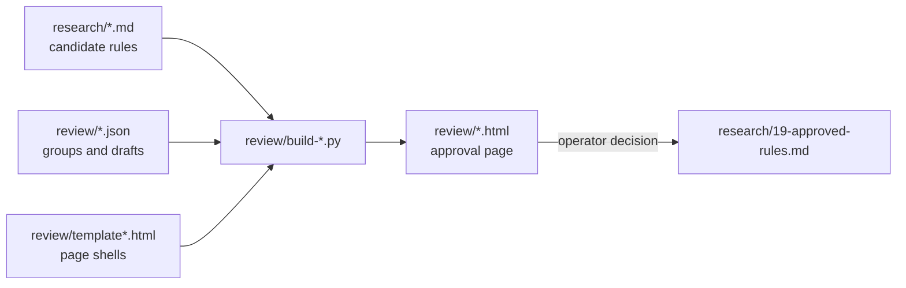

# review: rule-approval pages

The operator approves rules on HTML pages, not in chat. Each builder here reads the research files (and, for some, a
JSON file of groups) and writes one self-contained page. The operator marks rules on the page and pastes the decision
line back. Approved rules then go into the [ledger](../research/19-approved-rules.md).

| builder | page it writes | used for |
|---|---|---|
| [`build.py`](build.py) | `rule-review.html` | the main rule review: any group of ledger rules, passed as JSON |
| [`build-good-rewrites.py`](build-good-rewrites.py) | `good-rewrites.html` | rewritten Good examples (`research/47`) |
| [`build-neutral.py`](build-neutral.py) | `neutral-pairs.html` | neutral-domain Good/Bad pairs (`research/68a`–`68f`) |
| [`build-reasons.py`](build-reasons.py) | `rule-reasons.html` | the *because* reason for each approved rule (`reasons.json`) |
| [`build-planning.py`](build-planning.py) | `planning-good-bad.html` | planning Good/Bad pairs (`research/42`) |
| [`build-g9b.py`](build-g9b.py) | `g9b-rules.html` | code and obs rules (`g9b.json`) |
| [`build-g9c-mg.py`](build-g9c-mg.py) | `g9c-migration-rules.html` | migration rules (`research/60a`) |
| [`build-llm-testing.py`](build-llm-testing.py) | `llm-testing-rules.html` | G34: the LLM-testing candidates LT and LS (`research/69`, `research/70`), with a recommendation each (`llm-testing.json`) |
| [`build-spring.py`](build-spring.py) | `spring-rules.html` | Spring core and Security rules (`r33.json`, `r34.json`) |

Run a builder from the repo root, for example `python3 review/build-neutral.py`. Builders read only paths relative to
this folder, and `make test` runs each one in a copy of the repo and checks the page it writes. The other `*.html`
files (`crq-stages`, `fleet-design`, `pipeline-comparison`, `error-catalogue`) are design pages written by hand.
