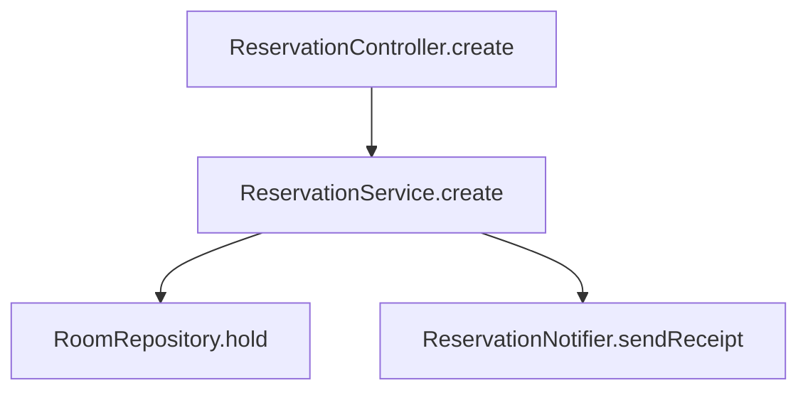

With planning, review the diagram in this design doc and give the corrected version.

Caption: This shows the create flow. The design also adds `WaitlistService.promote`, which runs only when the room had a waitlist, and removes `DepositPolicy.check`, which the controller already covers. When there is no waitlist the service skips promote. Receipts are sent last in every case, and the notifier retries once.
