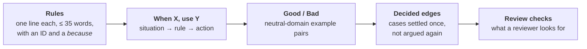

# rulebook

Generic engineering rules for coding agents. The agent that writes the code and the agent that reviews it read the same
file. Project-specific values (commands, paths, module names) stay in each project's own `AGENTS.md`.

> **Status: 0.1.0, references only.** The `testing` references below are written and approved. The `SKILL.md` router
> that loads them is not written yet, so nothing loads on its own. Point an agent at a reference by path until then.

## Install

```bash
# Claude Code
claude plugin marketplace add chiyanram/skills
claude plugin install rulebook@chiyanram

# Other agent tools
npx skills add chiyanram/skills
```

The repo is private. See the [root README](../../README.md#install) for credentials and the worker-container setup.

## What a reference holds

Every reference has the same five sections, in this order, so an agent knows where to look without reading the
whole file.



The writer reads it top to bottom. The reviewer starts at **Review checks** and follows each one back to its rule
ID. When a reference cannot fit every approved pair, the rest sit in `references/examples/<topic>.md`.

## Testing references

| reference | rule IDs | read it when |
|---|---|---|
| [strategy](skills/testing/references/strategy.md) | S | you choose a test's tier, fix a bug, or review a test's tier and doubles |
| [value-bar](skills/testing/references/value-bar.md) | V | you add, keep or remove a test: should it exist at all? |
| [coverage-design](skills/testing/references/coverage-design.md) | C | you write tests for new logic or for a call to an external dependency |
| [boundaries](skills/testing/references/boundaries.md) | B | the logic takes a number, collection, format, enum, time or optional input |
| [unit-tests](skills/testing/references/unit-tests.md) | U | you write or review a unit test or a Spock spec |
| [spock](skills/testing/references/spock.md) | K | you write interactions, data tables, shared state, cleanup or assertions in Spock |
| [integration-tests](skills/testing/references/integration-tests.md) | IT, SP | you write an IT, a fake port, a test slice or a test configuration |
| [scenario-to-tests](skills/testing/references/scenario-to-tests.md) | GT | a Gherkin scenario in a work item's acceptance criteria needs its tests |
| [property-based](skills/testing/references/property-based.md) | P | a requirement says "for any input", or you write a generator |
| [mutation](skills/testing/references/mutation.md) | M | you configure PIT, read its report, or answer a surviving mutant |
| [smoke-specs](skills/testing/references/smoke-specs.md) | EA–ED | you write or review a Playwright smoke spec, or a fixture such specs import |

## Code references

| reference | rule IDs | read it when |
|---|---|---|
| [design](skills/code/references/design.md) | SEAM | you write or review an interface a caller depends on, or a method that implements one |

`make lint` fails when a reference is missing from these tables.

## Where a rule comes from

Each rule has a source. A rule goes in only after the operator says yes; the
[ledger](../../research/19-approved-rules.md) lists every approved rule with its reason and source. How to propose one:
[CONTRIBUTING.md](../../CONTRIBUTING.md).
