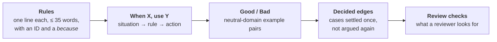

# rulebook

Generic engineering rules for coding agents. The agent that writes the code and the agent that reviews it read the same
file. Project-specific values (commands, paths, module names) stay in each project's own `AGENTS.md`.

Each domain is one skill: `testing`, `code`, `migrations`, `obs`, `planning` and `meta`. Its `SKILL.md` lists every reference in the
domain and when to read it, and the agent opens only the references the task needs. From a project's nested
`AGENTS.md`, point at a reference by name, never by path, because the plugin's install folder differs per machine and
per version:

```text
Tests here call the model: use the `testing` skill (rulebook plugin) and read its `llm-tests` reference.
```

## Install

```bash
# Claude Code
claude plugin marketplace add chiyanram/skills
claude plugin install rulebook@chiyanram

# Other agent tools
npx skills add chiyanram/skills
```

The repo is private. See the [root README](../../README.md#quick-start) for credentials and the worker-container setup.

## What a reference holds

Every reference has the same five sections, in this order, so an agent knows where to look without reading the
whole file.



The writer reads it top to bottom. The reviewer starts at **Review checks** and follows each one back to its rule
ID. When a reference cannot fit every approved pair, the rest sit in `references/examples/<topic>.md`.

## Skills

Each skill's `SKILL.md` lists its references, their rule IDs and when to read each one. `make index` builds that list
from the references, and `make lint` fails when it is stale.

| skill | read it when you |
|---|---|
| [testing](skills/testing/SKILL.md) | choose, write or review a test: its tier, its value, its boundaries, Spock, ITs, model calls, mutation |
| [code](skills/code/SKILL.md) | write or review production code: Java, Spring, types, errors, services, API design, security, concurrency, persistence, Angular |
| [deslop](skills/deslop/SKILL.md) | clean up an implemented branch's diff, behaviour-neutral, before review |
| [migrations](skills/migrations/SKILL.md) | write or review a database migration |
| [obs](skills/obs/SKILL.md) | write or review a log call, a metric or a trace |
| [planning](skills/planning/SKILL.md) | write or review a spec, its acceptance criteria, a design or a diagram |
| [meta](skills/meta/SKILL.md) | write or review a reference of this rulebook |

## Where a rule comes from

Each rule has a source. A rule goes in only after the operator says yes; the
[ledger](../../docs/rulebook/approved-rules.md) lists every approved rule with its reason and source. How to propose one:
[CONTRIBUTING.md](../../CONTRIBUTING.md).
