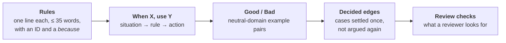

# rulebook

Generic engineering rules for coding agents. The agent that writes the code and the agent that reviews it read the same
file. Project-specific values (commands, paths, module names) stay in each project's own `AGENTS.md`.

Each domain is one skill: `testing`, `code`, `migrations` and `obs`. Its `SKILL.md` lists every reference in the
domain and when to read it, and the agent opens only the references the task needs. From a project's nested
`AGENTS.md`, point at a reference by name, never by path, because the plugin's install folder differs per machine and
per version:

```text
Tests here call the model: use the `testing` skill (rulebook plugin) and read its `llm-tests` reference.
```

## Install

```bash
# Claude Code
claude plugin marketplace add chiyanram/skills
claude plugin install rulebook@chiyanram

# Other agent tools
npx skills add chiyanram/skills
```

The repo is private. See the [root README](../../README.md#install) for credentials and the worker-container setup.

## What a reference holds

Every reference has the same five sections, in this order, so an agent knows where to look without reading the
whole file.



The writer reads it top to bottom. The reviewer starts at **Review checks** and follows each one back to its rule
ID. When a reference cannot fit every approved pair, the rest sit in `references/examples/<topic>.md`.

## Testing references

| reference | rule IDs | read it when |
|---|---|---|
| [strategy](skills/testing/references/strategy.md) | S | you choose a test's tier, fix a bug, or review a test's tier and doubles |
| [value-bar](skills/testing/references/value-bar.md) | V | you add, keep or remove a test: should it exist at all? |
| [coverage-design](skills/testing/references/coverage-design.md) | C | you write tests for new logic or for a call to an external dependency |
| [boundaries](skills/testing/references/boundaries.md) | B | the logic takes a number, collection, format, enum, time or optional input |
| [unit-tests](skills/testing/references/unit-tests.md) | U | you write or review a unit test or a Spock spec |
| [spock](skills/testing/references/spock.md) | K | you write interactions, data tables, shared state, cleanup or assertions in Spock |
| [integration-tests](skills/testing/references/integration-tests.md) | IT, SP | you write an IT, a fake port, a test slice or a test configuration |
| [scenario-to-tests](skills/testing/references/scenario-to-tests.md) | GT | a Gherkin scenario in a work item's acceptance criteria needs its tests |
| [property-based](skills/testing/references/property-based.md) | P | a requirement says "for any input", or you write a generator |
| [mutation](skills/testing/references/mutation.md) | M | you configure PIT, read its report, or answer a surviving mutant |
| [llm-tests](skills/testing/references/llm-tests.md) | LT1–LT13, LS1–LS10 | the code under test calls a language model: the scripted fake, the agent loop, agent scenarios, recorded traffic |
| [llm-live-tests](skills/testing/references/llm-live-tests.md) | LT14–LT18, LS11, LS13, LS15, LS16, LS19, LS20 | a test calls a real model provider, or an eval scores model quality |
| [smoke-specs](skills/testing/references/smoke-specs.md) | EA–ED | you write or review a Playwright smoke spec, or a fixture such specs import |

## Code references

| reference | rule IDs | read it when |
|---|---|---|
| [angular-ui](skills/code/references/angular-ui.md) | NGA–NGD | you write or review an Angular component, template, or its TypeScript or `tsconfig` |
| [comments](skills/code/references/comments.md) | CM | you write or review a comment, a Javadoc block or a lint suppression |
| [concurrency](skills/code/references/concurrency.md) | CC | you start threads, submit async work, call a remote service, retry, lock, or build a pool or a cache |
| [design](skills/code/references/design.md) | SEAM | you write or review an interface a caller depends on, or a method that implements one |
| [deslop](skills/deslop/SKILL.md) | an implemented branch needs a behaviour-neutral cleanup of its diff before review |
| [errors](skills/code/references/errors.md) | ER | you write or review a `throw`, a `catch`, an exception handler or request validation |
| [java](skills/code/references/java.md) | U4, JV, CV3 | you write or review Java production code |
| [messaging](skills/code/references/messaging.md) | MS | you write or review a message consumer, a scheduled job, or an operation that can run twice |
| [security](skills/code/references/security.md) | SE, SS | code takes outside input, stores or checks a secret, or touches the security filter chain, a guard, a token or a security test |
| [services](skills/code/references/services.md) | LY1–LY3 | you write or review a controller, a service, an interface or a use case that makes two calls |
| [smells](skills/code/references/smells.md) | DS, FW, NM, SM | you write or review production code: the smell baseline, and the shape and naming rules behind it |
| [spring](skills/code/references/spring.md) | LY6, LY7, SC, X6, SX | you write or review a bean, a configuration class, a settings record, a startup hook or a proxied method |
| [types](skills/code/references/types.md) | TY | you write or review a field, parameter, return type, record, enum, sealed type or generic type |

`make lint` fails when a reference is missing from these tables.

## Migrations references

| reference | rule IDs | read it when |
|---|---|---|
| [postgres-design](skills/migrations/references/postgres-design.md) | MG30–MG33, MG35, MG36, MG38 | you write or review a migration that creates a table or adds a column, key, constraint or index |
| [review](skills/migrations/references/review.md) | MG1, MG5, MG10, MG22, MG41, MG44, MG45, MGN1 | you write or review a migration that alters, indexes, constrains, renames, drops or backfills an existing table, or edits, renames or deletes a merged migration |

## Observability references

| reference | rule IDs | read it when |
|---|---|---|
| [levels](skills/obs/references/levels.md) | — | you choose the level of a log call or of a caught exception |
| [logging](skills/obs/references/logging.md) | LG1–LG6, LG8, LGN1 | you write or review a log call, a logger field, a `catch` that logs, or the logging configuration |
| [metrics](skills/obs/references/metrics.md) | MX1–MX3, MX5, MXN1–MXN3 | you write or review a meter, a tag, a timer or histogram setting, or the metrics of an endpoint, an outbound dependency, a pool, a queue or a job |
| [tracing](skills/obs/references/tracing.md) | TR1–TR3, TR5, TRN1–TRN3 | you write or review a span or observation, a message producer or consumer, a thread hand-off, or the tracing configuration |

## Planning references

| reference | rule IDs | read it when |
|---|---|---|
| [acceptance-criteria](skills/planning/references/acceptance-criteria.md) | GA1–GA6, CV1, AC7–AC10 | you write or review the acceptance criteria of a spec as Gherkin scenarios |
| [writing-docs](skills/planning/references/writing-docs.md) | WD1, WD2, WD4, WD5, WD7 | you write or review a design, a spec, a guide or a README, or decide which spec a change updates |

## Where a rule comes from

Each rule has a source. A rule goes in only after the operator says yes; the
[ledger](../../research/19-approved-rules.md) lists every approved rule with its reason and source. How to propose one:
[CONTRIBUTING.md](../../CONTRIBUTING.md).
