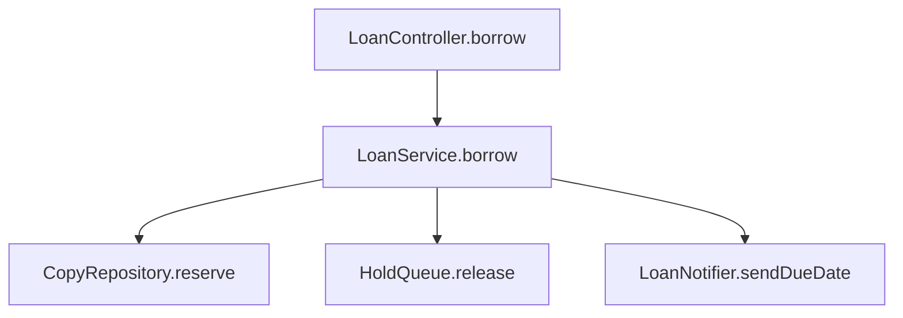
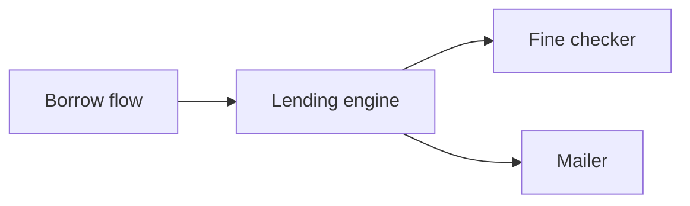
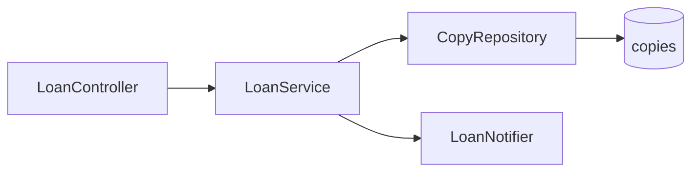
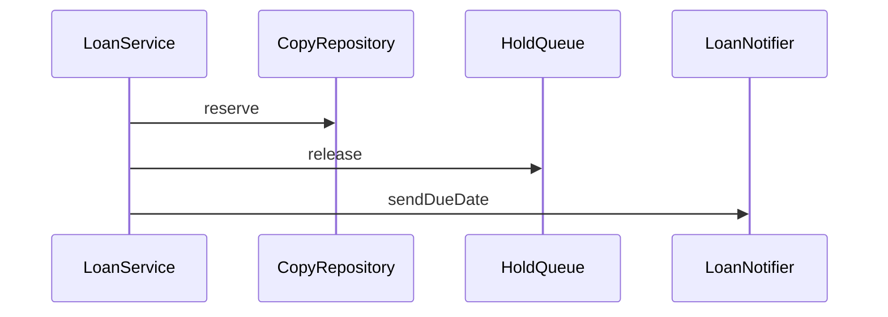
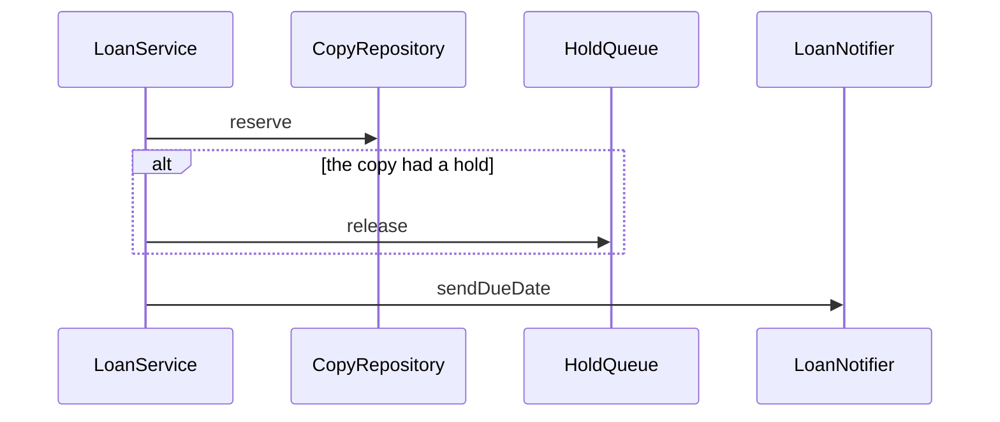

# Diagrams

Which form a diagram takes, what it names, and where it lives. Read it when you draw or review a diagram in a design,
a spec, a decision record, a Markdown doc or a chat reply.

## Rules

- Draw a diagram in a committed Markdown file as a `mermaid` fence, and one in chat or a terminal as plain fenced
  text, because a terminal shows Mermaid source as raw text.
- Draw a call tree or a file tree as fenced `diff` text, in any file, because boxes and arrows cannot mark new or
  removed calls. Use Mermaid for the rest, one form per question:

  | the diagram answers | use |
  |---|---|
  | which components call which, when the change adds or removes no call | `flowchart` |
  | in which order messages pass between parts | `sequenceDiagram` |
  | which states one thing moves through | `stateDiagram-v2` |
  | which tables relate, and how | `erDiagram` |
  | which types extend or hold which | `classDiagram` |
  | which calls or files a change adds, moves or removes | a `diff` tree |

- Label each node with a class, module, table or endpoint name a search finds on the main branch, because a node that
  names deleted code teaches replaced behaviour. An actor outside the code, such as a user or an outside service, is
  named by its role, and a `+` line in a design diff names code still to come.
- Make each diagram answer one question from the table, and draw a second diagram for a second question, because a
  diagram that answers several serves none of its readers. A failure branch of the same flow in an `alt` block is
  still one question.
- Give a diagram at most a one-line caption; when it needs prose to explain a box, arrow or branch, redraw it smaller,
  because a diagram that needs a paragraph does not show its point. The doc's own argument around it is not a caption.
- Put a diagram in the decision record, spec or design it illustrates, and link it from other docs, because a separate
  diagrams file is not linked from the decision it shows.

## Good / Bad

### A call tree that a design changes is a `diff`

**Bad**

The design adds `HoldQueue.release` and removes `FinePolicy.check`. The chart shows neither change.

**Good**
```diff
 LoanController.borrow
   LoanService.borrow
-    FinePolicy.check
     CopyRepository.reserve
+    HoldQueue.release
     LoanNotifier.sendDueDate
```
The `-` and `+` marks show what the design removes and adds. Indent shows who calls whom.

### Each label is a name the code has

**Bad**

No label is a name in the code. The fine check was removed, and a search cannot show that the box is stale.

**Good**

A search on the main branch finds each class and the `copies` table. A deleted name fails that search.

### Redraw the diagram instead of explaining it

**Bad**

Its caption is a paragraph: borrow a copy. `release` runs only when the copy had a hold. When it had none, the
service skips that call and goes on to `sendDueDate`.

**Good**

Caption: borrow a copy. The `alt` block shows the condition, so the paragraph goes.

## Review

Walk every diagram the change adds or edits, in every Markdown file, design, spec, decision record and comment.

Each line is a finding, a blocker unless marked (warning).

- A diagram in a committed `.md` file as plain text that is not a tree, or a `mermaid` fence in a chat reply.
- A call tree or file tree drawn as a Mermaid chart, or a component, sequence, state, entity-relationship or class
  diagram drawn as plain text in a committed file.
- A node label that matches no class, module, table or endpoint on the main branch, other than an outside actor or a
  `+` line in a design diff.
- A diagram that answers two questions.
- A caption longer than one line, or prose that explains a box, arrow or branch.
- A diagram in a file that holds only diagrams, or in a doc other than the one it illustrates.
