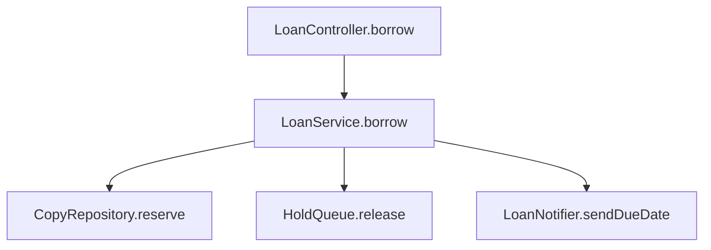
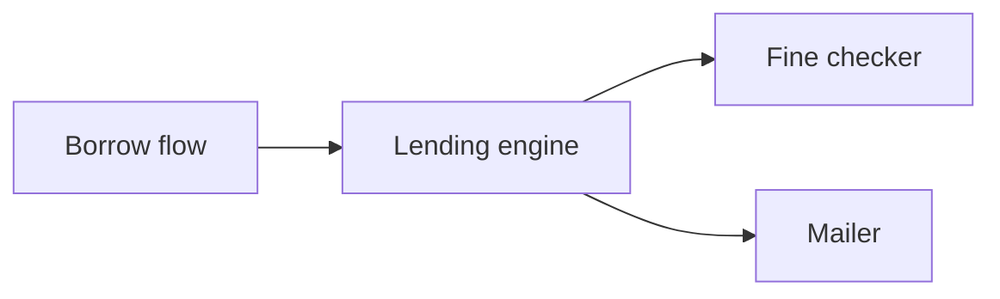
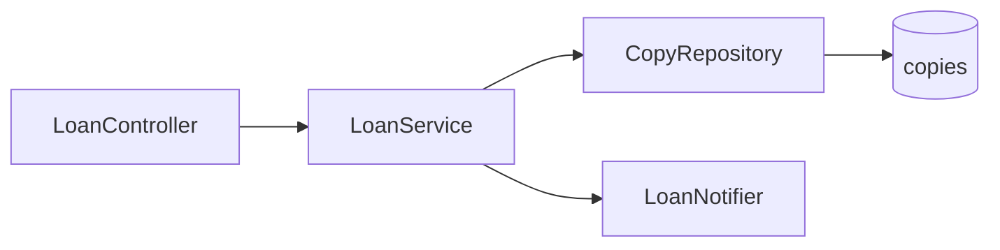
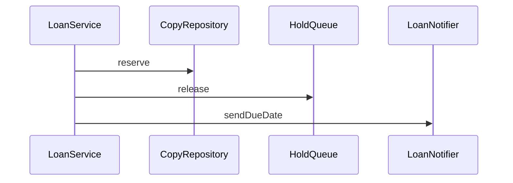
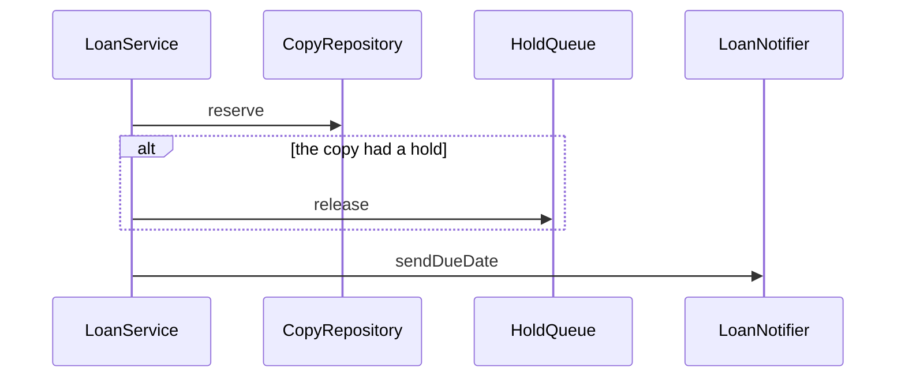

# Diagrams

Which form a diagram takes, what it names, and where it lives. Read it when you draw or review a diagram in a design,
a spec, a decision record, a Markdown doc or a chat reply.

Contents: Rules · When X, use Y · Good / Bad (DG2, DG3, DG5) · Decided edges · Review checks

## Rules

- **DG1** — Draw a diagram in a committed Markdown file as a `mermaid` fence, and a diagram in chat or a
  terminal as plain fenced text, because a terminal shows Mermaid source as raw text.
- **DG2** — Draw a call tree or file tree in a design as fenced `diff` text; use Mermaid for component, sequence,
  state, entity-relationship and class diagrams, because boxes and arrows cannot mark new or removed calls.
- **DG3** — Label each node with a class, module, table or endpoint name that a search finds on the main branch,
  except `+` lines in a design diff, because a node naming deleted code teaches replaced behaviour.
- **DG4** — Make each diagram answer one question from the When X, use Y table, and draw a second diagram for a second
  question, because a diagram that answers several questions serves none of its readers.
- **DG5** — Give a diagram at most a one-line caption; when it needs more prose to be understood, redraw it smaller,
  because a diagram that needs a paragraph does not show its point.
- **DG6** — Put a diagram in the decision record, spec or design doc it illustrates, never in a standalone diagrams
  file, because a separate diagrams file is not linked from the decision it shows.

## When X, use Y

| the diagram answers | use | why |
|---|---|---|
| which components call which | a Mermaid `flowchart` (DG2) | a flowchart shows call direction, which a list or a table hides |
| in which order messages pass between parts | a Mermaid `sequenceDiagram` (DG2) | a sequence diagram keeps the order of messages, which a flowchart loses |
| which states one thing moves through | a Mermaid `stateDiagram-v2` (DG2) | a state diagram shows the moves a thing cannot make, which prose leaves out |
| which tables relate, and how | a Mermaid `erDiagram` (DG2) | an entity-relationship diagram shows each relation's cardinality, which a table list hides |
| which types extend or hold which | a Mermaid `classDiagram` (DG2) | a class diagram shows inheritance and ownership at once, which a flowchart mixes up |
| which calls a change adds or removes | a fenced `diff` call tree (DG2) | `+` and `-` lines mark the calls a change adds or removes |
| which files a change adds, moves or removes | a fenced `diff` file tree (DG2) | `+` and `-` lines mark the files a change adds or removes |

| the diagram sits in | use | why |
|---|---|---|
| a committed Markdown file | a `mermaid` fence, or a `diff` fence for a tree (DG1, DG2) | GitHub renders a `mermaid` fence in Markdown as a diagram |
| a chat reply or a terminal | plain fenced text (DG1) | a terminal shows Mermaid source as raw text |
| a doc that one decision, spec or design owns | that doc, next to the text it supports (DG6) | a separate diagrams file is not linked from the decision it shows |

## Good / Bad

### DG2 — A call tree that a design changes is a `diff`

**Bad**

The design adds `HoldQueue.release` and removes `FinePolicy.check`. The chart shows neither change.

**Good**
```diff
 LoanController.borrow
   LoanService.borrow
-    FinePolicy.check
     CopyRepository.reserve
+    HoldQueue.release
     LoanNotifier.sendDueDate
```
The `-` and `+` marks show what the design removes and adds. Indent shows who calls whom.

### DG3 — Each label is a name the code has

**Bad**

No label is a name in the code. The fine check was removed, and a search cannot show that the box is stale.

**Good**

A search on the main branch finds each class and the `copies` table. A deleted name fails that search.

### DG5 — Redraw the diagram instead of explaining it

**Bad**

Its caption is a paragraph: borrow a copy. `release` runs only when the copy had a hold. When it had none, the
service skips that call and goes on to `sendDueDate`.

**Good**

Caption: borrow a copy. The `alt` block shows the condition, so the paragraph goes.

## Decided edges

- **Skip when** the diagram is a call tree or file tree in a committed Markdown file: it is a `diff` fence, not a
  `mermaid` fence (DG2 over DG1). — **Do not skip when** it is a component, sequence, state, entity-relationship or
  class diagram: it is a `mermaid` fence (DG1). — **Confidence** high
- **Skip when** the diagram shows which components call which, and the change adds or removes no call: a Mermaid
  `flowchart` is right. — **Do not skip when** the design adds, removes or moves a call: draw a
  `diff` call tree (DG2). — **Confidence** medium
- **Skip when** a node names an actor outside the code, such as a user or an outside service: name its role. Skip also
  for a `+` line in a design diff (DG3). — **Do not skip when** a node names a part of the code with a description
  instead of its name. — **Confidence** medium
- **Skip when** a sequence diagram shows the failure branch of the same flow in an `alt` block: it is still one
  question (DG4). — **Do not skip when** a second request, flow or actor's view enters the same diagram: draw it
  apart. — **Confidence** medium
- **Skip when** the text around the diagram is the doc's own argument, such as a decision record's reasons: DG5 bounds
  the caption, not the doc. — **Do not skip when** the text explains what a box, arrow or branch means: redraw the
  diagram. — **Confidence** high
- **Skip when** one diagram serves several docs: put it in the doc that owns the decision and link it from the others
  (DG6). — **Do not skip when** the diagram would sit in a file that holds only diagrams. — **Confidence** high

## Review checks

Walk every diagram that the change adds or edits, in every Markdown file, design, spec, decision record and comment.

- [ ] DG1 — A diagram in a committed `.md` file that is plain text and not a tree is a finding. A `mermaid` fence in a
  chat reply is a finding.
  Applies when: the change adds or edits a diagram in a committed `.md` file or a chat reply.
  Evidence: the file and line of the fence, and its fence type.
  Not a finding: a call tree or file tree in a `diff` fence (decided edge).
  Severity: Act on
  Verify: re-open the fence and confirm what the diagram shows.
- [ ] DG2 — A call tree or file tree in a design drawn as a Mermaid chart is a finding. A component, sequence, state,
  entity-relationship or class diagram drawn as plain text in a committed file is a finding.
  Applies when: the change adds or edits a diagram in a design or a committed file.
  Evidence: the diagram's fence, and what it shows.
  Not a finding: a `flowchart` of which components call which, when the change adds or removes no call (decided edge).
  Severity: Act on
  Verify: re-open the diagram, and the design text that says whether calls are added, removed or moved.
- [ ] DG3 — Search the main branch for each node label. A label that matches no class, module, table or endpoint is
  a finding, unless it is a `+` line in a design diff or an outside actor.
  Applies when: the change adds or edits a diagram node.
  Evidence: the label, and the search you ran on the main branch.
  Not a finding: an outside actor named by its role; a `+` line in a design diff (decided edge).
  Severity: Act on
  Verify: run the search for the label again on the main branch.
- [ ] DG4 — Name the one question each diagram answers, from the When X, use Y table. A diagram with two questions is
  a finding.
  Applies when: the change adds or edits a diagram.
  Evidence: the two questions, and the parts of the diagram that answer each.
  Not a finding: a failure branch of the same flow in an `alt` block (decided edge).
  Severity: Act on
  Verify: re-open the diagram and match each part to its question.
- [ ] DG5 — A caption longer than one line, or prose that explains a box, arrow or branch, is a finding: ask for a
  smaller diagram.
  Applies when: the change adds or edits a diagram or the text next to it.
  Evidence: the caption or the prose, quoted.
  Not a finding: text that is the doc's own argument, not an explanation of the diagram (decided edge).
  Severity: Act on
  Verify: re-open the text and confirm it explains a box, arrow or branch.
- [ ] DG6 — A diagram in a file that holds only diagrams, or in a doc other than the one it illustrates, is a finding.
  Applies when: the change adds, edits or moves a diagram.
  Evidence: the file the diagram sits in, and the doc it illustrates.
  Not a finding: a diagram in its owning doc and linked from the others (decided edge).
  Severity: Act on
  Verify: re-open the file and the doc the diagram illustrates.
